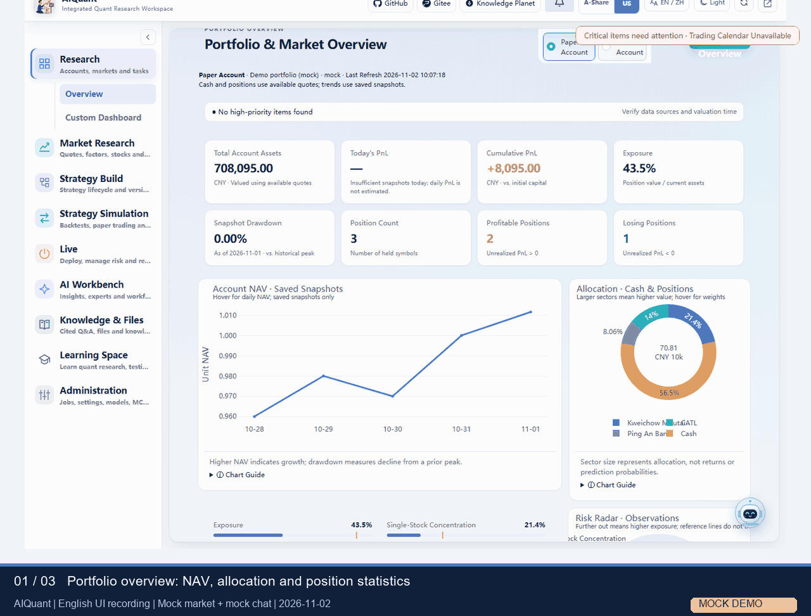
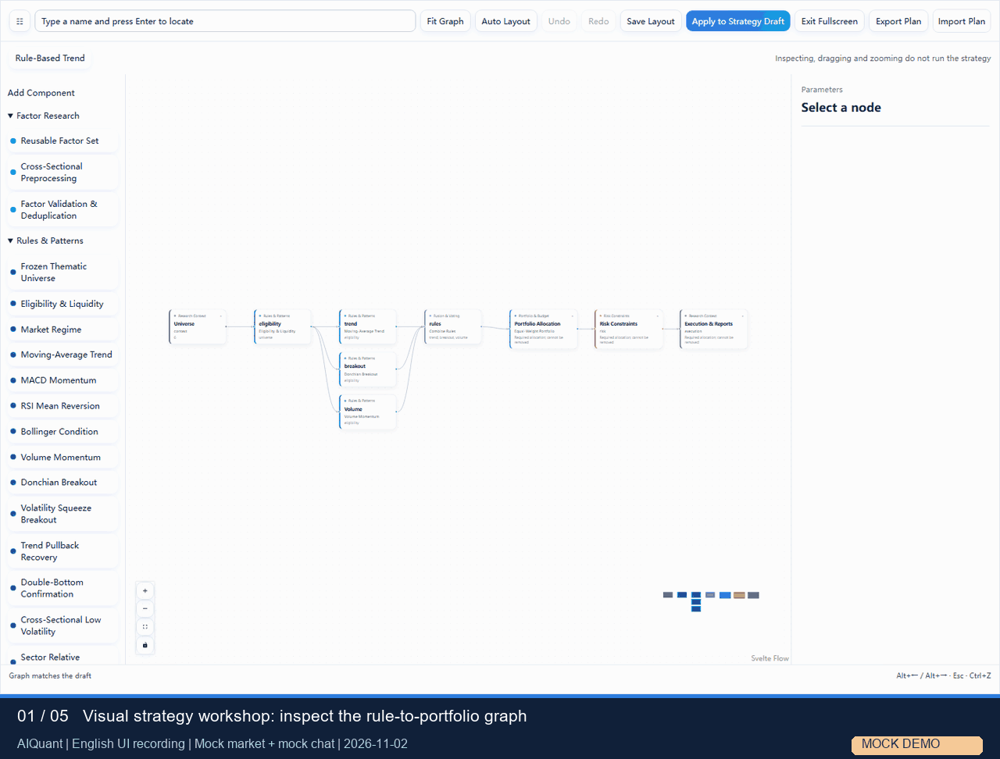
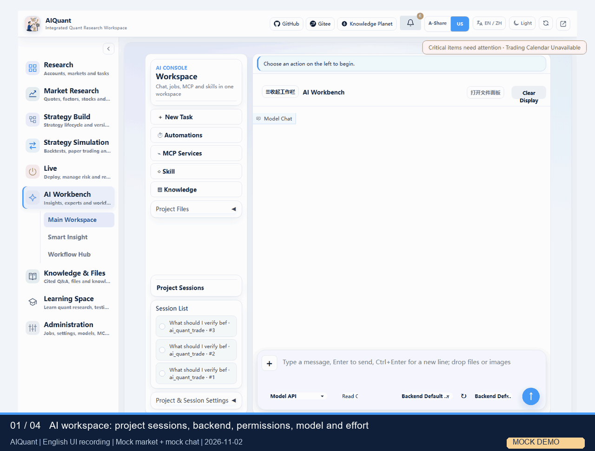
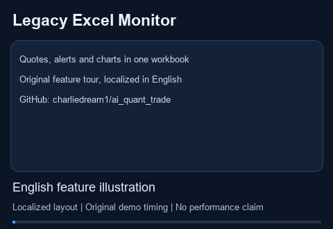
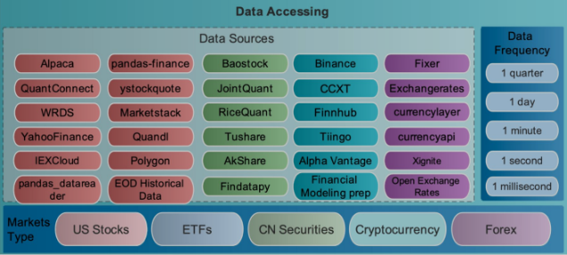

<div align="center">


# 🤖 AI Quantitative Trading Bot

**One-Stop AI Quantitative Trading Platform · From Learning & Simulation to Live Trading**

[**中文版**](README_ZH.md) | [**日本語版**](README_JA.md)

[](https://opensource.org/licenses/Apache-2.0)
[](https://github.com/charliedream1/ai_quant_trade)
[](https://github.com/charliedream1/ai_quant_trade)

<p>
  <sub>👇 Follow the WeChat account · Join the Knowledge Planet for more hands-on content and video tutorials</sub>
</p>

<a href="https://t.zsxq.com/dHt9l" title="AI智投星球">
  
</a>
&nbsp;&nbsp;&nbsp;&nbsp;


</div>

---

**Economic research · 2026-11-03:** Chinese macroeconomic trends and A-share financial statements, accounting metrics, peer comparisons and optional evidence-backed model reports. See the [economic analysis guide](docs/usage/economic_analysis.md).

**Model APIs · 2026-11-03:** selectable OpenAI/LiteLLM SDK backends and shared RPM/concurrency controls; see the [model interface guide](docs/usage/model_interfaces.md).

**Knowledge update · 2026-11-02:** named file libraries, Markdown heading chunks, recursive model-keyword retrieval with zvec-grep, session attachments, source previews, and report/paper downloads. See the [knowledge guide](docs/usage/knowledge.md).

**Latest update · 2026-11-01:** one [quant research workspace](#integrated-workspace) connects market views, visual strategy construction, backtests, AI sessions and cited knowledge. Start with the [workspace guide](docs/usage/workspace.md).

## 📑 Table of Contents

- [1. ✨ Core Highlights](#1--core-highlights)
- [2. 🔥 New Features](#2--new-features)
- [3. 🧩 Integrated Quant Workspace (`src`)](#integrated-workspace)
- [4. 📖 Introduction](#4--introduction)
- [5. 🌟 awesome_projects (Highly Recommended)](#5--awesome_projects-highly-recommended)
- [6. 🚀 Quick Start](#6--quick-start)
- [7. 📊 Local Quantitative Strategies](#7--local-quantitative-strategies)
- [8. 💰 Live Trading](#8--live-trading)
- [9. 🛠️ Trading Assistant Tools](#9--trading-assistant-tools)
- [10. ⛏️ Alpha Mining](#10--alpha-mining)
- [11. 💾 Data Processing](#11--data-processing)
- [12. 📝 Text Analysis](#12--text-analysis)
- [13. 🤖 LLM Applications](#13--llm-applications)
- [14. 📚 Programming & AI Basics](#14--programming--ai-basics)
- [15. 🌐 Online Research Platforms](#15--online-research-platforms)
- [16. 📖 Quant Resource Collection](#16--quant-resource-collection)
- [17. 🎁 Companion Resources](#17--companion-resources)
- [18. 💖 Support Me](#18--support-me)
- [19. 💬 Discussion](#19--discussion)
- [20. 🐛 Technical Support](#20--technical-support)
- [21. ❓ FAQ](#21--faq)
- [22. 📄 Citation](#22--citation)

---

## 1. ✨ Core Highlights

| 🎯 Positioning | 📌 Description |
|:---:|:---|
| 🏦 **One-Stop Platform** | Full-process coverage from learning and simulation to live trading |
| 📈 **Diverse Strategies** | LLMs, alpha mining, traditional strategies, ML, DL, RL, GNN, high-frequency trading |
| 📚 **Resource Aggregation** | Curated online resources, real-world case studies, paper interpretations, code implementations |
| 🛠️ **Assistant Tools** | Practical trading helpers such as stock monitoring and stock recommendations |
| 🌍 **Multi-Market Coverage** | Stocks, funds, cryptocurrencies, and other markets |
| 🚀 **Live Deployment** | Supports multiple deployment methods including Python/C++/CPU/GPU |

---

## 2. 🔥 New Features

| **Date** | **Feature** |
|:---|:---|
| 2026.11.06 | [**SAG knowledge and document Q&A**](docs/usage/sag_knowledge_qa.md): optional SAG retrieval, isolated single-document questions, JEV/vector/standard rerank alternatives and explicit fallback traces. |
| 2026.11.01 | 🆕 [**Integrated quant research workspace**](docs/usage/workspace.md): portfolio overview, market research, visual strategies, fee-aware backtests, AI project sessions and cited knowledge Q&A in one Gradio application. |
| 2026.10.31 | [**Execution controls and research evidence**](docs/usage/access_and_execution.md): custom-source review, frozen parameter snapshots, backend process status, RAG citations and local document reading/Markdown editing. |
| 2026.10.29 | [**Agent API/CLI backends and ten native research Skills**](docs/usage/agent_cli_skills.md), with recorded process events and explicit availability checks. |
| 2026.10.28 | [**Bull/bear debate and team-contest strategies**](docs/usage/agent_strategies.md), alongside [Alpha mining, theme and regime research](docs/usage/alpha_mining.md). |
| 2026.10.24 | [**Visual strategy workshop**](docs/usage/strategy_composition.md): cascades, parallel scoring, factor/model components and Portfolio/Risk. |
| 2026.07.25 | 🆕 [**"Stealth Stock Trading" Tool V2: Modular Monitoring System + Alert Monitoring + K-Line Charts + Multi-Source Fallback**](egs_aide/excel_stock_monitor/v2) |

<details>
<summary>📂 <b>2025 Updates</b></summary>

| **Date** | **Feature** |
|:---|:---|
| 2025.08.09 | 🆕 [**Reasoning Stock Price Forecasting LLM Training Tutorial (20% accuracy boost, interpretable)**](egs_courses/01_推理型股价预测大模型训练教程.md) |
| 2025.05.17 | 🆕 [**Unsloth Reasoning Stock Forecasting LLM (code in this repo, detailed guide & model on the Planet)**](egs_llm/a01_train/a01_unsloth_stock_forcaster) |
| 2025.01.03 | [**LLM-based Financial Market Analysis (video tutorial on the Planet or WeChat account)**](egs_llm/b01_app/a01_hot_topic_report/v1_proto_internet) |

</details>

<details>
<summary>📂 <b>2023 Updates</b></summary>

| **Date** | **Feature** |
|:---|:---|
| 2023.04.09 | [**StructBERT Market Sentiment Analysis**](https://github.com/charliedream1/ai_quant_trade/tree/master/egs_fin_nlp/emotion_analysis/01_StructBert_Binary_Class) |
| 2023.03.28 | [**RL Multi-Stock Trading: 53% Annualized Return**](https://github.com/charliedream1/ai_quant_trade/tree/master/egs_trade/rl/a002_finRL_tutorial/a01_Stock_NeurIPS2018) |
| 2023.02.28 | [**ML Auto-Mining 5,000 Alphas & Stock Trend Prediction**](https://github.com/charliedream1/ai_quant_trade/tree/master/egs_alpha/auto_alpha/tsfresh) |
| 2023.02.05 | [**Stock Monitoring with Excel**](https://github.com/charliedream1/ai_quant_trade/tree/master/egs_aide/%E7%9C%8B%E7%9B%98%E7%A5%9E%E5%99%A8/v1) |
| 2023.01.01 | [**Local Deep RL Strategy**](https://github.com/charliedream1/ai_quant_trade/tree/master/egs_trade/rl/a001_proto_sb3) |

</details>

<details>
<summary>📂 <b>2022 Updates</b></summary>

| **Date** | **Feature** |
|:---|:---|
| 2022.11.07 | [**Wind Local Live Trading Simulation**](https://github.com/charliedream1/ai_quant_trade/tree/master/egs_trade/real_bid_simulate/wind) |
| 2022.08.03 | [**Basic Backtest Framework + Double Moving Average Strategy**](https://github.com/charliedream1/ai_quant_trade/tree/master/egs_trade/vanilla/double_ma) |

</details>

---

<a id="integrated-workspace"></a>

## 3. 🧩 Integrated Quant Workspace (`src`)

The new [`src/`](src) is a runnable research workspace: a modular **Gradio UI**, shared **REST API and CLI**, and one strategy/backtest pipeline. It connects market research, strategy construction, simulation, AI sessions and local knowledge in one project. The older `egs_*/` examples remain available as independent projects.

[**Platform handbook**](docs/platform/index.md) · [**Workspace guide**](docs/usage/workspace.md) · [**Getting started**](docs/usage/quick_start.md) · [**Architecture and principles**](docs/principles/README.md) · [**CLI reference**](docs/usage/cli.md)

| Capability | What you can do |
| --- | --- |
| Overview and market research | Inspect NAV/allocation/position statistics, news, sector/stock views, factor monitoring and relationship evidence. |
| Strategy library and small models | Import rule strategies, ETF/industry rotation, LightGBM/XGBoost ranking and CPU MLP ensembles; preview YAML parameters and freeze each run. |
| Visual composition, Portfolio and Risk | Build rule → model → Agent cascades or parallel scoring/voting, then apply allocation and risk components; inspect connected steps on the graph. |
| Backtests and simulation | Set dates, commission/tax/slippage and execution assumptions; inspect NAV, drawdown, trades, attribution and parameter snapshots. |
| Alpha and multi-Agent research | Run hypothesis → implementation → evaluation, theme/regime experiments, bull/bear debate and team contests with evidence and review gates. |
| AI, native CLI and Skills | Use project sessions and attachments; select backend, permissions, model and reasoning settings. Agent backends include API/Codex/Qoder/TRAE/CodeBuddy where installed and qualified. |
| Knowledge and documents | Ask local RAG questions with references, preview HTML/Office/PDF, edit Markdown and browse saved reports. |
| Learning and operations | Read ordered quant lessons, schedule tasks, manage MCP/Skills and receive reviewable notifications. |

### Watch the workspace

**Nine modules in one page** — overview → market research → ETF research → learning → collapse navigation.



**Strategy construction and backtest review** — load a graph preset, inspect and drag a node, configure a backtest, then inspect its output and frozen parameters.



**AI sessions and knowledge references** — attach a note, send with Enter, inspect the persisted status, ask a RAG question and find the Skill-report actions.



This README and the Japanese README share recordings of the English interface with English captions.

These GIFs are recorded from real clicks in an isolated **mock-data** service. Chat replies are explicitly mock; opening the Skill panel does not run a report. They demonstrate workflow and UI behavior, not investment performance or successful paid CLI/model execution. [Recording details](.README_images/workspace/README.md).

### Code and run entry points

| Location | Responsibility |
| --- | --- |
| [`src/frontend`](src/frontend), [`src/api`](src/api), [`src/cli`](src/cli) | Gradio modules, REST/WebSocket and command-line access to shared services. |
| [`src/strategy`](src/strategy), [`src/engine`](src/engine), [`src/portfolio`](src/portfolio), [`src/risk`](src/risk) | Strategy ports, visual composition, execution ledger, allocation and risk. |
| [`src/agent`](src/agent), [`src/alpha_mining`](src/alpha_mining), [`src/agent_strategies`](src/agent_strategies), [`src/skills`](src/skills) | Model/CLI providers, research orchestration and native Skills. |
| [`src/data`](src/data), [`src/documents`](src/documents), [`src/knowledge`](src/knowledge), [`src/integration`](src/integration) | Market sources, local document/RAG support and MCP integrations. |
| [`src/core`](src/core), [`src/scheduler`](src/scheduler), [`src/notifications`](src/notifications) | Settings, storage, access/execution support, task ownership and reminders. |
| [`egs/`](egs), [`tests/`](tests), [`doc/`](doc), [`docs/`](docs) | YAML settings and launchers, regression tests, designs, user guides and principles. |

The workspace requires **Python 3.11+** and the pinned root dependencies. Follow [environment setup](docs/usage/installation.md), then run from the repository root:

```text
.venv-secure/Scripts/python.exe -B egs/check_runtime.py --role web
.venv-secure/Scripts/python.exe -B start.py --host 127.0.0.1 --port 8000
```

Open `http://127.0.0.1:8000/app/`. On Linux, create the declared environment and use `.venv-secure/bin/python`. Business settings live in YAML under `egs/`; private keys stay in local `.env` / `.llm_env`. See [access and source-review rules](docs/usage/access_and_execution.md) before remote use or custom Python execution. Qlib signal analysis and the native Qlib Workflow are separate capabilities; the latter needs its own data and configuration. Broker/live execution also requires a configured channel and checks.

---

## 4. 📖 Introduction

### Target Audience

- 🏢 **Institutional Investors**
- 👨‍💻 **Retail Traders (with programming background)**
- 🌱 **Retail Traders (no programming background)**

### Project Structure

```
ai_quant_trade
├── ai_notes ........... Financial quantitative trading knowledge (Markdown / Jupyter Notebook knowledge system)
│   ├── 资源 ........... Continuously collected excellent resources from across the web
│   ├── 实战 ........... Hands-on usage, frameworks, libraries, and pitfalls
│   └── 热点 ........... Financial market hot topics, tech hot topics, paper interpretations
├── src ................ Integrated workspace services and modular Gradio UI
├── egs ................ Workspace YAML configuration and entry points
├── tests .............. Workspace unit, integration and browser checks
├── doc ................ Design documents
├── docs ............... User guides, principles and the integrated documentation site
├── start.py ........... Workspace service launcher
├── egs_aide ........... Trading assistant tools (monitoring tools, etc.)
├── egs_alpha .......... Alpha library & alpha mining
├── egs_data ........... Data acquisition & processing (Wind / open-source tools)
├── egs_fin_nlp ........ Text analysis (sentiment analysis, etc.)
├── egs_llm ............ LLM applications (stock prediction / financial analysis)
├── egs_online_platform  Online research platform strategies (JoinQuant / Uqer)
├── egs_trade .......... Local quantitative stock trading strategies
│   ├── paper_trade .... Live trading simulation (Wind)
│   ├── rl ............. Reinforcement learning for trading
│   ├── ms_qlib ........ Microsoft Qlib framework
│   └── vanilla ........ Traditional rule-based strategies
├── runtime ............ Model deployment and real-world usage
├── tools .............. Auxiliary tools
└── README.md
```

> The integrated workspace uses the root `requirements.txt` / `pyproject.toml`, plus optional model dependencies and project environments. Legacy `egs_*/` examples keep their own dependency files; install only the environment for the project you choose.

---

## 5. 🌟 awesome_projects (Highly Recommended)

> 📁 **Directory**: [awesome_projects](awesome_projects)
>
> ⭐ **The Highlight Section of This Repo**: Curated, organized, and reviewed top-quality quantitative resources from across the entire web, all in one place!

### 🎯 What Is This?

This is the most essential "resource treasure trove" of this repo — **we spent tremendous effort curating, organizing and reviewing tens of thousands of materials from across the web**, classified by the full quantitative trading workflow so that you can quickly find the tools and materials you need, avoiding detours.

### ✨ Four Major Features

- 🔍 **Best of the Best**: Selected from the vast sea of resources across the web to avoid repeated pitfalls
- 📂 **Clear Categorization**: Classified by the full quant workflow (data → strategy → backtest → trading), easy to find what you need
- 📝 **With Reviews**: Not just links, but also pros/cons analysis and getting-started guides
- 🔄 **Continuously Updated**: Keeping up with technology development, continuously adding new resources

### 📚 Resource Category Overview

| No. | Category | Core Content |
|:---:|:---|:---|
| 📚 [00-basics](awesome_projects/00-basics.md) | Beginner Learning | Stock learning guides, introductory tutorials |
| 🎓 [00-learning-resources](awesome_projects/00-learning-resources.md) | Learning Resources | GitHub quant resources, open-source project collection |
| 📊 [01-data](awesome_projects/01-data.md) | Data Acquisition | Data tools, news data, multimodal data |
| 🏗️ [02-comprehensive-frameworks](awesome_projects/02-comprehensive-frameworks.md) | Mainstream Quant Frameworks | Qlib, WonderTrader, etc. |
| 🔄 [03-backtesting-frameworks](awesome_projects/03-backtesting-frameworks.md) | Backtest Tools | Backtrader, Zipline, RQAlpha, etc. |
| ⛏️ [04-factors](awesome_projects/04-factors.md) | Alpha Library | alphalens, ta_lib, etc. |
| 💹 [05-trading-strategies](awesome_projects/05-trading-strategies.md) | Strategy Resources | Traditional / DL / RL / report reproduction / portfolio |
| 🛠️ [06-assistant-tools](awesome_projects/06-assistant-tools.md) | Assistant Tools | K-line patterns, monitoring, office tools |
| 📊 [07-visualization](awesome_projects/07-visualization.md) | Visualization | Quant charts and visualization |
| 🧠 [08-knowledge-graphs](awesome_projects/08-knowledge-graphs.md) | Knowledge Graph | Traditional & LLM-based solutions |
| ⚡ [09-high-frequency-trading](awesome_projects/09-high-frequency-trading.md) | High-Frequency Trading | Crypto HFT |
| 🤖 [10-llm](awesome_projects/10-llm.md) | LLM in Finance | FinGPT, FinRobot, TradingAgents, Agent, RAG, etc. |
| 🌐 [11-research-platforms](awesome_projects/11-research-platforms.md) | Research Platforms | Free quant platform collection |
| 💻 [12-trading-platforms](awesome_projects/12-trading-platforms.md) | Trading Platforms | EasyTrader, VN.Py, etc. |
| 📄 [13-research-reports](awesome_projects/13-research-reports.md) | Research Reports | Report reproduction & sources |

### 🔥 Highlighted Recommendations

- 🤖 **LLM Applications in Finance**: Covers the latest research and practice including FinGPT, FinMem, Self-Reflective, Stock-chain, TradingAgents, FinRobot, etc.
- 🛠️ **Skill Pack Collection (60+)**: Includes Chan Theory, technical analysis, quant statistics, fundamental analysis, crypto, macro analysis, etc.
- 📊 **Backtest Framework Multi-dimensional Comparison**: Hands-on comparison of Backtrader, Zipline, RQAlpha, PyAlgoTrade, QuantDigger, etc.
- 🔬 **Research Report Reproduction**: Selected high-quality broker research reports with reproduction code
- 💹 **Complete Trading Strategies**: From traditional double MA to RL and GNN, covering all types of strategy resources

> 💡 **Usage Tip**: Browse the [awesome_projects](awesome_projects) directory as needed; each project entry now includes Stars, License, maintenance status, documentation/homepage and a value review.

---

## 6. 🚀 Quick Start

For the integrated **`src` workspace**, follow [installation](docs/usage/installation.md) and [quick start](docs/usage/quick_start.md); run `start.py` from the repository root with Python3.11+. See [workspace capabilities and workflows](#integrated-workspace) for the main operations.

For a legacy example, clone the repository, enter that `egs_*/` project and use its own requirements and README. These examples may have different Python and optional-library requirements; they do not all share the workspace runtime.

---

## 7. 📊 Local Quantitative Strategies

> 📁 **Code Directory**: [egs_trade](egs_trade)
>
> 🎯 Each example comes with a comprehensive tutorial — from principles and usage to code walkthrough.

You can build an independent quantitative trading system locally, covering the following strategy types:

| Category | Strategy | Status |
|:---:|:---|:---:|
| 🤖 AI Strategies | Reinforcement learning, GNN, DL, ML, HFT, alpha mining, LLMs | ✅ / 🔨 |
| 📐 Traditional Strategies | Rule-based strategies (double MA, portfolio management, etc.) | ✅ |

### 🧠 Reinforcement Learning Strategies

> 📁 **Code Directory**: `egs_trade/rl`

Since the AlphaGo vs. Ke Jie match in 2017, deep reinforcement learning has taken off.

Compared with ML and DL, RL is **goal-oriented** (uses interaction as the objective), while many other methods consider isolated sub-problems (such as "stock price prediction", "market prediction", "trading decision", etc.) and cannot directly obtain interactive actions. RL is directly oriented to "completing the commander's task" and can produce a sequence of actions.

**Strategy List:**

| **No.** | **Strategy** | **Paper** |
|:---:|:---|:---|
| 1 | [Prototype](egs_trade/rl/a001_proto_sb3) | — |
| 2 | [FinRL Tutorial 0 - NeurIPS2018](egs_trade/rl/a002_finRL_tutorial/a01_Stock_NeurIPS2018) | [Practical Deep Reinforcement Learning Approach for Stock Trading](https://arxiv.org/abs/1811.07522) |

**Backtest Results:**

| **No.** | **Strategy** | **Market** | **Annualized Return** | **Max Drawdown** | **Sharpe Ratio** |
|:---:|:---|:---|:---:|:---:|:---:|
| 1 | [Prototype](egs_trade/rl/a001_proto_sb3) | China A-Shares | — | — | — |
| 2 | [FinRL Tutorial 0 - NeurIPS2018](egs_trade/rl/a002_finRL_tutorial/a01_Stock_NeurIPS2018) | US Dow Jones 30 | 53.1% | -10.4% | 2.17 |

### 📐 Traditional Strategies

> Although traditional strategies may seem outdated, they are more operable and still have some practical value. DL and ML often need to be combined with rules to work effectively.

1. **[Double Moving Average Strategy + Simple Handwritten Backtest Framework](egs_trade/vanilla/double_ma)**
   - [Detailed Tutorial](egs_trade/vanilla/double_ma/文档教程)
   - Includes strategy code + self-built pure handwritten backtest framework
   - Includes nice plotting indicating buy/sell points
   - 🎯 Goal: Through this example, understand how to build a complete quantitative trading framework

2. **[Portfolio Management 7-Lesson Course](egs_trade/vanilla/portfolio_optimization)**

---

## 8. 💰 Live Trading

> 📁 **Code Directory**: [egs_trade](egs_trade)

### Live Trading Simulation

1. **[Wind Local Live Trading Simulation: Double MA Strategy](egs_trade/paper_trade/wind)**
   - Live trading simulation implemented with Wind software
   - Wind is often the data source of choice for major financial institutions; due to its high price, it's more suitable for institutions
   - 🏢 Target Users: Institutions

---

## 9. 🛠️ Trading Assistant Tools

> 📁 **Code Directory**: [egs_aide](egs_aide)

1. **[Stock Monitoring with Excel V1](egs_aide/excel_stock_monitor/v1)**
   - 👀 Hard to be spotted while monitoring stocks
   - 📋 Customizable stock watchlist
   - ⚡ Use Excel for fast calculation and data processing

2. **["Stealth Stock Trading" Tool V2: Modular Monitoring System](egs_aide/excel_stock_monitor/v2)** 🆕

   

   - 🏗️ **Architecture Refactor**: Upgraded from a single file to a modular `excel_monitor` package with Sheet Handler pattern; each Sheet refresh is isolated
   - 🔔 **Alert Monitoring**: Customizable upper/lower price/change limits; triggered rows turn red + popup reminders
   - 📈 **K-Line Charts**: Draw K-line charts with a button click in Excel (mplfinance candlestick + MA lines), no need to switch software
   - 💰 **Capital Sentiment**: New Sheet aggregating northbound capital + Weibo sentiment + news sentiment + Guba hot posts
   - 🔍 **Stock Pool Selection**: Built-in all A-shares; fuzzy search by code/name/pinyin initial + dropdown selection, no need to look up codes
   - 🔄 **Multi-Source Fallback**: qstock main source + akshare/Eastmoney/Tencent/NetEase/efinance backups; auto-switch when one fails
   - ⚙️ **Hot Config Reload**: YAML + Excel "Config" Sheet; watchlist/refresh interval can be hot-applied in Excel without restart
   - 🧪 **Out-of-the-Box**: One command auto-generates the Excel template (7 Sheets), no need to prepare stock lists in advance
   - ✅ **Unit Tests**: pytest covers core logic (156 items), stable for long-running sessions

3. **[Streamlit Real-Time Market Monitor](egs_tools/a02_market_monitor_via_streamlit)**
   - 🌐 Web-based real-time market dashboard

---

## 10. ⛏️ Alpha Mining

> 📁 **Code Directory**: [egs_alpha](egs_alpha)

### Alpha Mining Strategies

| **No.** | **Strategy** | **Paper** |
|:---:|:---|:---|
| 1 | [ML Auto-Mining 5,000 Alphas & Stock Trend Prediction](egs_alpha/auto_alpha/tsfresh) | — |

### Alpha Library

| **No.** | **Alpha Library** |
|:---:|:---|
| 1 | [alpha101](egs_alpha/alpha_libs/alpha101) |
| 2 | [stockstats](egs_alpha/alpha_libs/stockstats) |
| 3 | [ta_lib](egs_alpha/alpha_libs/ta_lib) |

---

## 11. 💾 Data Processing

> 📁 **Code Directory**: [egs_data](egs_data)

- Detailed usage of various common data sources
- Unified data source interface



---

## 12. 📝 Text Analysis

> 📁 **Code Directory**: [egs_fin_nlp](egs_fin_nlp)

| **No.** | **Tool** |
|:---:|:---|
| 1 | [**StructBERT Market Sentiment Analysis**](egs_fin_nlp/emotion_analysis/01_StructBert_Binary_Class) |

---

## 13. 🤖 LLM Applications

> 📁 **Code Directory**: [egs_llm](egs_llm)

| **No.** | **Tool** |
|:---:|:---|
| 1 | [**LLM-based Financial Market Analysis (video tutorial on the Planet or WeChat account)**](egs_llm/b01_app/a01_hot_topic_report/v1_proto_internet) |
| 2 | [**Unsloth Reasoning Stock Forecasting Model Training (open-source code; detailed guide & model on the Planet)**](egs_llm/a01_train/a01_unsloth_stock_forcaster) |

---

## 14. 📚 Programming & AI Basics

For easier maintenance, the original `ai_wiki` directory content (system operations, programming basics, AI basics, AI practice, etc.) has been independently synchronized to the repo **AI LLM Pitfall Guide**.

It records a large number of problems and solutions encountered in actual development, and tracks cutting-edge technology developments in real-time. Welcome to follow and Star ⭐

> ✨ **AI LLM Pitfall Guide**
> - **Github**: https://github.com/charliedream1/ai_wiki
> - **Gitee (Domestic Mirror)**: https://gitee.com/charlie1/ai_wiki.git
> - **Introduction**: Share various practical cases, track cutting-edge technology developments, covering the full stack of AI knowledge — including LLMs, programming techniques, machine learning, deep learning, reinforcement learning, GNN, speech recognition, NLP, image recognition, etc.

---

## 15. 🌐 Online Research Platforms

> 📁 **Code Directory**: [egs_online_platform](egs_online_platform)

Domestic quant platforms such as JoinQuant, Uqer, MiRuo, GuoRen, and BigQuant can be tried by interested readers.

Research platforms are cloud platforms tailored for quant enthusiasts (quants), providing free stock data acquisition, accurate backtesting, high-speed live trading interfaces, easy-to-use API documentation, and a strategy library from easy to difficult, making it convenient to quickly implement and validate strategies.

> ⚠️ **Note**: The following strategies are only valid for the backtest periods described and have not been carefully tuned or verified for full-period performance. No strategy can guarantee effectiveness across all periods, so please be cautious when using them in live trading.

### JoinQuant Platform

> 🔗 [JoinQuant Platform](https://www.joinquant.com/) · Welcome to follow me: **量客攻城狮**
>
> - For detailed strategy introductions and source code, please click the corresponding strategy link
> - JoinQuant Usage Introduction: [egs_online_platform/聚宽_JoinQuant](https://github.com/charliedream1/ai_quant_trade/tree/master/egs_online_platform/%E8%81%9A%E5%AE%BD_JoinQuant)
> - This part of the code can only run on [**JoinQuant Platform**](https://www.joinquant.com/)

**Stock Quant Strategies:**

| Strategy | Return | Max Drawdown |
|:---|:---:|:---:|
| [**ML - Dynamic Factor Selection Strategy**](https://www.joinquant.com/view/community/detail/f2a9d2ec6d4ad18882fa0a364fb9123d) | 12.3% | 38.93% |
| [**Small-Cap + Multi-MA Quantitative Trading**](https://www.joinquant.com/view/community/detail/c754d315a391f39f61858dfe3275f45f) | 58.4% | 46.61% |
| [**Dragon-Tiger List - Look Long Trade Short**](https://www.joinquant.com/view/community/detail/0986c3b92578952cc22c52f0a5ea4664) | 41.82% | 26.89% |
| [**Strong Stocks + Trend Line + Stop-Loss/Take-Profit**](https://www.joinquant.com/view/community/detail/c0390ceabdc1b3365df343490b7caf28) | 10.09% | 21.449% |

**Stock Analysis Research:**

- [Hands-on Tutorial on "ML - Dynamic Multi-Factor Stock Selection" (with nanny-level tutorial)](https://www.joinquant.com/view/community/detail/4fa769264b0bf6489b36351b43e37012)
- [Dragon-Tiger List Data Filtering](https://www.joinquant.com/view/community/detail/a3a95cc7e53092aaea510d93bab9cb96)
- [Concept Sector Data Acquisition and Stock Selection](https://www.joinquant.com/view/community/detail/d1bf674ad163654aa263dac859762c90)
- [Detailed Explanation: Stock Data Acquisition & Graphical Analysis (with detailed code)](https://www.joinquant.com/view/community/detail/8fe84d0d25dcf1a6da72e442460cdf36)

---

## 16. 📖 Quant Resource Collection

> [(Our article with 26,000+ reads on Zhihu) The Ultimate Collection of AI Stock Quantitative Trading Tools and Open-Source Projects](https://zhuanlan.zhihu.com/p/562878605)

We have re-categorized and reviewed all tools, collected in the [ai_notes](ai_notes) folder for easy lookup.

🎯 **In Development:**
- Continuously reviewing all tools to facilitate selection
- Continuously documenting the pros and cons of each tool to form comparison tables for easy selection
- Continuously documenting usage: We don't make comprehensive tutorials, only list the most commonly used and practical features, so you can get started quickly

---

## 17. 🎁 Companion Resources

This code repository adheres to the principle of **parallel paid and free** offerings.

### 💎 Paid Resources — Knowledge Planet

> Register on the official Knowledge Planet website for guaranteed user rights. [Planet Content Introduction](docs/03_星球使用和介绍)

<font face="逐浪立楷" color=#00bfff>
🔥 As low as 0.1 RMB/day | Exclusive Crash Course | Painless Learning | 📺 Video Tutorials | Q&A |
Open-Source Pitfall Guide | Self-Developed Tool Code | 3-Minute Video Paper Speed | Library |
One of the lowest-priced quant planets on the web | 3-day no-questions-asked refund
</font>

👇 Scan the QR code below or click the link to enter the Planet and view more detailed introductions 🎏

**Planet Video Introduction:**
- Planet Usage Guide: https://mp.weixin.qq.com/s/SGc49e0xf24q5aUbf3rO0g?token=2028063978&lang=zh_CN
- Learning Path & Group Resource Usage: https://mp.weixin.qq.com/s/3-U048mc0riVsdETrKr77g

**Planet Join Links:**
- [AI智投星球](https://t.zsxq.com/dHt9l): AI quantitative trading crash course, cutting-edge tech, real-world cases, resource library
- [AI速成营](https://t.zsxq.com/q42Js): In-depth supplements on programming, LLMs, AI basics, principles and finance practice & job-seeking cases, complementary to AI智投星球

**Planet Introduction:**
- [**Planet Content Introduction**](docs/03_星球使用和介绍/01_星球介绍.md)
- [**New User Guide**](docs/03_星球使用和介绍/02_新人使用指南.md)

👇 Scan the QR code for a more detailed introduction to the "Planet" (there are funny comics inside)!

<div align="center">


</div>

> 🎯 This repo will continue to be updated, but some code will be privately maintained and only visible on the Planet. The corresponding features will be noted in the repo.

---


### 🆓 Free Resources

**WeChat Official Account**

🔥 Real-time updates on the latest news
🎁 <font color=orange>Follow and like any article, DM the admin to receive a free exquisite quant material package!</font>


---

- [Zhihu: 576 Followers](https://www.zhihu.com/people/yi-dui-ji-mu-zai-kuang-xiang)
- [JoinQuant: 599 Followers](https://www.joinquant.com/user/d7aafd0b8b767b735bfb6f3639c81a6c)

---

**Code Repository (Forever Free)**

> ✨ **AI Quantitative Trading Bot**
> - **Github**: https://github.com/charliedream1/ai_quant_trade
> - **Gitee (Domestic Mirror)**: https://gitee.com/charlie1/ai_quant_trade.git

**Companion Repo**

> ✨ **AI驯龙笔记 (AI Taming Notes)**
> - **Github**: https://github.com/charliedream1/ai_wiki
> - **Gitee (Domestic Mirror)**: https://gitee.com/charlie1/ai_wiki.git
> - **Introduction**: Share various practical cases, track cutting-edge technology developments, covering the full stack of AI knowledge — including LLMs, programming techniques, machine learning, deep learning, reinforcement learning, GNN, speech recognition, NLP, image recognition, etc.

---

## 18. 💖 Support Me

Your support is the driving force for me to move forward. Even "0.1 RMB" makes me happy. Thank you for your support \(^o^)/

<div align="center">

&nbsp;&nbsp;&nbsp;&nbsp;

</div>

---

## 19. 💬 Discussion

Feel free to start a discussion in [Github Discussions](https://github.com/charliedream1/ai_quant_trade/discussions).

## 20. 🐛 Technical Support

- Feel free to submit issues at [Github Issues](https://github.com/charliedream1/ai_quant_trade/issues)
- Join the Knowledge Planet for more technical support
  - [AI智投星球](https://t.zsxq.com/dHt9l): Focused on AI quantitative trading knowledge sharing
  - [LLM Pitfall Guide](https://t.zsxq.com/q42Js): Focused on programming, LLMs, and AI application empowerment

## 21. ❓ FAQ

Please see the documentation → [**FAQ**](docs/02_常见问题)

## 22. 📄 Citation

```bibtex
@misc{ai_quant_trade,
  author={Yi Li},
  title={ai_quant_trade},
  year={2022},
  publisher = {GitHub},
  journal = {GitHub repository},
  howpublished = {\url{https://github.com/charliedream1/ai_quant_trade}},
}
```

---

<div align="center">

**If this project helps you, please give it a Star ⭐ to support!**

[](https://star-history.com/#charliedream1/ai_quant_trade&Date)

</div>
