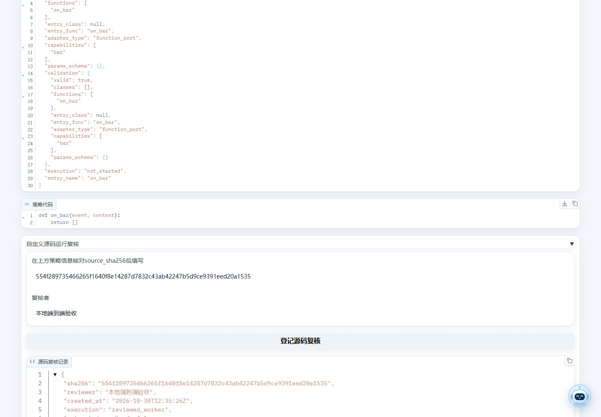

# 访问控制与源码运行

2026-10-30更新。默认本地访问，上传自定义Python源码先复核再执行；正常内置策略、图形工坊和研究门槛沿用原流程。

## 本地与远程访问

本机通过`http://127.0.0.1:8000/app/`访问。默认`local`模式只接受回环客户端，允许的Host为localhost、127.0.0.1和IPv6回环；外部网页的跨站请求也会拒绝。已有配置即使监听0.0.0.0，也不等于向局域网开放功能。

需要远程使用时，由本机操作员在项目`.env`设置下列变量后重启；访问令牌不要填进YAML、URL或提交到Git。

| 配置 | 用途 |
| --- | --- |
| `ALL_IN_ONE_ACCESS_MODE=token` | 启用统一令牌认证 |
| `ALL_IN_ONE_ACCESS_TOKEN` | 至少32位ASCII随机令牌，作为单一管理身份 |
| `ALL_IN_ONE_ACCESS_HOSTS` | 逗号分隔的实际域名/IP，不含协议、路径或通配符 |
| `ALL_IN_ONE_HOST` | 需要监听的接口；仅在有远程部署需求时调整 |

远程客户端必须通过HTTPS/WSS接入；反向代理需正确转发Host及协议，应用服务器仅信任实际代理来源。浏览器打开`/access/login`输入令牌，登录cookie为HttpOnly、SameSite=Strict，有效8小时；POST `/access/logout`后退出。登录页有次数限制。`/_health`仅返回最小存活状态，业务健康和资料接口仍受保护。

图95来自本地隔离令牌服务，截图未输入令牌。本轮实际验证登录、退出、未认证拒绝及CLI访问；未对外发布站点。

平台CLI继续使用`egs/cli.example.yaml`的`authorization_env`配置，默认变量为`ALL_IN_ONE_CLI_AUTHORIZATION`，值需包含`Bearer `前缀及同一访问令牌。令牌只保存在项目`.env`或进程环境。401表示缺少/无效认证，403表示Host、来源或访问范围不符；关闭认证不能解决跨站来源问题。

这是个人或共用管理令牌的部署模式，尚不提供多用户隔离、角色权限和按用户数据空间。获得访问令牌的人可以管理模型、程序和研究资料，应按管理员对待。

## 自定义策略复核

1. 在“策略构建 → 策略管理”导入策略，保存返回的策略ID。创建、列表和详情只做静态检查，不执行模块顶层代码。
2. 在“策略库”填写ID并点击“查看详情”，核对源码、依赖、入口和参数。策略信息中展示`source_sha256`。
3. 展开“自定义源码运行复核”，填写当前SHA256和复核者，点击“登记源码复核”。这一步应由能判断源码可信性的操作员完成，不能当成跳过阅读的勾选项。
4. 再运行一键回测或普通回测，核对实际日志、成交、费用、持仓和曲线。源码修改后旧复核失效，需重新检查并新建回测任务。

图94来自隔离mock服务，展示真实点击后的`reviewed_worker`记录；不代表该样例有投资收益。

命令行也可操作：先用`strategy show <ID>`查看源码摘要，再用`strategy review-source --help`查看当前字段并提交复核；之后按[CLI回测流程](cli.md)执行。复核记录位于运行数据目录的`strategies/reviews/`，按源码摘要关联，不修改旧回测结果。

内置样例和受控平台生成方案按其已知源码识别；上传、手工编辑和普通CLI产物不能仅凭名称冒充内置策略。同名同版本重复导入会提示冲突，使用新版本或新名称。结束的回测任务不能再次执行覆盖结果。

## 执行及凭据边界

经复核的自定义源码运行在单独工作进程，保留策略状态，限制内存、调用时限、可见环境和工作目录，并限制网络/外部程序能力。内置策略继续使用受信任路径以控制逐K线开销。这些约束是对可信源码的纵深防护，Python审计钩子和普通子进程不能隔离任意恶意Python；不接受不可信第三方源码自动执行。

Windows已实际验证工作进程、拒绝越界写入、结束和资源释放；Linux分支使用相应文件锁及资源限制，但本机WSL缺少Hyper-V支持，本轮没有取得Linux实机验收结果。

模型/MCP密钥保存为环境引用，公开列表和错误日志会脱敏；`.env`等文件仍是受操作系统权限保护的本地明文，并非加密保管库。不要将密钥放入URL、研究提示词或上传资料。CLI使用自己的登录文件和明确环境白名单，仍属于操作员信任的外部程序。

原始提示词、模型响应、附件、数据库和研究报告可能含个人/商业信息；认证不等于内容匿名化。自行归档时限制读取权限，发布MkDocs仅发布已核查的使用/原理文档，不发布私有运行目录或整份审计数据库。

## Git提交边界

`.gitignore`把原始`docs/audit/`、`.workbuddy/memory/`及`docs/task*.md`留在本地，连同已有环境、数据库和私有配置排除提交。正式`docs/usage/`、`docs/principles/`、配图/GIF，以及`.agents/.qoder/.codebuddy`下的项目级Skill仍可提交。忽略规则不会删除本地资料，也不能移除已经进入Git索引或历史的文件。

提交前先查看`git status`和明确路径的差异，再逐项选择源码、配置样例及已审阅文档。安装独立的Git与Gitleaks工具后，可运行`gitleaks version`确认版本；本轮使用8.30.1。暂存后的检查为`gitleaks git . --pre-commit --staged --redact=100`，不要开启显示凭据原文的输出。`tests/core/test_gitleaks_config.py`实际验证忽略路径和合成凭据的目录/隔离暂存扫描，需要这两个命令在PATH中，不会静默跳过缺失工具。

`src/data`和`uv.lock`也接受扫描，不能按“数据目录”或“锁文件”整段放行。扫描通过不等于图片、PDF、附件和研究内容都已匿名化；正式配图应确认无个人账户、凭据、私有对话和操作系统个人路径。历史笔记本的已有输出需按实际发布范围另行审阅，不因本次忽略规则自动清空。当前规则整改没有自动暂存、提交或推送资料。

2026-11-03补充：公开配置样例、入门文档、迁移说明、Qlib笔记本输出及设置/CUDA截图中的具体机器目录已匿名化；笔记本源代码不变，原件保留本地。扫描覆盖当前可提交文本、Office/ZIP/PDF提取内容及图片/动图OCR；软件安装目录示例、公开作者信息和PDF中的xx占位符仍按上下文区分。新提交的脱敏不会清除已有历史，后续提交应继续扫描实际暂存集合。

## 已知限制和排障

2026-10-31重扫更新：Web环境合计46条公告，包含原Pillow39条与pypdf6.21.2新增命中的7条。pypdf修复版本覆盖到6.21.4，需先用项目内候选环境验证PDF解析、Office转PDF与阅读后再同步锁定版本；当前依赖没有被擅自替换。最新计数以`docs/audit/code_health_e2e_2026-10-31/`为准，以下Pillow说明仍适用。

主Gradio环境Pillow12.3.0仍有39条已知公告，独立Pillow13图片校验环境不消除这些公告；当前Gradio候选仍约束pillow小于13，因此本轮未强行覆盖依赖。图形构建链deepmerge仍有一个无补丁公告，对应两个低危包条目。具体日期与结果见项目正式验收记录。

后台任务支持跨进程租约、取消及有界队列。取消在安全检查点生效，已经发出的HTTP请求/远端计费可能要等受限调用结束；线程软超时不会伪装成线程已停止。研究报告保留失败和缺口，不能把被阻断或缺历史资料的流程说成成功投资验证。

需要了解具体原理和质量检查入口，请看[安全与并发原理](../principles/security_concurrency.md)、[运行环境](navigation_and_environment.md)及[排障](troubleshooting.md)。
