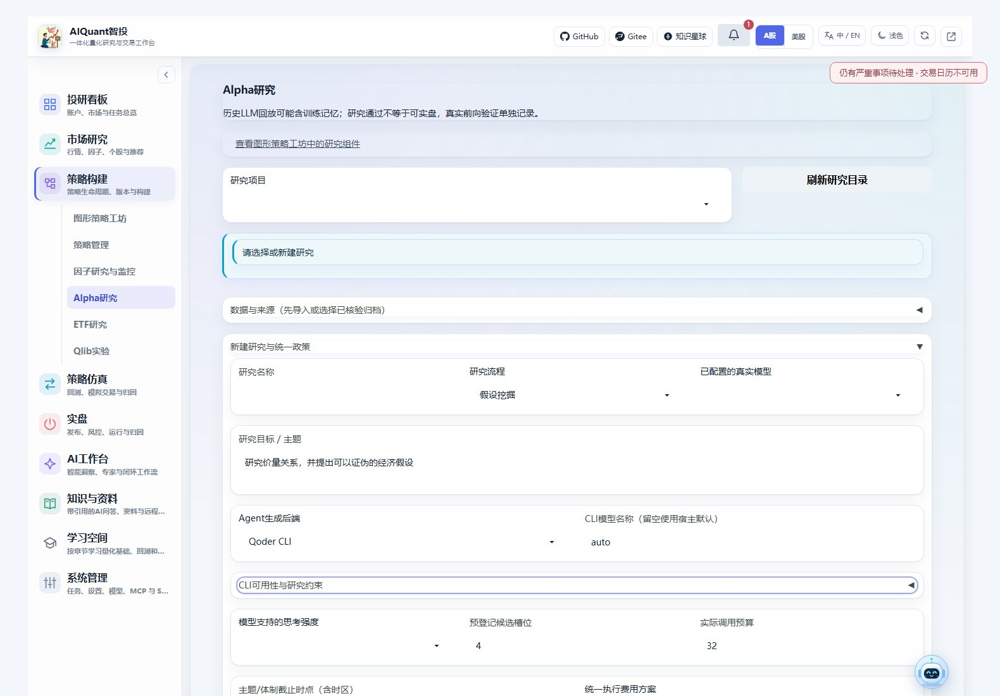
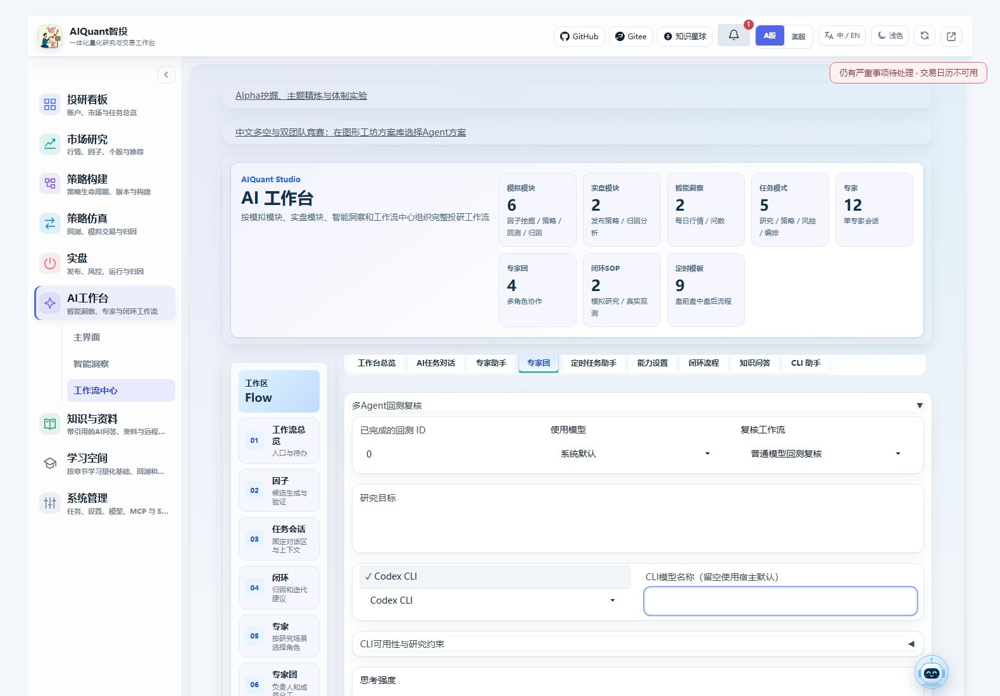

# Agent后端与原生研究Skills

本页说明如何让平台Agent使用API/CLI，以及如何在CLI里直接执行研究。CLI安装、认证见[安装指南](cli_installation.md)，各研究的证据和指标见[Alpha研究](alpha_mining.md)、[Agent策略](agent_strategies.md)和[ETF复核](etf_research.md)。

## 两种使用方向

平台调用CLI时，CLI只生成研究角色的普通文本，证据读取、ReAct、预算和结论校验仍由平台执行。用户在原生CLI中启用Skill时，Skill调用本项目执行器，执行器直接复用网页所用的研究服务；默认不需要启动网页或FastAPI。

“可以聊天”“可以作为严格研究角色”和“可以自动发现Skill”是三项不同能力。不要因为某CLI已安装就把它当作历史PIT验证已通过。

| 后端 | 对话/生成协议 | 严格研究角色的当前边界 | 原生Skill目录 |
| --- | --- | --- | --- |
| 模型API | OpenAI兼容普通文本生成 | 沿用平台模型、引用、PIT和研究门槛 | 不适用 |
| Codex | exec JSONL | 当前程序尚未证明可关闭全部原生工具及隐式Skill，严格角色预检会阻断；工作台对话可用 | `.agents/skills` |
| Qoder | print/stream-json | 已按1.1.80核对空工具、空配置来源、空MCP和系统提示参数；还需已登录，并通过初始化事件检查 | `.qoder/skills` |
| TRAE | 旧版print；2.0单独适配exec | 本机0.120.42不能套用2.0参数，严格角色不可用；不自动升级 | 旧版CLI目录未核验，使用显式加载或项目执行器 |
| CodeBuddy Code | 非交互stream-json | 未安装时明确不可用；须核验实际版本的研究约束，不自动使用WorkBuddy桌面账户 | `.codebuddy/skills` |

Qoder的版本核对不代表已完成真实模型对话。`providers --probe`分别展示程序、认证、版本、模型未知状态和严格研究资格；未知用量保留为未知。API Key仍放项目环境配置，不放Skill、研究YAML或命令参数。

TRAE和CodeBuddy默认使用项目数据目录中的`cli_profiles/trae`和`cli_profiles/codebuddy`，不会迁移桌面工具的账户。需要指定已有独立配置时，在项目.env配置`ALL_IN_ONE_TRAE_HOME`或`ALL_IN_ONE_CODEBUDDY_CONFIG_DIR`；程序路径分别为`ALL_IN_ONE_TRAE_CLI`、`ALL_IN_ONE_CODEBUDDY_CLI`。CodeBuddy调用关闭自动更新。

## 网页中选择

“策略构建→Alpha研究”的新建研究区可以选择生成后端和CLI模型名；高级YAML的`models`按角色覆盖，体制实验的`configurations`可以逐项指定后端。八配置仍须为实际不同的后端、模型或受支持思考配置，不按角色名称凑数。



“AI工作台→工作流中心→专家团”中的多Agent回测复核支持默认后端和`analyst/risk/reviewer/chair`角色覆盖，ETF使用同一组控件。组合工坊、中文多空、竞赛及Skill洞察也使用同一生成边界；工作台和悬浮窗对话继续展示原生过程事件。



## 本地命令

在本项目根目录，使用现有项目Python环境。Windows可将下列`python`替换为`.venv-secure/Scripts/python.exe`；Linux使用已安装项目依赖的解释器，不在全局环境临时安装包。

```console
python egs/entrypoints/skills.py catalog
python egs/entrypoints/skills.py providers --probe
python egs/entrypoints/skills.py preview --config egs/examples/skills_examples/quant-backtest-review.yaml
python egs/entrypoints/skills.py run --config <项目内研究.yaml> --format jsonl
python egs/entrypoints/skills.py show <运行ID>
python egs/entrypoints/skills.py events <运行ID>
python egs/entrypoints/skills.py files <运行ID>
python egs/entrypoints/skills.py cancel <运行ID>
```

`egs/examples/skills_examples/`中十份YAML是可编辑模板。示例ID不是已存在的数据，日期和证券也须换成研究所需的实际输入。`preview`只解析，不调用模型；`preflight`增加后端清单，带`--probe`才检查原生元数据，不做付费生成。

```yaml
# YAML 1.2, UTF-8
skill: quant-backtest-review
provider:
  backend: api
  model_id: 1
request:
  backtest_id: 1
  objective: 复核实际成本、风险和证据
  role_models:
    risk: {backend: qoder, model_name: auto, reasoning_effort: low}
```

CLI使用模型名称，API使用平台`model_id`。未登录、型号/强度不受支持或严格角色不可用时，不静默回退API、不提升权限、不重复付费重试。同一工作流可混合API/CLI，但每个实际选择都必须通过校验。

本地运行占用当前进程；另一个终端可以按ID查看、等待或请求取消。关闭终端不承诺任务继续存活。网络取消可能要等当前有时限的请求返回，保留已经发生的消耗；不要把缺少外层CLI账单当成零成本。研究产物保存在项目数据目录`skill_runs/<ID>/`，包括配置摘要、真实事件、结果JSON和HTML；具体业务运行ID与原始报告路径也保留。

执行进程定期更新心跳；超过30秒没有心跳时，后续查看会标记`interrupted`，保留事件供核查，不自动重跑付费研究。该标记反映本地执行器失去活动证据，不等于远端请求一定尚未计费。

## 十个Skill与继续研究

| Skill | 必要输入和输出 |
| --- | --- |
| `quant-market-review` | 市场、时点；来源可追溯的复盘HTML |
| `quant-stock-analysis` | 单一证券；价量、新闻及缺口报告 |
| `quant-backtest-review` | 已完成回测ID、目标；四角色复核 |
| `quant-etf-review` | ETF回测ID、目标；敞口、跟踪误差、流动性复核 |
| `quant-strategy-composition` | 方案/版本、证券、日期；级联/并行、Portfolio/Risk和统一账本 |
| `quant-alpha-mining` | 行情数据集、预登记政策/预算；假设、受控实现，后续冻结和验证 |
| `quant-theme-refine` | 带可得时点原文、主题、截止；关键词和原文公司关联 |
| `quant-regime-research` | 宏观PIT、截止、股债映射和独立配置；匿名日期体制研究 |
| `quant-cn-debate` | 行情/原文数据集、时点；综合/质量/事件预置 |
| `quant-contest-trade` | 行情/原文数据集、时点；事件/质量/行业预置与成熟成绩 |

Alpha首次执行只完成发现，不能自动宣称验证通过。后续YAML在`request`提供已有`study_id`及`action: seal`、`validate`或`holdout`；留出还要提供`candidate_id`，仍执行同一冻结家族和一次性留出限制。已有研究不会因为新命令提供不同默认模型而修改其冻结配置。经济与技术人工复核仍使用原页面或`egs/entrypoints/cli.py alpha`命令。

可在配置顶层增加`imports`列表，每项指定项目内`file`、`kind`和`target`，由原有数据校验器导入。`target`支持`dataset_id/market_dataset_id/documents_dataset_id/memory_dataset_id`。导入不等于来源已核验，不自动授予历史验证资格。

## 导出并在宿主中使用

```console
python egs/entrypoints/skills.py export --host codex
python egs/entrypoints/skills.py export --host qoder
python egs/entrypoints/skills.py export --host codebuddy
```

规范源在`src/skills/quant-*/SKILL.md`。导出为项目内可追踪副本和摘要清单，不写用户全局目录；用户修改过的同名文件会拒绝覆盖，不删除旧文件。Codex可提及`$quant-market-review`，Qoder按其Skill菜单或`/quant-market-review`调用；必要时刷新Skill菜单。CodeBuddy须先完成实际安装。TRAE旧版可让宿主显式读取对应`SKILL.md`，或直接执行上述本地命令，不把IDE目录当成已验证的CLI发现目录。

## 复用远程服务

已有平台服务时，可显式加`--base-url http://127.0.0.1:端口`；远程执行仍调用相同业务逻辑，自动等待并可输出事件。远程文件须先通过平台数据导入接口上传，再用数据集ID，不让远程任务任意读取客户端路径。

原`egs/entrypoints/cli.py`继续可用，新增`provider list`和`research-skill list/preview/run/show/events/files/cancel`。后端/原生技能约束见[原理说明](../principles/agent_cli_skills.md)；命令失败后的证据应保留，流程完成不代表收益有效。
