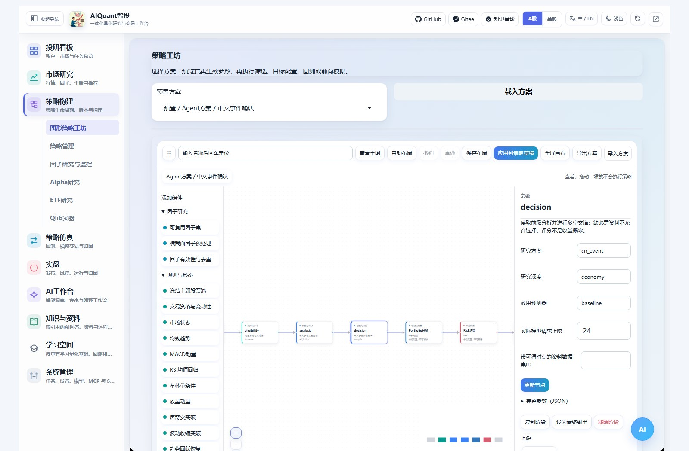
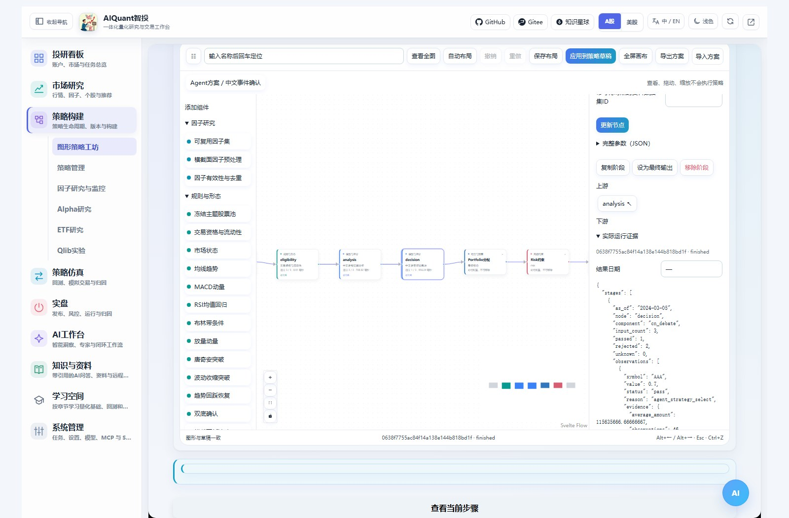
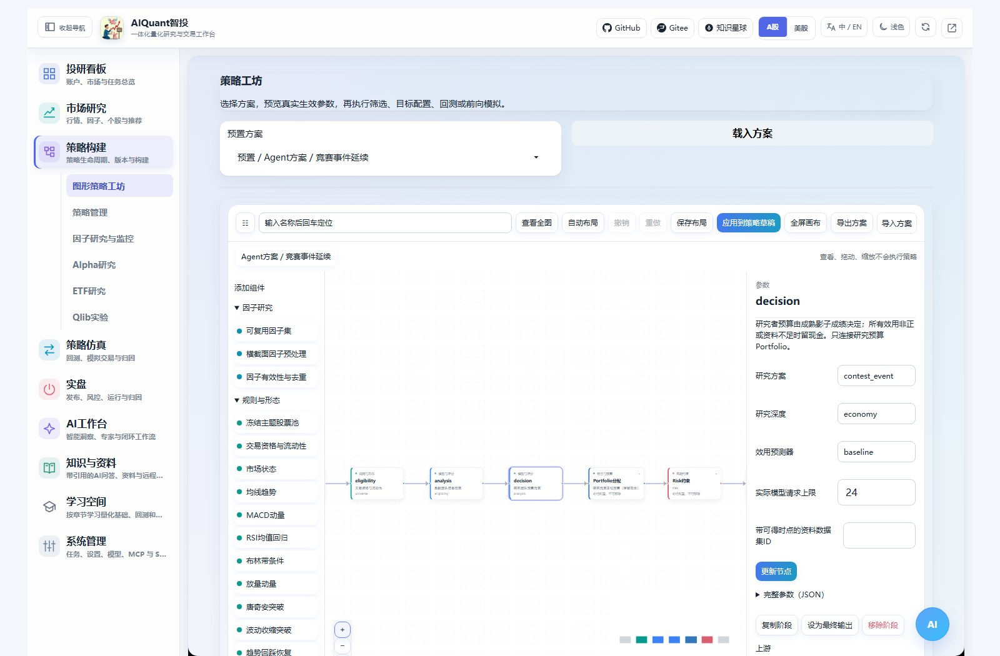
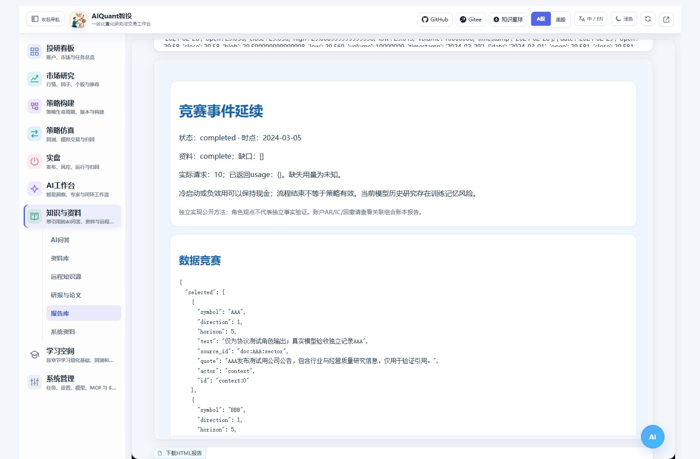
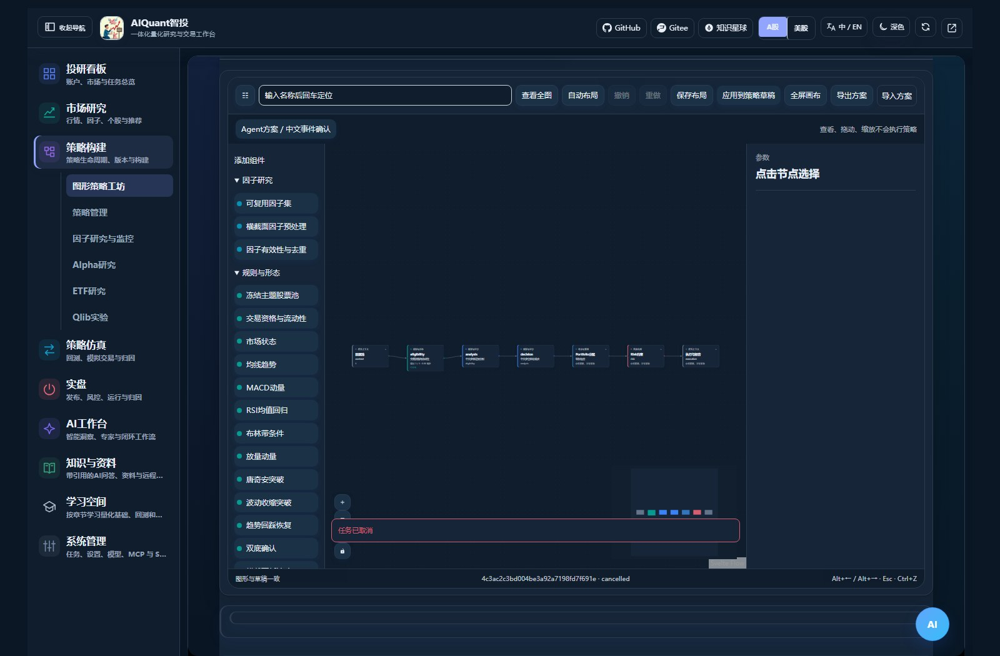

# 中文多空与双团队竞赛策略

2026-10-29：研究角色新增统一API/CLI选择；不用网页的十个本地研究Skill、按角色覆盖、项目级导出及严格研究可用性边界，见[Agent后端与原生Skills](agent_cli_skills.md)。程序安装与普通对话成功不等于历史研究资格已通过。

入口：“策略构建 → 图形策略工坊”。在顶部“预置方案”选择以“Agent方案 /”开头的项目，再点“载入方案”。AI工作台的“工作流中心”也提供工坊入口。保持同一个Gradio页面，查看、拖动和换方案不会调用模型。



## 六套方案怎么选

| 方案 | 主要用途 | 必需资料 |
| --- | --- | --- |
| 中文多空综合 | 多维事实分析、多空反证及裁决 | 新闻与基本面资料 |
| 中文质量防御 | 对质量及防御假设做反证 | 有来源、可得时间明确的基本面 |
| 中文事件确认 | 核查事件及价量反应 | 证券关联明确的事件原文 |
| 竞赛事件延续 | 数据与研究团队分别竞争 | 事件原文及逐步成熟的影子成绩 |
| 竞赛质量防御 | 质量/防御研究者竞争预算 | 基本面及逐步成熟的影子成绩 |
| 竞赛行业传导 | 政策、行业、公司传导研究 | 事件与历史可得行业证据 |

这些是本项目独立实现的方法模板，不是上游软件原版集成，也不是已证明盈利的策略。方法与许可边界见[原理](../principles/agent_strategies.md)。上游专有代码、提示词和未知joblib权重没有引入。

## 准备行情与资料

行情归档、资源池和股票池沿用工坊。PIT资料使用“Alpha研究 → 数据与来源”导入的documents数据集，填写其ID到“Agent策略设置”。可以从工坊的“导入行情/PIT资料或下载模板”直接跳转。

每条资料至少包含ID、symbols、text、published_at、available_at与source，可补category、url和原文元信息。category使用news、fundamental或sector；时间必须有时区。公司基本介绍应标成基本面资料，不能冒充事件新闻；导入日期不能伪装原始发布日期。原文长短和数量按配置预算限制。

系统按证券逐一核查必需类别，并只提供截止时点实际可得的资料。导入后正文或来源不能被研究结果覆盖；资料缺口时保留分析与partial报告，禁止将不完整研究当作合格选股。当前类别和引用检查不等于逐项核实财务数字或全文事实，仍需核对原文和缺口。

模型在“系统管理 → 模型管理”配置。工坊的“日期、模型与模拟账户”可填API模型ID；0表示使用平台默认配置。API与已经接通的Codex CLI可选，CLI取决于本机安装、认证及参数支持。没有真实模型或后端不可用会失败，不生成假的过程。

默认全部角色使用同一个后端和模型，适合先验证流程、节约费用。如需分别指定，展开“Agent策略设置 → 按角色指定模型”，填写角色模型YAML，例如：

```yaml
technical: {model_id: 2, reasoning_effort: low}
bear: {backend: codex, model_name: '', reasoning_effort: medium}
```

上例ID需要替换成已配置的真实API模型。角色名为technical、fundamental、news、sentiment、bull、bear、chair、events、context、fundamentals、continuation、defensive、sector或judge；只执行当前方案和深度包含的角色。未填写字段沿用统一设置，每个请求共用总预算，并记录实际后端、模型与时延。

## 执行一次中文多空研究

1. 载入“Agent方案 / 中文事件确认”，明确股票池，导入并选择该池对应的事件资料。
2. 在“Agent策略设置”选择economy/standard/deep、资料ID、请求上限；选模型后端和模型。
3. 当期研究使用“当期筛选”或“目标组合”，日期设为今天，Agent执行模式选“当前研究”。
4. 点击“执行当前方案”。分析角色先读取证据，再由看多、看空、裁决角色交换意见；实际过程显示真实调用、工具读取和阶段结果。
5. 点击图中的“中文多维证据分析”“中文多空辩论裁决”查看同一运行的输入、引用、分歧及最终决定。Portfolio/Risk和实际委托结果分别查看。



select/watch/reject/exit分别表示选入、观察、拒绝和持仓退出建议。研究相对评分不是收益率或上涨概率；最终目标也不等于已经成交。规则硬排除、可交易限制和风险削减不会被角色投票恢复。

## 竞赛为什么可能全现金



“数据团队信息竞赛”决定哪些观察进入受限上下文；“研究团队预算竞赛”决定不同信念获得的资金预算。它们分别保留观察、去重/预算淘汰原因、历史成绩、预测器状态、子预算及现金。

首次没有成熟成绩时默认冷启动，只记录影子研究，资金保持现金。历史标签完全成熟后才能给下一期更新成绩；刷新不重复记分。所有效用为负、样本不足或资料不齐，也可以继续全现金，不能强行选出赢家。

baseline是明确的统计预测基线，未声称训练了模型；lightgbm只有实际本地训练并满足样本要求时才标fitted。训练不足或依赖不满足会显示不可用，不会偷偷切成另一算法。研究者的语言质量评分不能单独让负绩效获得资金。

影子研究者通过现有组合账本计算费用和未成交，不是股票涨跌幅的简单平均。查看相应shadow产物可核对净值、成交、基准与成本；它们是研究账本，不是券商实盘账户。

## 历史回测与调用预算

| Agent执行模式 | 行为 |
| --- | --- |
| 自动 | 历史回测默认无Agent量化对照，状态明确提示Agent未执行 |
| 当前研究 | 仅允许当前研究时点；调用实际选择的API/CLI |
| 历史模型研究 | 显式调用今天的模型分析历史可得资料；存在模型训练记忆风险，不属于当时决定回放 |
| 当时决定回放 | 仅消费已归档且时点、证券、证据摘要和有效期一致的决定；未来生成的决定会被拒绝 |

历史研究可能产生费用。整轮模型请求上限跨日期、节点和子策略共享，不是每天各跑满一次；达上限即停止，不自动补预算。已发生请求即使失败也计数；未返回usage记未知。先用少量证券、短区间验证，再扩大范围。

模型只接收有限近期价量和确定性历史摘要；完整原始历史仍归档。资料原文可使用片段ID引用，由服务端解析为准确文字；未知片段、未读取的观察ID、公司不匹配或改写引用都会被拒绝。完整实际工具观察与模型公开正文可在事件中核对，不展示模型隐藏思维。

## 报告、指标和组合



“知识与资料 → 报告库 → 报告来源：Agent策略”可重新打开HTML，无需再次运行。报告分别展示过程完成、资料完整、冷启动与是否可配置资金；历史研究说明保留。报告中的账户AR/回撤等以关联工坊账本为准，单次研究尚无交易时不伪造业绩。

实际回测报告包含区间/年化收益、回撤、Sharpe、换手、费用和未成交；记录的中文研究连续评分在成熟日期足够时计算IC/RankIC及日期区块显著性。资金权重不当作预测评分；常数、样本不足或不适用明确显示。固定小池、未复权、权益事件/历史状态缺口随数据保留。

可将规则/形态、模型评分接到研究阶段前面；中文评分可以参与同预测期的并行排名。竞赛资金端口必须配套agent_budget，不能混进评分投票。要将竞赛与其他策略并行，使用工坊子策略预算；同证券净额、现金和费用由既有账本统一计算，Risk削减后不再放大。



## 命令行

```powershell
.venv-secure/Scripts/python.exe -B egs/cli.py agent-strategy recipes
.venv-secure/Scripts/python.exe -B egs/cli.py alpha import --kind documents --file documents.yaml
.venv-secure/Scripts/python.exe -B egs/cli.py agent-strategy start --file study.yaml
.venv-secure/Scripts/python.exe -B egs/cli.py agent-strategy watch 1 --stream
.venv-secure/Scripts/python.exe -B egs/cli.py agent-strategy scores 1
.venv-secure/Scripts/python.exe -B egs/cli.py agent-strategy file 1 result.json
```

study.yaml示例位于`egs/agent_strategy_examples/study.yaml`，数据集/模型ID需替换。agent-strategy用于单时点研究；pipeline命令继续承担组合发布、历史/模拟执行和归因，可传agent_mode、agent_documents_dataset_id、agent_strategy_options。文件命令返回有界正文及下载链接；watch、events、cancel使用同一真实运行ID。

原理见[辩论与竞赛](../principles/agent_strategies.md)。本轮真实模型验收的完成与受阻项单独记录在正式审计报告，不能用演示截图替代真实模型或收益证据。
