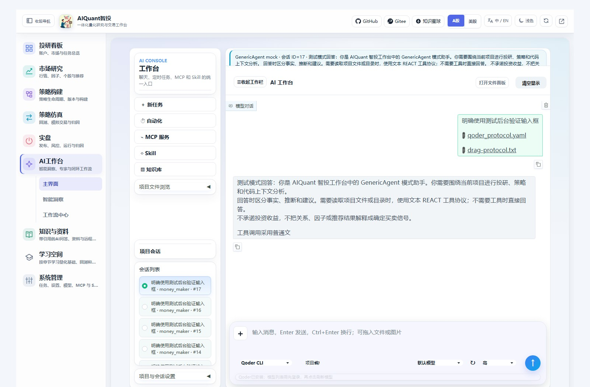
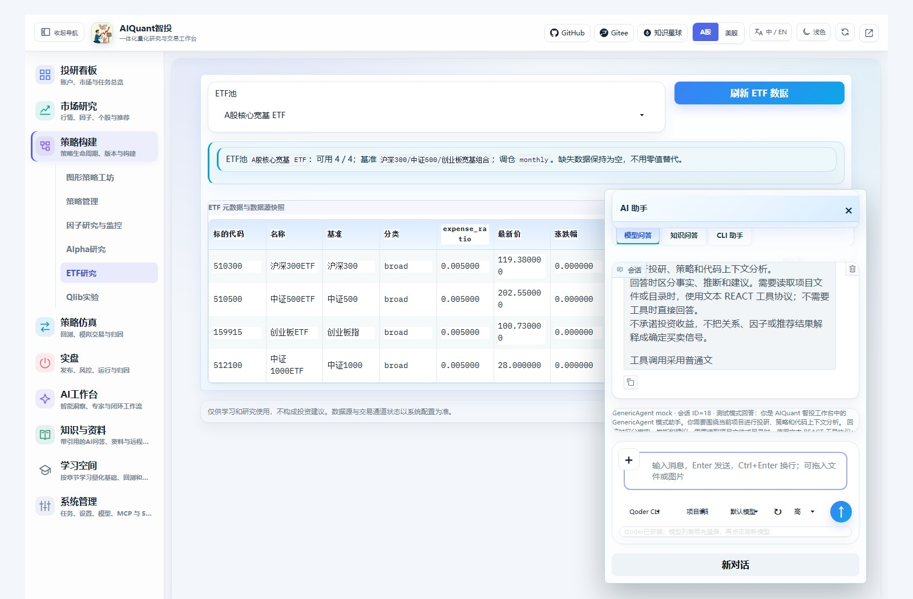
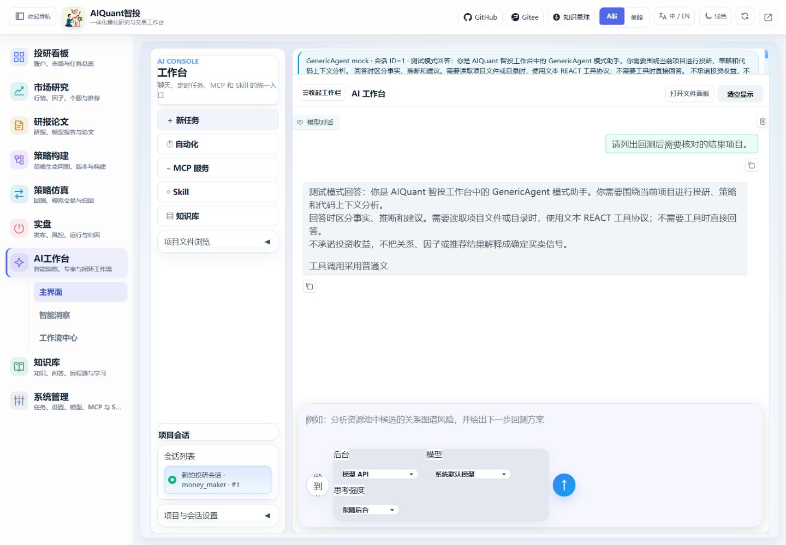
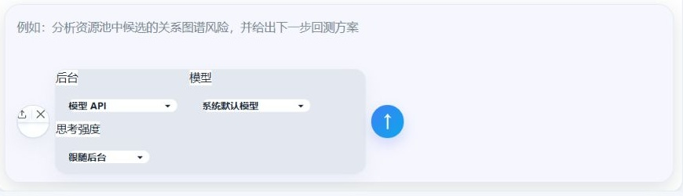
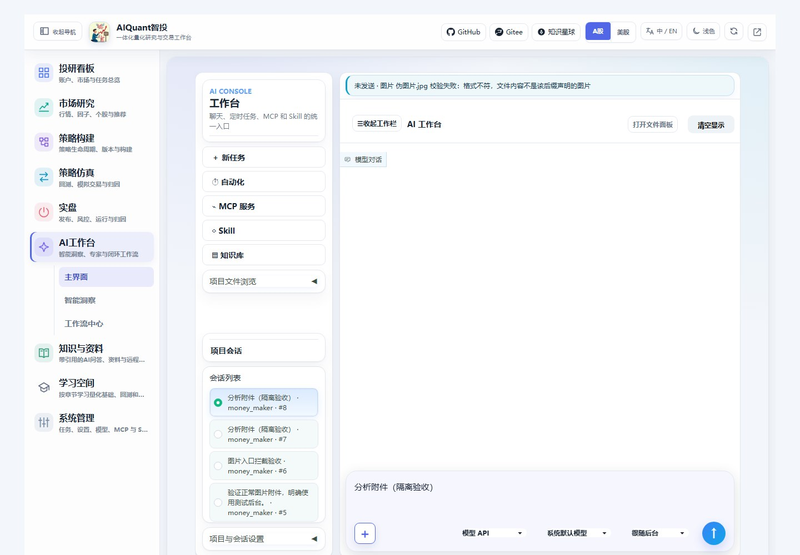
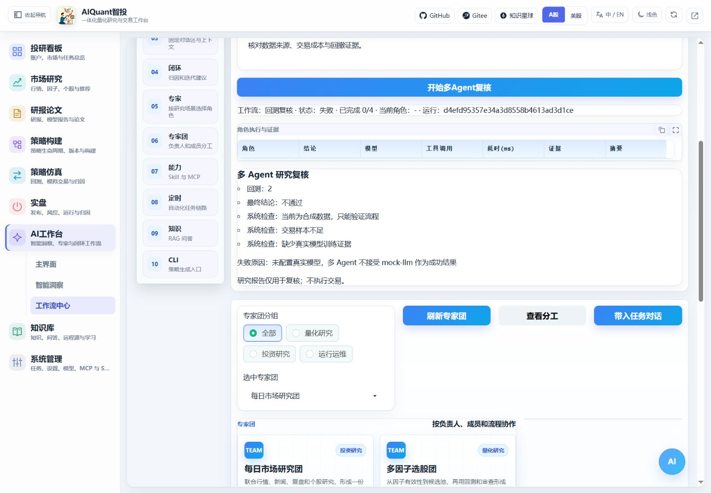

# AI 工作台与悬浮助手

右下角AI入口可切换为本地卡通机器人；重要系统提醒使用右上卡片和顶部铃铛，不占用聊天消息。关闭/回看规则和外观设置见[提醒中心与助手形象](notifications.md)。

扁平输入、Skill首屏、冻结图形定位及新版知识入口见[工作台与量化课程](workspace_learning.md)。2026-10-28更新两处对话框：左下为后端→访问权限，右下为模型→思考强度→发送；正文左侧保留附件图标。Enter发送，Ctrl+Enter换行，Shift+Enter兼容；中文输入法确认不触发发送。占位提示在输入后消失，清空后恢复，不会作为消息发出。

## 先选择对话后台

首次安装、Windows E盘目录、Linux命令和认证排障见[AI CLI安装与接入](cli_installation.md)。先核对工具已安装及已登录，再按本页操作选择后端。

| 后台 | 准备条件 | 实际行为 |
| --- | --- | --- |
| 模型 API / GenericAgent | 在系统配置登记并启用 OpenAI 兼容模型，配置对应环境密钥 | 复用项目上下文和文本 ReAct；当前在调用完成后返回动作与正文，不逐 token 更新 |
| Codex CLI | 服务所在机器已安装并认证；必要时配置ALL_IN_ONE_CODEX_CLI | 默认只读，可显式选择项目编辑；实际sandbox参数及模型/思考强度传给CLI |
| Qoder CLI | 在.env配置ALL_IN_ONE_QODER_CLI、ALL_IN_ONE_QODER_CONFIG_DIR，并使用同一配置目录登录 | 官方非交互事件流；默认只读工具，项目编辑增加Write/Edit；不启用Shell/MCP或绕过确认 |
| Trae CLI / WorkBuddy CLI | 当前尚未接入真实协议 | 返回 unavailable / 未接入，不生成模拟动作或假回复 |

先在“系统管理 → 系统配置”检查模型；命令行可执行 `python egs/entrypoints/cli.py model list --format json`。看到 mock-llm 或“测试模式回答”表示模拟回复，不代表真实模型工作。模型 API 与本地 CLI 是不同后台，启用一个不会自动启用另一个。

mock数据服务默认禁止调用真实CLI。如需在mock行情下验收真实CLI，在启动服务环境中设置`ALL_IN_ONE_ENABLE_REAL_CLI=true`后重启；real行情模式也仍需程序和认证。行情模式、模型来源与CLI是否接通分别判断。Trae/WorkBuddy仍不可用；旧策略CLI产物模拟器不属于此真实对话链。

## Qoder在E盘的安装与登录

本机已安装并核验官方Qoder CLI 1.1.80：`E:/Tools/QoderCLI/1.1.80/qodercli.exe`；配置目录为`E:/Tools/QoderCLI/config`，不修改全局PATH。项目.env只保存这两个路径，不含Qoder凭据。初次状态为未登录；需要本人在终端完成登录：

```powershell
$env:QODER_CONFIG_DIR='E:\Tools\QoderCLI\config'
& 'E:\Tools\QoderCLI\1.1.80\qodercli.exe' login
```

登录后点击模型旁的刷新图标，或等待认证缓存刷新。模型列表来自实际账户；也可输入CLI支持的模型标识，不能用平台API模型ID代替。模型不支持某推理等级时按CLI实际错误处理，不默默忽略。首次探测及显式刷新有超时和缓存，不在页面首屏请求账户服务。其他Windows/Linux机器需要分别配置当地实际路径，本机E盘路径不是跨平台默认值。

访问权限默认只读；模型API没有写入工具，权限字段固定只读。Codex使用实际sandbox，Qoder使用工具白名单与自身权限模式，后者不是操作系统文件沙箱。项目编辑不意味着任意命令或无限制访问。参数在API/业务层再次校验，并写入消息元数据。





## 在主界面完成一次对话



图 11：会话位于左栏下半部；输入区选择后台、模型和思考强度。截图明确显示 mock 回复，仅验证操作与留档。

1. 进入左侧“AI工作台 → 主界面”，点击工作栏“＋ 新任务”。
2. 左下选择后端和访问权限，右下选择模型及思考强度；模型API只显示平台模型，CLI默认跟随自身配置，亦可填写实际模型标识。空值表示跟随后端默认。
3. 输入消息，按Enter或点击发送；Ctrl+Enter在光标/选区处换行，Shift+Enter仍可用，中文输入法组合输入期间不会抢发。
4. 观察状态条与正文。running 表示仍在运行，completed 表示后台已完成，failed、unavailable 或 mock-disabled 要按提示处理；没有产生工具调用时不会出现动作记录。
5. 继续追问会使用已保存的会话历史。项目会话在工作栏下半部，点击已有会话可以载入；刷新或重启后可重新选择会话。

主导航右上角的小箭头图标收起/打开整个功能导航；按钮位于左侧导航栏内部，收起后仍可点击展开，悬停显示说明。工作台中的“收起工作栏”只控制AI内部工作栏。对话区、会话列表和工具面板在各自区域内滚动；“清空显示”不作为删除持久会话的操作。

## 添加文本和图片

成功发送后的附件可点击进入[文件阅读面板](file_reader.md)，项目文件也可在右侧直接打开；Markdown支持保存，Office只读。阅读和保存不会自动向模型重发文件，旧历史没有阅读ID时需重新上传。



图 12：输入区左侧是附件入口，选择后可见清除图标；此处截取实际输入区，已选择项目内 question.txt。图片理解仍需实际支持视觉的后台，不能用模拟回复证明。

在输入框左侧附件入口选择文件，也可以将文件或图片拖入附件区。确认文件列表后再发送。当前默认最多 8 个文件、总计 20 MiB，每个文本附件最多取 24,000 字符；这些上限由 `egs/config/platform/ai_workbench_presets.yaml` 配置。

| 类型 | 当前支持 |
| --- | --- |
| 文本/资料 | CSV、DOCX、JSON、Markdown、Python、PDF、TXT、YAML/YML |
| 图片 | JPEG/JPG、PNG、WebP |

PDF/DOCX 会先提取文本，不提供扫描件 OCR。图片会传给后台，是否理解图片取决于模型本身；mock 回复不能用来验证图片理解。发送后附件列表会清空，消息元数据保留附件数量和名称。

图片会先由项目内独立Pillow13进程校验真实格式、解码完整性、像素、帧数及大小。文本改名.jpg、损坏图和动画会在模型请求前被拒绝；不会以主Web环境的旧Pillow作为备用解码器。失败时状态栏显示“未发送”，保留输入和附件供修改。配置与安装见[独立图片环境](installation.md#image-validation)。



图64：隔离浏览器中给普通文本加.jpg后缀，再按Enter发送，页面显示图片校验失败，此时未调用模型。通过校验的图片按同一份字节内容传给视觉API；CLI读取项目内`data/ai_workspace/validated/`下的校验副本，避免重新打开已被替换的原缓存。副本作为会话附件保留，不自动删除历史文件。

在服务器部署场景，CLI 的附件是客户端文件，经上传后返回标识；不能把客户端文件路径当作服务器已存在的文件。测试时可通过服务进程的 `GRADIO_TEMP_DIR` 将 Gradio 上传缓存放在项目内目录。

## 其他工作区

| 入口 | 使用方式 |
| --- | --- |
| 自动化 | 刷新、手动触发与开关；新增/编辑跳到系统管理的同一任务配置 |
| MCP 服务 | 测试连接、启停与本次调用；登记/编辑跳到系统配置，调用前核对服务和参数 |
| Skill | 本次运行、启停；登记及持久参数统一在系统管理，不执行任意上传代码 |
| 知识库 | 刷新资料摘要，直达知识与资料中的RAG或唯一上传/分类编辑入口 |
| 项目文件浏览 | 展开目录，按需打开文本预览；不支持项目目录外的任意文件 |
| 智能洞察 | “Skill 报告”选择 API 或 Codex，一键执行市场复盘或个股分析，查看过程、HTML 和历史；“每日行情”保留快照入口。见 [Skill 洞察报告](insight_reports.md) |

“工作流中心 → 专家团 → 多Agent回测复核”需要已完成回测和真实可用模型。ETF 工作流额外复核池、流动性、费用、换手及跟踪误差；输出研究报告，不执行交易。



图 16：本图演示准备条件不满足时的失败原因，不是成功报告；配置可用模型后再复核。

## 使用悬浮助手

在普通业务页面点击右下角AI，选择“模型问答”“知识问答”或“CLI助手”。模型问答和CLI助手支持Enter发送；CLI助手可选已安装并认证的Codex/Qoder，Trae/WorkBuddy仍不可用。悬浮CLI按实际事件更新状态，支持多轮上下文；不要把悬浮显示历史当作主工作台的持久会话列表。

## 从命令行使用同一工作台会话

先执行 `python egs/entrypoints/cli.py ai session create --title ETF研究`，读取 data.id；以下 8 需替换为实际 ID。

```text
python egs/entrypoints/cli.py ai ask --session-id 8 --backend codex --message-file egs/config/cli/prompts/question.txt --format jsonl
python egs/entrypoints/cli.py ai session show 8 --format json
```

添加文件用 `--attachment 文件路径`，可重复指定；模型 API 用 `--backend generic --model-id 实际ID`。完整说明见 [命令行](cli.md)。

超时、断流或 Ctrl+C 后先查会话，不立即重发；服务端可能继续执行。若升级后仍出现“needed: 6, returned: 1”或旧消息变成结构串，重启服务并刷新页面，详见 [排障指南](troubleshooting.md)。
