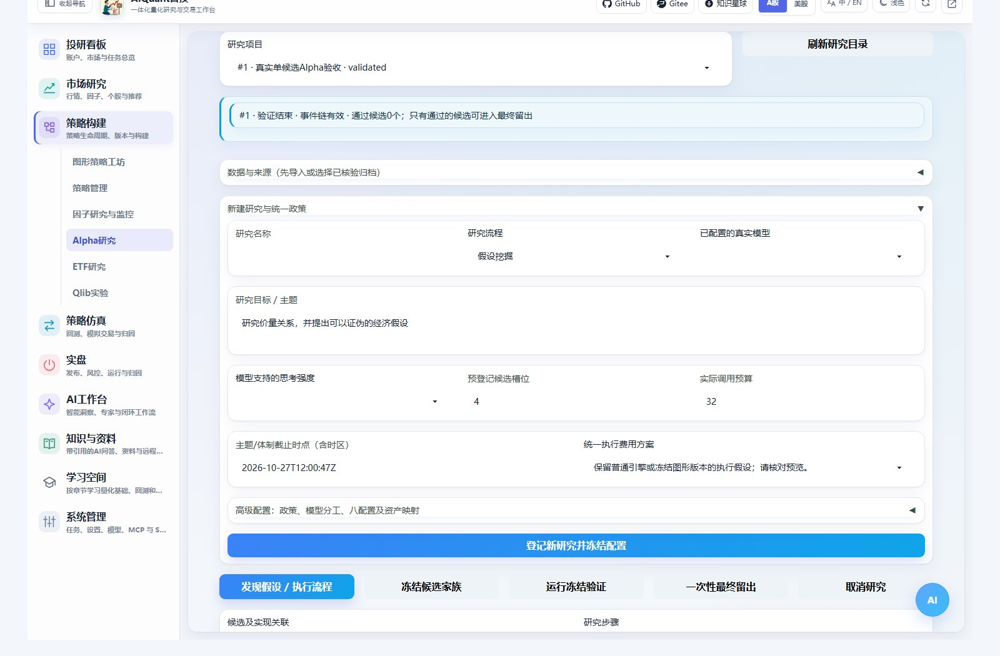
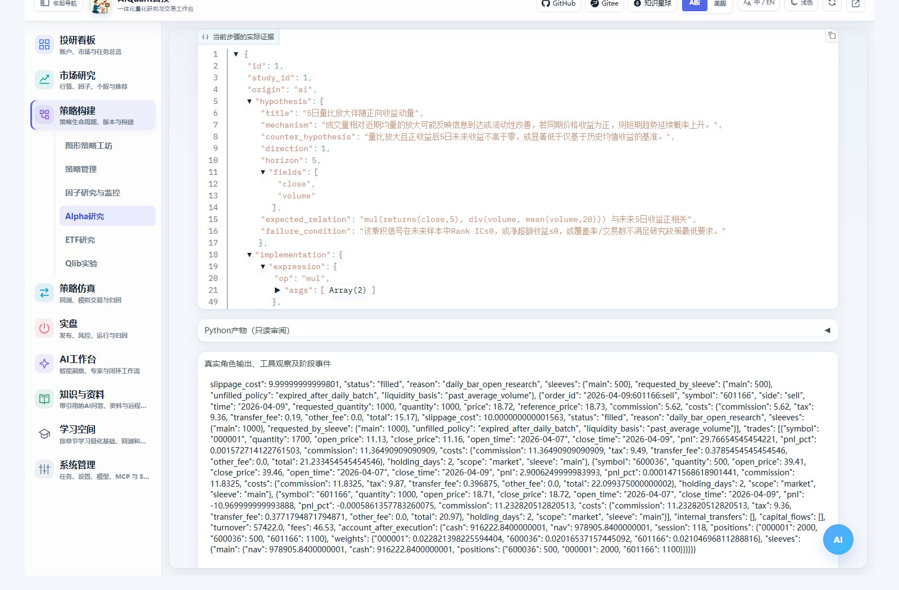
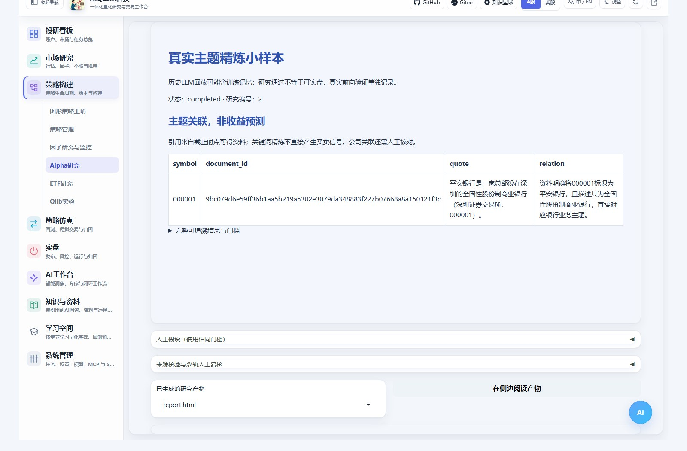
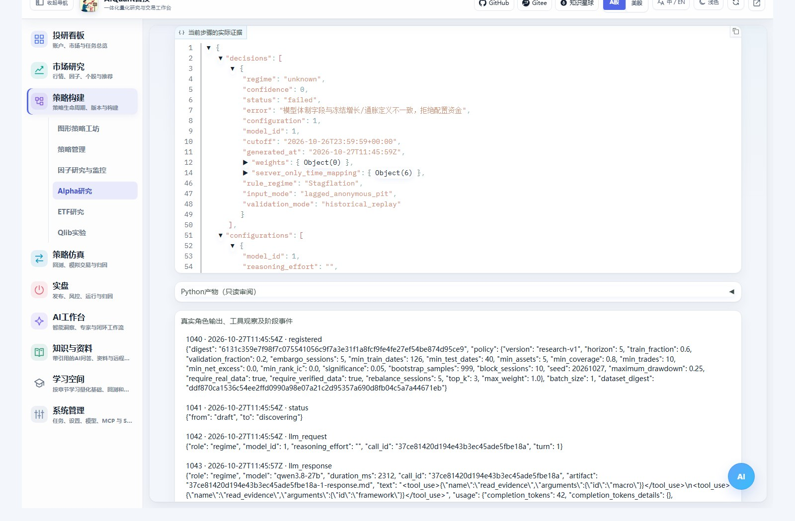
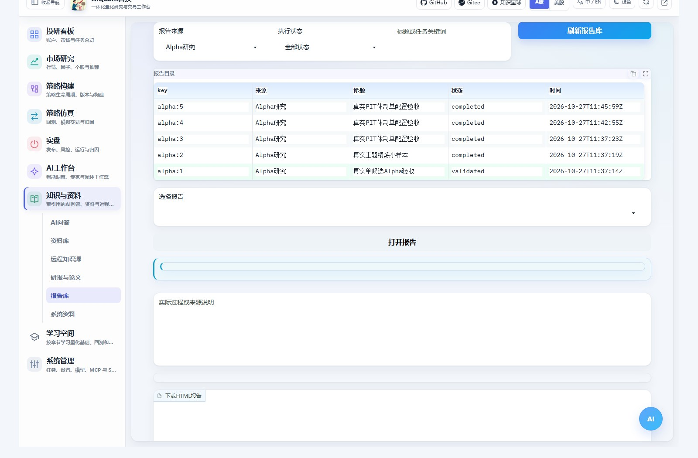

# Alpha挖掘、主题精炼与体制实验

2026-10-29：研究角色新增统一API/CLI选择；不用网页的十个本地研究Skill、按角色覆盖、项目级导出及严格研究可用性边界，见[Agent后端与原生Skills](agent_cli_skills.md)。程序安装与普通对话成功不等于历史研究资格已通过。

入口为“策略构建 → Alpha研究”。AI工作台 → 工作流中心也有同一入口，完成报告收录到“知识与资料 → 报告库 → Alpha研究”。主界面保持Gradio，流程在当前页面执行。

这里有三条独立流程：假设挖掘负责产生和检验可证伪因子；主题精炼负责关键词和公司关联；体制配置负责根据宏观资料分类，再使用冻结权重。它们不能互相替代，也不自动下实盘委托。

## 准备资料与模型



展开“数据与来源”，可以导入UTF-8 CSV、JSON或YAML，也可以填写现有组合行情归档SHA256。页面提供三份空模板下载；源码模板位于`egs/examples/alpha_mining_examples/`，不包含伪装成真实行情的示例行。

| 类型 | 用途 | 必需内容 |
| --- | --- | --- |
| market | Alpha因子与组合账本回测 | symbol、date、OHLCV；可选amount、逐日交易状态和公司行为 |
| documents | 主题及有截止约束的研究记忆 | ID、symbols、text、published_at、available_at、source |
| macro | 历史版本宏观资料 | ID、series、observation_date、value、published_at、vintage_at、available_at、source |

JSON/YAML根对象中分别使用`history`、`documents`、`observations`。行情CSV一行一证券日期；资料CSV的多个证券用竖线分隔；宏观记录必须包含时区，不接受仅有日期的可得时间。系统会拒绝重复日期、非法价格、缺字段、时点矛盾、超量文件和空模板。

用户导入的资料默认未核验。在登记研究前，可在“来源核验与双轨人工复核”中填写复核者及含`reason`、`source_reference`的证据，创建新的已核验数据版本；旧研究仍指向旧版本。来源核验是本地操作者确认，不是第三方认证。服务器已有真实行情归档按摘要核验，不用修改文件名绕过来源检查。

先在系统管理配置OpenAI兼容模型，再在研究中选择实际模型ID。各角色使用普通文本ReAct及json_repair，不要求function calling或厂商结构化输出。无真实模型时明确失败，不能把mock当真实研究成功。

高级配置支持`models`为idea、implement、evaluate指定不同模型，或用default共享同一模型。`reasoning_effort`只用于服务实际支持的强度。支持混合思考开关的兼容服务可显式指定`enable_thinking: false`节约流程验收成本；未填写时不向其他服务添加该参数。此参数是提供方扩展，[DashScope官方说明](https://www.alibabacloud.com/help/en/model-studio/qwen-api-via-openai-chat-completions)。

## 假设挖掘的正常顺序

1. 选择行情母池、真实模型、目标、候选槽位、调用预算和执行费用。高级配置可指定政策及参数；登记后全部冻结。
2. 点击“发现假设 / 执行流程”。Idea Person读取允许的发现期信息，Implementer把假设转为受控计算树和可审阅Python。
3. 点击候选，切换“假设 / 实现 / 验证 / 复核 / 产物”，查看该候选及其相互引用。人工也可在“人工假设”中按同一契约登记候选。
4. 确认候选后点击“冻结候选家族”，再点击“运行冻结验证”。冻结后不能追加、覆盖或调参替换旧候选。
5. 只有通过全部硬门槛与Evaluator的候选，才能明确选择后点击“一次性最终留出”。不能通过换项目、文件名或数据副本重用已消费的重叠留出。
6. 最终留出合格后，经济轨与技术轨分别记录实际人工意见和证据，再导出图形工坊草稿。发布和前向模拟仍在现有工坊/仿真流程进行。



“Python产物”是受控因子定义生成的可审阅适配源码。系统实际调用登记算子，不执行未知LLM自由代码。算子目录不支持的假设会明确失败，不用近似实现冒充完成。

调用预算计算实际模型请求，工具预算也有上限；取消在当前有界网络请求结束后生效，不能保证服务端已经消费的请求立即撤销。刷新页面后可重新选中项目查看已有记录；进程中断不会自动重跑或重新解锁留出。

## 怎么看评估结果

| 指标或检查 | 含义 |
| --- | --- |
| RankIC与IC | 因子与未来目标的横截面关系；不是收益率，也不能单独证明可交易 |
| 日期区块区间及p值 | 按预登记区块处理时间依赖；样本不足或常数序列不会给出虚假显著性 |
| 调整后p值 | 按冻结家族的两个主检验及全部预留候选槽位做Holm校正；失败项不会从分母消失 |
| 费用后净超额 | 实际策略账本与同日期、母池、费用和风险的等权基准相减；不是图中不扣费的价格参考线 |
| 成交与风险 | 佣金、最低佣金、税费、滑点、换手、回撤、未成交和历史能力缺口 |
| 因果与一致性 | 未来数据扰动、证券排列及字段/方向/持有期对齐；不等同于经济机制已证实 |
| 参考因子相关性 | 与运行前冻结的价量因子逐日比较Rank相关，发现重复或反向表达；不等于已证明全策略库增量收益 |
| 策略与基准收益相关性 | 同一实际账本日期上的日收益相关；不能替代扣费后超额及显著性检验 |

验证按日期划分，跨边界标签被剔除并隔离；信号最早在后续开盘执行。资料未复权、固定池幸存者偏差、历史交易状态或权益事件缺失会随报告披露，生产候选不能通过人工意见清除硬失败。

无合格候选是正常研究结果。不能为了显示绿色通过而降低样本、风险或显著性门槛；已读取的重叠验证日期不能再被新项目称为未见验证。模型历史训练记忆仍可能存在，因此历史回放和冻结后前向模拟必须分开理解。

## 主题精炼



选择documents资料，在目标/高级配置中设置theme、manual_keywords和带时区cutoff，运行后查看关键词、排除词、公司、资料ID及原文摘录。不存在的引用、不是原文的摘录或资料范围外公司都会被拒绝。

无LLM词表、人工词表、LLM精炼词表分别列出关联与覆盖；如关联market_dataset_id且词表冻结后行情足够，使用同一账本做费用后对照。不把读取整段资料后得到的词表回填到最早新闻日；关联分数不当成收益预测。无冻结后行情时明确显示不能完成该项对照。

两轨人工确认后，冻结主题池可导入工坊，后续规则/模型生成信号，Portfolio/Risk继续约束资金。只有当前资料时允许当前筛选和前向观察，不伪造历史主题池。

## 四体制与八配置能力



选择macro资料，设置增长/通胀序列、asset_mapping及configuration模型列表。高级配置和完整样例见`egs/examples/alpha_mining_examples/regime_study.yaml`。最多八个配置独立运行；同模型/强度重复配置会被拒绝，模型未配置不静默补齐。

Goldilocks、Reflation、Stagflation、Risk_Off的定义、权重和现金余量在运行前冻结；资料不足或低置信度允许unknown。模型只分类、引用和说明，不能直接改权重。系统提供规则体制及同资产静态股债基准，对照遵守相同费用与风险；实际资金可能因风控及未成交偏离目标。

宏观资料按当时可得版本和滞后过滤，以相对期及受控ID送给模型。日期匿名不能抹去模型对历史事件的记忆。无历史版本时阻断相关验证；美国股债和本地ETF代理必须明确区分。示范权重属于本项目，不是JPM专有参数。

用户要求节约token时，先用单候选、单配置确认流程，再扩大研究；八配置能力不要求每次付费跑满。少调用实测不应描述成八模型收益验证。

## 报告、产物和CLI



报告保存完整失败、调整后显著性、费用与证据引用。页内报告地址随结果版本变化，防止上一阶段内容残留。研究步骤中显示真实角色返回、工具观察与耗时，完整请求/响应和逐次试验保留在对应项目数据目录，不记录API密钥。

“在侧边阅读产物”可用现有阅读器查看Markdown、Python、JSON、HTML。研究产物只读；原件和事件仍留在`data/reports/alpha_mining/`。图形工坊的“已复核Alpha因子 / 冻结主题股票池 / 冻结体制配置”使用同一冻结研究摘要，不能在组件中绕过两轨或修改成另一份产物。

CLI提供alpha命令组：

```powershell
.venv-secure/Scripts/python.exe -B egs/entrypoints/cli.py alpha --help
.venv-secure/Scripts/python.exe -B egs/entrypoints/cli.py alpha import --kind market --file market.csv
.venv-secure/Scripts/python.exe -B egs/entrypoints/cli.py alpha create --file egs/examples/alpha_mining_examples/study.yaml
.venv-secure/Scripts/python.exe -B egs/entrypoints/cli.py alpha run 1 --action discover --stream
.venv-secure/Scripts/python.exe -B egs/entrypoints/cli.py alpha seal 1
.venv-secure/Scripts/python.exe -B egs/entrypoints/cli.py alpha run 1 --action validate --stream
.venv-secure/Scripts/python.exe -B egs/entrypoints/cli.py alpha events 1
```

示例ID需替换。alpha watch恢复读取真实事件，alpha files列产物，alpha file读取有界文本及完整下载链接；alpha review、export与页面遵守同一门槛。配置/查看/导入模板不会调用模型，执行流程才计入预算。

统计与架构边界见[Alpha研究原理](../principles/alpha_mining.md)，机构来源分级保存在研究资料中的Alpha分类。
