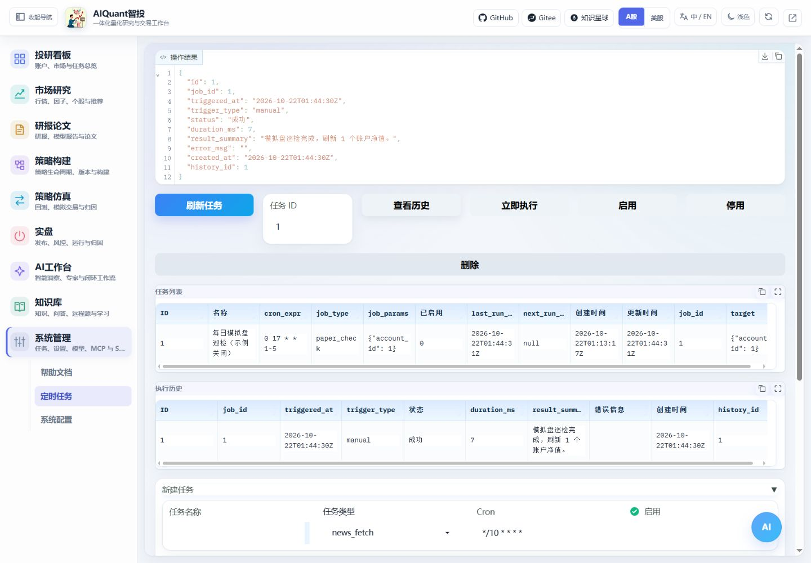
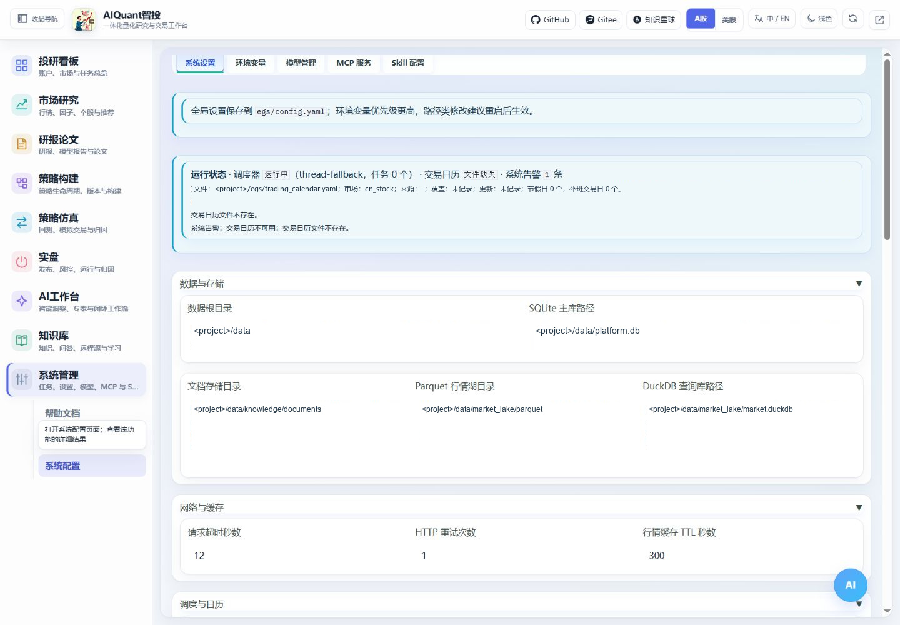

# 自动化与能力配置

## 自动化任务

进入“系统管理 → 定时任务”，也可从 AI 工作台打开自动化工作区。任务启用、手动触发和查看历史是三种不同操作。

图 14：核对任务类型、参数和启用状态，再检查执行历史；未接入的执行体会记录跳过。

1. 为任务填写独立名称、实际任务类型、cron 和业务参数。
2. 初次配置保持关闭，检查运行条件及交易日约束，再启用。
3. 需要立即验证时手动触发一次，读取执行历史的状态、开始时间和失败原因。
4. 涉及行情或模型的任务，还要检查实际来源与产物。手动成功不保证未来定时运行的数据源总是可用。

## 模型、MCP 与 Skill

图 15：配置按用途分区。图中交易日历缺失是隔离环境的真实准备状态，需按提示补齐；密钥不在截图中展示，实际认证信息保存在环境文件中。

| 能力 | 建议操作 |
| --- | --- |
| 模型 | 登记 OpenAI 兼容地址、模型名及密钥环境变量名，启用后测试实际调用 |
| MCP | 登记服务、检查参数、测试连接，再启用；工具可能产生外部动作，执行前核对用途 |
| Skill | 登记描述和参数契约，再按已接入能力运行；登记不等于任意执行上传代码 |
| 系统配置 | 修改全局设置；数据模式、监听及启动相关变更后重启服务 |

普通模型配置、Codex CLI 与平台 CLI 客户端地址互相独立。详细变量见[配置说明](configuration.md)，对话用法见[AI 工作台](ai_workspace.md)。
