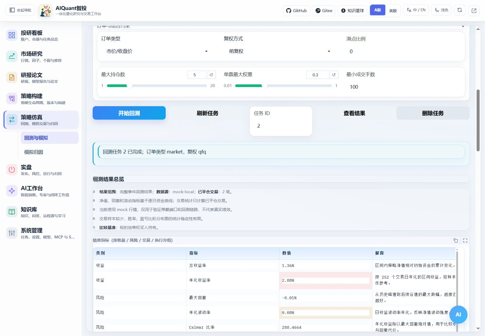
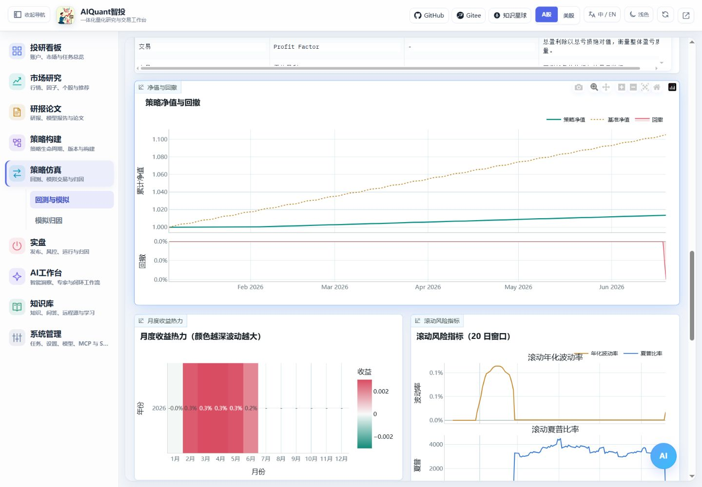

# 回测与结果核对

多阶段筛选或多子策略资金组合请使用[图形策略工坊](strategy_composition.md)。工坊发布的组合策略需要 `composition` 引擎；策略库“一键回测”默认跟随策略，自动识别普通/组合执行器。显式选择不兼容引擎会提前说明。快捷入口、后台任务及实际日期核对见[工作台指南](workspace_learning.md)。

2026-10-26：一键回测状态提供“打开统一回测结果”，携带原任务ID自动读取，不重新提交；运行归因统一在策略仿真中按来源与账户查看。新入口与配图见[统一入口指南](navigation_and_environment.md)。

## 创建回测

进入“策略仿真 → 回测与模拟 → 回测”，选择已导入并启用的策略。首次使用选择“跟随策略”，填写标的、起止日期和资金，核对订单方式、复权、成交数量及仓位限制。普通、一键及图形工坊均有[交易成本与执行假设](backtest_execution.md)，可设置最低佣金、买卖税费、滑点及结算。图形组合保留冻结结构和风控，本次费用覆盖单独保存快照；不覆盖时继承冻结执行参数。

1. 选择参数方案，填写少量本次覆盖，点击“预览生效参数”。
2. 日期必须与当前数据源覆盖相交；真实行情无区间内数据会失败。mock 使用请求区间内工作日的合成数据，并标明模拟来源。
3. 点击创建或开始回测，记录实际任务 ID。执行超时不表示后端取消，应先查已有任务。
4. 完成后核对任务状态与实际来源，再读取结果。

图 6：任务完成只是第一步，还需对照日期、成交和参数。截图是流程演示，不代表实盘收益。

## 按顺序读结果

图 7：比较策略与基准曲线，观察回撤及交易成本；原始曲线日期必须在请求区间内。

| 检查项 | 怎样判断 |
| --- | --- |
| 参数快照 | 策略版本、生效参数、行情摘要、日期和执行假设与本次设置一致 |
| 净值与回撤 | 曲线点数、日期及初始资金合理；基准是标的池等权买入持有 |
| 收益与风险 | 结合最大回撤、波动率、Sharpe/Sortino、Calmar；短样本的年化值可能失真 |
| 成交与费用 | 买卖时间、价格、数量、费用及仓位符合约束；零成交先检查信号和历史长度 |
| 月度与滚动图 | 查看收益是否集中于少数时段；样本不足时不强行解释 |
| 标的归因 | 检查主要贡献和拖累，区分已实现与未实现盈亏 |

展开证据区读取快照、导出成交 CSV，或用两个实际任务 ID 比较。比较参数时固定股票池、日期与费用；条件不同不能只按收益排序。可从结果创建模拟账户，继续[模拟交易](paper_trading.md)。指标定义见[回测原理](../principles/backtest_metrics.md)。

## Qlib 的区别

Qlib 引擎需要当前服务环境内的 pyqlib、qrun、真实 provider 数据和有效 Workflow。当前默认验收环境不满足原生 Qlib 完整运行条件；blocked 记录不表示训练成功。只有逐日组合产物存在时才绘制完整曲线，仅有指标时显示摘要。
