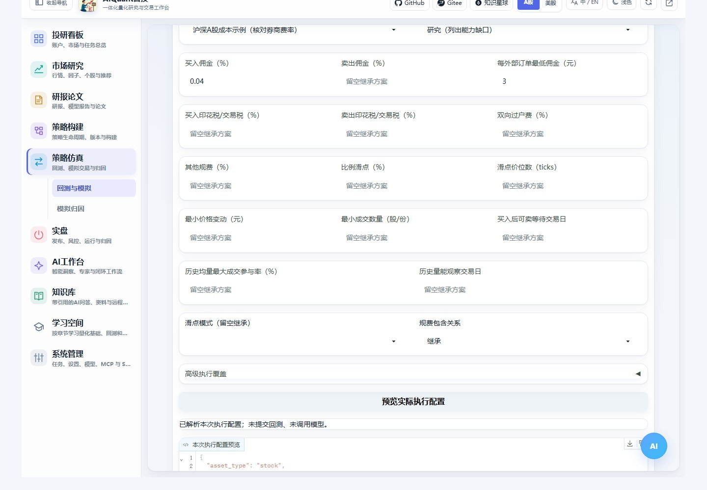
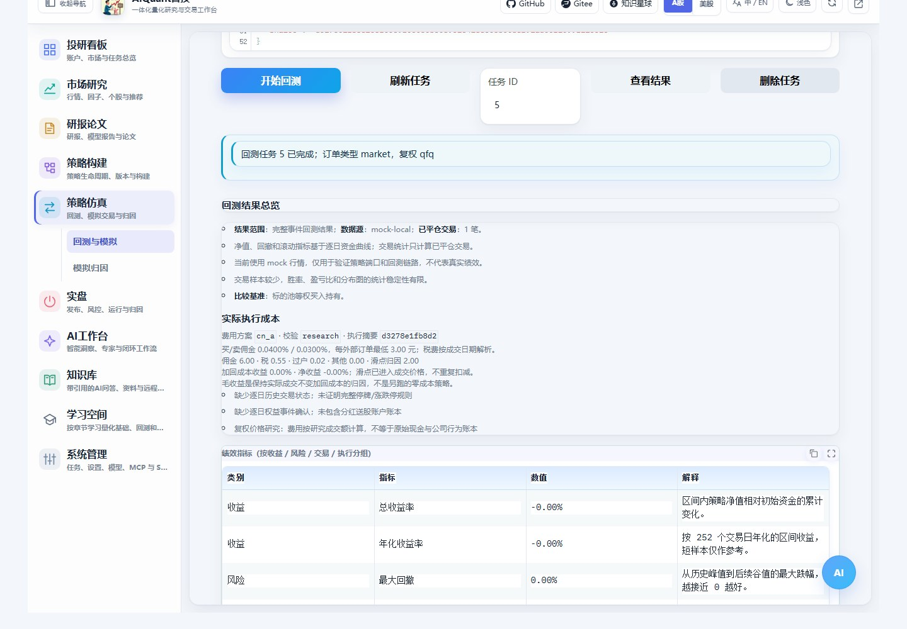
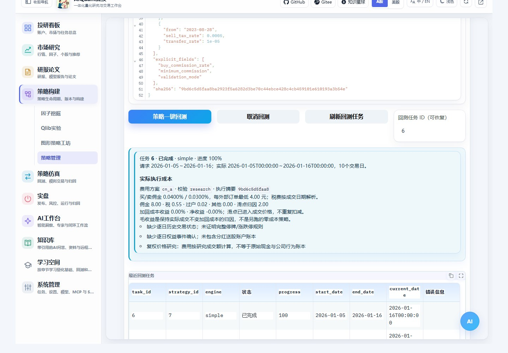
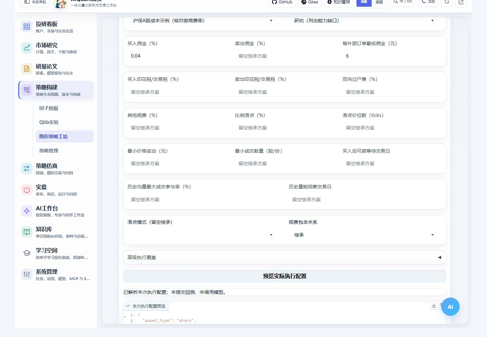

# 回测交易成本与执行设置

普通回测、策略库一键回测、图形策略工坊共用“交易成本与执行假设”。它设置本次实验的成交条件，与策略信号参数分别保存。配图来自2026-10-25隔离mock服务的实际操作；真实行情对照另外留档。

## 在哪里设置

| 入口 | 操作 |
| --- | --- |
| 策略仿真 → 回测与模拟 → 回测 | 填策略、日期和资金，展开费用区 |
| 策略构建 → 策略管理 → 策略库 | 填策略ID及回测区间，展开费用区，再点“策略一键回测” |
| 策略构建 → 策略工坊 | 选择已发布方案，设置“纯量化回测”，展开全宽费用区 |

图46：空框表示继承，输入0才是明确覆盖为零。截图把买入佣金改为0.04%、最低佣金改为3元。

1. 先选费用方案。“继承当前执行配置”保留普通默认值或组合冻结执行参数；A股/ETF是可修改示例；“零成本研究对照”只清除费用和滑点，其他成交约束仍需核对。
2. 百分比框填百分数，例如`0.03`表示0.03%，内部保存为`0.0003`。最低佣金单位元，成交数量单位股/份。
3. 点击“预览实际执行配置”，核对买卖方向、来源、生效区间、日历税费、结算和摘要。预览不会提交回测或调用模型。
4. 提交后在结果中核对“实际执行成本”和参数快照；改变输入不会改写已完成任务。

## 方案与覆盖项

| 设置 | 含义与核对方式 |
| --- | --- |
| 买入/卖出佣金 | 分方向按成交额计收；每个外部订单累计达到最低佣金，不按成交碎片或虚拟子策略重复收最低值 |
| 买入/卖出税、过户费 | 税率方向独立；A股示例按每笔成交日期匹配税费区间，早于覆盖区间会拒绝 |
| 规费包含关系 | 佣金已含规费时，不允许再填非零“其他规费”；需拆分时按实际收费修改包含关系 |
| 滑点 | 比例、最小价位数、无滑点三选一；价位模式结合最小价格变动计算，比例框此时不参与价格计算 |
| 最小价格变动/成交数量 | 适配证券价格档位和买入单位；A股示例100股、ETF示例0.001元不是所有证券的通用规则 |
| 等待交易日 | 买入批次经历指定数量的实际观察交易日后才能卖出；ETF产品可能不同，需自行核对 |
| 历史均量参与率 | 用过去观察窗口的成交量约束当日成交量，不用当天完整成交量预知当天容量 |
| 研究/严格校验 | 研究模式列出数据缺口；严格模式对缺失或不可用的历史交易状态、权益事件确认等阻断 |

配置在`egs/execution_costs.yaml`，包含来源和适用日期。A股示例中的万三佣金、5元最低佣金是示例券商假设，必须按实际合同覆盖；ETF不含申赎费，其可卖规则应按产品检查。高级JSON采用内部小数单位，只接受支持的字段。

## 怎样读费用结果

图47：实际佣金、税、过户费、其他费用和滑点归因随结果保留。滑点已经进入成交价格，不会再扣一遍现金。

“加回成本收益”保持实际成交不变，将费用和滑点归因加回净损益。费用可能改变可买数量、后续信号和仓位，因此它与“另跑一遍零成本策略”不同。对照时应固定数据、策略和其他执行条件，分别创建任务。

图48：一键回测也会保存本次执行配置，可用任务ID恢复结果。本次实测确认最低佣金4元进入了执行快照。

逐笔`execution_orders`保留实际成交、费用类别、外部订单及未成交原因。限价加滑点后超限会拒绝成交，资金不足会缩量或拒绝；期末仍受结算或容量限制的持仓保持持仓，不伪造成已平仓。

## 组合版本与本次实验

图49：费用区在工坊运行设置的全宽区域。实测最低佣金6元生效，运行保留原发布版本ID，单独保存执行费用摘要。

图形结构、模型、Portfolio/Risk等规则变化仍需重新发布；本次回测费用覆盖不改写冻结策略。组合先做内部调拨，再汇总市场订单，共享最低佣金、按实际成交分摊费用。前向模拟账户继续使用冻结执行条件，本轮不允许通过本次费用覆盖修改已有模拟账户。

## API、CLI与其他边界

`POST /api/v1/backtests`及组合运行接口接受可选对象`execution_costs`，如`{"profile":"cn_a","minimum_commission":3}`；佣金率应使用内部小数单位。CLI的`backtest run`与`pipeline run`支持`--execution-costs` JSON，也可把该对象写入`--file`请求文件，按[命令行指南](cli.md)操作，先用`--dry-run`核对请求。

普通任务在`parameter_snapshot.run.execution_costs`保留配置；组合请求保存`execution_cost_snapshot`，结果指标也保留摘要。旧任务没有完整成本拆分时显示旧口径提示，不按新规则重算。

Qlib原生Workflow使用自身费用配置；显式传通用执行覆盖会拒绝，避免界面与原生引擎行为不一致。复权价格研究不能等同原始价格加公司行为账本。严格模式需要完整、按时可知的历史状态与权益事件确认；当前通用历史源缺少部分字段，不能仅切换开关就得到完整实盘模拟。

日K不能还原盘中路径、队列和真实市场冲击。计算与限制见[执行成本原理](../principles/execution_costs.md)，结果阅读见[回测指南](backtest.md)。
