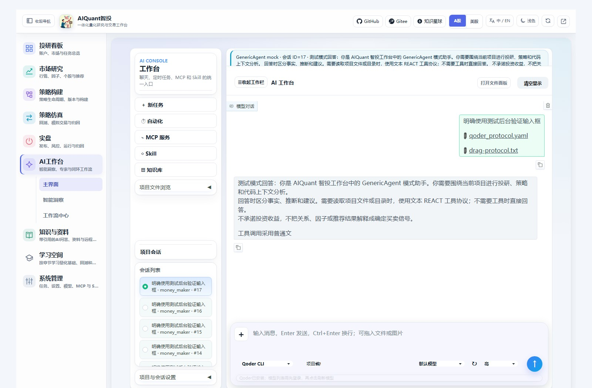

# AI CLI 安装与接入

2026-10-29：研究角色新增统一API/CLI选择；不用网页的十个本地研究Skill、按角色覆盖、项目级导出及严格研究可用性边界，见[Agent后端与原生Skills](agent_cli_skills.md)。程序安装与普通对话成功不等于历史研究资格已通过。

2026-10-29核对。本文说明安装、登录、路径和接入检查；命令需要您在目标机器执行。本轮只更新文档，没有重新安装工具或替您登录。平台自身的 `python egs/entrypoints/cli.py` 用法见[平台命令行](cli.md)，不需要先安装下面所有AI工具。

## 先选需要的工具

| 工具 | 实际命令 | 本项目对话后端 | 安装与认证 |
| --- | --- | --- | --- |
| Codex CLI | `codex` | 已接入 | 原生安装或npm；ChatGPT/API认证 |
| Qoder CLI | `qoder`，部分发行包为`qodercli` | 已接入；兼容`qorder`输入别名 | 原生安装优先；Qoder账户认证 |
| TRAE CLI 2.0 | `traecli` | 尚未接入，页面返回不可用 | 官方安装器；首次启动引导登录 |
| WorkBuddy / CodeBuddy Code | WorkBuddy为桌面应用；官方CodeBuddy CLI命令为`codebuddy` | WorkBuddy选项尚未接入 | 两种产品分别安装、确认账户和配置 |

安装CLI并不等于平台已经接通；`--version`成功也不等于登录成功。模型API/GenericAgent只需平台模型配置，不需要安装CLI。不要把 `openai` API工具、Codex桌面应用的安装或旧策略产物模拟器当作上述对话适配器。

## 安装前准备

在运行量化服务的同一台机器安装。远程浏览器不能直接调用您个人电脑的CLI；Windows服务也不能直接执行WSL中的Linux程序。使用WSL时，量化服务、CLI与认证应同在WSL环境中。

选择原生包时按官方平台/CPU架构下载。使用npm方式前先检查Node.js与npm；Qoder兼容npm安装要求Node.js至少20，CodeBuddy要求至少18.20，其余以各自当前官方要求为准：

```text
node --version
npm --version
```

Windows需要程序和配置均放E盘时，优先采用后文的原生包或npm指定prefix方案。厂商默认安装器可能写用户目录和PATH，不保证全部内容都落在E盘。本文中的E盘路径是示例，Linux请改为实际目录。

## Codex CLI

安装方式以[OpenAI官方Codex CLI文档](https://learn.chatgpt.com/docs/codex/cli)为准。Windows可使用官方PowerShell安装器，macOS/Linux可使用官方原生安装器；下面提供两种系统均可采用的npm入口：

```text
npm install -g @openai/codex
codex --version
```

希望Windows安装包位于E盘，可在PowerShell使用独立prefix与缓存，不修改npm全局配置：

```powershell
npm install --global --prefix 'E:\Tools\CodexCLI\npm' --cache 'E:\Tools\CodexCLI\npm-cache' @openai/codex
& 'E:\Tools\CodexCLI\npm\codex.cmd' --version
```

上例的`.cmd`是npm生成的启动入口，仅用于终端。**平台Windows子进程适配器应指向实际原生`codex.exe`**，不要把`.cmd`或`.ps1`填到ALL_IN_ONE_CODEX_CLI。可以在安装目录检查原生程序，也可从官方页面进入原生发行包下载，解包到E盘；程序名称、内部路径以该发行包为准：

```powershell
Get-ChildItem -LiteralPath 'E:\Tools\CodexCLI' -Filter codex.exe -Recurse
```

如果该npm版本没有包含可直接使用的原生exe，请采用官方原生包。选择确认过的exe，先在同一终端验证并登录；以下假设已将其放为`E:/Tools/CodexCLI/bin/codex.exe`：

```powershell
$env:ALL_IN_ONE_CODEX_CLI='E:\Tools\CodexCLI\bin\codex.exe'
& $env:ALL_IN_ONE_CODEX_CLI --version
& $env:ALL_IN_ONE_CODEX_CLI login
& $env:ALL_IN_ONE_CODEX_CLI login status
```

登录方式及远程设备登录见[OpenAI认证文档](https://learn.chatgpt.com/docs/auth)。浏览器回调不便时可按官方说明使用`codex login --device-auth`；账号策略可能限制可用方式。不要把API Key或登录缓存粘贴到项目文档或提交到Git。

Linux安装与登录可采用同一npm入口，也可按官方文档使用原生包。若程序未在服务PATH中，在启动服务的终端设置实际完整路径，例如：

```bash
export ALL_IN_ONE_CODEX_CLI="$(command -v codex)"
codex --version
codex login
codex login status
```

Codex认证默认使用自己的配置目录。如果您已经显式配置了官方CODEX_HOME，登录终端与服务进程必须继承相同值；重新指定目录后需要在新目录完成登录，不能只移动exe就认为原认证随之迁移。

当前Codex适配器从**进程环境**读取ALL_IN_ONE_CODEX_CLI，再查PATH；仅写项目`.env`不会自动使这个变量生效。请在上面设置环境变量的同一个终端启动平台，或由您的服务管理器传入。已有有效安装无需再装一份。

## Qoder CLI

官方名称为Qoder；不要按`qorder`寻找未经核验的同名npm包。本项目接受该拼写作为后端别名，实际仍运行Qoder。通常官方安装后的命令是`qoder`，本机使用的独立发行包程序是`qodercli.exe`。

普通安装可按[Qoder官方安装说明](https://docs.qoder.com/cli/installation)执行。Windows PowerShell：

```powershell
irm https://qoder.com/install.ps1 | iex
qoder --version
```

macOS/Linux：

```bash
curl -fsSL https://qoder.com/install | bash
qoder --version
```

这些是厂商默认安装器，不保证安装到E盘。本机已有的E盘安装不需要重复执行。npm兼容方式为`npm install -g @qoder-ai/qodercli`，需要Node.js；官方更推荐原生发行包。

### Windows复现E盘安装

本项目2026-10-28核验的是**1.1.80 Windows x64原生包**，不是承诺它永远是最新版。先读取该固定版本的官方发行清单：

```powershell
$qoderManifest=Invoke-RestMethod 'https://qoder-ide.oss-accelerate.aliyuncs.com/qodercli/channels/1.1.80/manifest.json'
$qoderPackage=@($qoderManifest.files | Where-Object { $_.os -eq 'windows' -and $_.arch -eq 'amd64' -and $_.variant -eq 'standard' })
if ($qoderPackage.Count -ne 1) { throw '未找到唯一的Windows x64原生发行包' }
$qoderTarget='E:\Tools\QoderCLI'
if (Test-Path -LiteralPath "$qoderTarget\1.1.80") { throw '目标版本已存在，请先验证现有安装，不重复覆盖' }
New-Item -ItemType Directory -Path $qoderTarget -Force
$qoderArchive=Join-Path $qoderTarget 'qodercli-1.1.80-windows-x64.zip'
Invoke-WebRequest -Uri $qoderPackage[0].url -OutFile $qoderArchive
$qoderActualHash=(Get-FileHash -LiteralPath $qoderArchive -Algorithm SHA256).Hash.ToLowerInvariant()
if ($qoderActualHash -ne $qoderPackage[0].sha256) { throw '发行包SHA-256不匹配，停止安装' }
Expand-Archive -LiteralPath $qoderArchive -DestinationPath "$qoderTarget\1.1.80"
& "$qoderTarget\1.1.80\qodercli.exe" --version
```

仅用于Windows x64。脚本不修改全局PATH，也不删除已有目录。上次核验的包SHA-256为`73f2aaf70c17b6ff192158f709ae49889230dc0a8ed4ce71805e8e138740d76f`；安装时仍以对应固定版本官方清单核对。

### 配置目录、登录和平台路径

在项目根目录的`.env`中补充或更新以下两项，保留原来的其他配置；不要覆盖整个.env文件：

```dotenv
ALL_IN_ONE_QODER_CLI=E:/Tools/QoderCLI/1.1.80/qodercli.exe
ALL_IN_ONE_QODER_CONFIG_DIR=E:/Tools/QoderCLI/config
```

Qoder适配器支持从进程环境、`.env`、`.env`依次读取这两个变量，已有更高优先级值会覆盖.env。登录时Qoder使用自己的QODER_CONFIG_DIR，所以要在同一目录完成认证：

```powershell
$env:QODER_CONFIG_DIR='E:\Tools\QoderCLI\config'
& 'E:\Tools\QoderCLI\1.1.80\qodercli.exe' login
& 'E:\Tools\QoderCLI\1.1.80\qodercli.exe' status --output json
```

本机最近一次已归档状态为未登录，不代表执行本文时的实时账户状态；以status输出为准。Linux路径示例如下，配置目录要与平台中的ALL_IN_ONE_QODER_CONFIG_DIR一致：

```bash
export QODER_CONFIG_DIR="$PWD/data/qoder"
export ALL_IN_ONE_QODER_CONFIG_DIR="$QODER_CONFIG_DIR"
export ALL_IN_ONE_QODER_CLI="$(command -v qoder)"
qoder --version
qoder login
qoder status --output json
```

如果该发行版本使用`qodercli`命令，请相应替换。另一种官方交互登录入口是启动Qoder后执行`/login`。认证方式和配置目录含义见[Qoder认证文档](https://docs.qoder.com/cli/authentication)。登录完成后重启平台或等待认证缓存刷新，并点击模型旁刷新按钮。

## TRAE CLI 2.0：独立使用，本项目未接入

当前官方命令是`traecli`。不要将TRAE IDE里的终端启动命令或第三方同名npm包当作官方CLI。官方[快速开始](https://docs.trae.cn/cli_get-started-with-trae-cli-2?lang=zh)列出的Windows安装方式：

```powershell
irm https://trae.cn/trae-cli/install_v2.ps1 | iex
traecli --help
traecli
```

Linux：

```bash
sh -c "$(curl -fsSL https://trae.cn/trae-cli/install_v2.sh)"
traecli --help
traecli
```

首次启动按终端界面完成账户登录、目录信任及必要的沙箱初始化。官方建议Windows优先使用WSL2；如果平台跑在原生Windows，不能因此假定它已获得WSL里的TRAE能力。登录状态用`traecli login status`核对。

以上是默认安装方式，未在本轮验证指定E盘的安装参数；不要给安装脚本拼上未经官方核验的目录开关。安装成功后目前仍只能独立终端使用；本项目的Trae选项继续返回未接入，不存在可填写后就自动生效的ALL_IN_ONE_TRAE_CLI配置。

## WorkBuddy与CodeBuddy Code

### WorkBuddy桌面应用

从[WorkBuddy官方入门](https://www.codebuddy.cn/docs/workbuddy/FirstTask)进入下载页，选择对应系统版本。在Windows安装向导选择安装位置；需要E盘时，可在向导提供目录选择的版本中设置为`E:\Tools\WorkBuddy`，再按应用指引完成扫码登录。

不要假定安装桌面端后PATH里就有`workbuddy`命令，也不要复制第三方教程中的固定内部app目录。桌面程序、内置引擎与独立CodeBuddy CLI的入口和认证是否共享，应按实际发行版本确认。本项目的WorkBuddy对话后端尚未接入；复制Skill文件也不等于接入它的CLI。

### CodeBuddy Code CLI：单独安装和验证

如果需要腾讯官方的命令行工具，可按[CodeBuddy Code安装指南](https://www.codebuddy.cn/docs/cli/installation)安装。Node.js要求至少18.20，Windows和Linux的npm命令相同：

```text
npm install -g @tencent-ai/codebuddy-code
codebuddy --version
codebuddy
```

首次运行按界面选择账户站点/企业域并完成认证，流程见[官方快速开始](https://www.codebuddy.ai/docs/cli/quickstart)。也可在官方安装页选择原生发行方式；本项目没有在本轮安装或验收CodeBuddy。

Windows需要npm程序和用户配置分别放E盘时，可以使用以下独立目录；这是独立CLI的终端用法，不是本项目的WorkBuddy适配：

```powershell
npm install --global --prefix 'E:\Tools\CodeBuddyCLI\npm' --cache 'E:\Tools\CodeBuddyCLI\npm-cache' @tencent-ai/codebuddy-code
$env:CODEBUDDY_CONFIG_DIR='E:\Tools\CodeBuddyCLI\config'
& 'E:\Tools\CodeBuddyCLI\npm\codebuddy.cmd' --version
& 'E:\Tools\CodeBuddyCLI\npm\codebuddy.cmd'
```

Linux使用`codebuddy`启动；如需独立配置目录，可设置`CODEBUDDY_CONFIG_DIR`。即使其独立CLI可正常回答，本项目的WorkBuddy候选项仍不可用，不要配置一个虚构的ALL_IN_ONE_WORKBUDDY_CLI变量来代替适配。

## 接入平台并验证



图84为已有隔离服务操作图，用来定位左下后端/权限与右下模型/强度；其中mock回复不是CLI安装或认证证据。主工作台与悬浮窗使用同一配置链路，完整操作见[AI工作台](ai_workspace.md)。

1. 确认工具的版本命令和登录状态分别通过，服务进程使用相同的账户、PATH及配置目录。
2. 修改环境后重新启动平台。Codex显式路径需要传入服务进程环境，Qoder的两项路径可从项目.env读取；子进程不会自动继承您另一个终端刚设置的变量。
3. 在左下选择已接入的Codex或Qoder，保持只读。模型API配置不能代替CLI登录；CLI模型用实际模型名称/标识，不用平台模型ID。
4. 在右侧刷新或选择模型。先用一条“只回复你好，不使用工具”的消息检查正文与状态；这一步可能产生供应商费用，不会因为安装完成自动执行。
5. 确认是该CLI的真实回复，且历史记录包含实际后端；缺程序、未登录、参数不支持或认证超时都应按实际提示处理。

mock行情服务默认不启动真实CLI。确实需要这种组合时，在启动平台前显式设置`ALL_IN_ONE_ENABLE_REAL_CLI=true`；它只打开执行门禁，不安装工具、不替您登录。普通真实行情模式仍需要上述程序与认证。

| 项目变量 | 当前读取方式 | 应填写内容 |
| --- | --- | --- |
| ALL_IN_ONE_CODEX_CLI | 进程环境，再查PATH中的codex | Windows原生exe，或Linux可直接执行的入口 |
| ALL_IN_ONE_QODER_CLI | 进程环境→.env→.env，再查qoder/qodercli | 实际Qoder原生程序路径 |
| ALL_IN_ONE_QODER_CONFIG_DIR | 同上 | 与登录时QODER_CONFIG_DIR相同的目录 |
| ALL_IN_ONE_ENABLE_REAL_CLI | 进程环境 | mock行情下需要真实CLI时显式开启 |

Qoder之外的CLI认证变量也需要由服务进程继承。不要把密钥或token作为命令行明文参数写入文档、截图或Git。

## 常见问题与更新

| 现象 | 检查与处理 |
| --- | --- |
| 终端能用，页面找不到 | 终端和Web服务是否同机/同一系统；是否继承PATH；是否已重启服务 |
| Windows报WinError 193或找不到程序 | Codex/Qoder应配置实际原生exe，检查是否误填npm的.cmd/.ps1或目录 |
| Qoder已登录，页面仍提示未登录 | QODER_CONFIG_DIR与ALL_IN_ONE_QODER_CONFIG_DIR是否一致；是否有更高优先级环境变量覆盖；刷新或等待缓存 |
| 认证检查失败或超时 | 与未登录区分；检查原生CLI状态、代理/网络和运行目录，不用反复发消息来测试 |
| 模型或思考强度被拒绝 | 选择该CLI账户实际支持的标识和等级，先使用后端默认值 |
| Trae/WorkBuddy安装后仍不可用 | 这是项目尚未实现协议适配，不是重新安装就能解决 |

更新时沿用原安装方式，先记录旧版本和配置目录，再按官方升级流程操作。原生发行包不要直接覆盖另一个版本目录；安装新版本后先验证，再切换平台路径。Codex/Qoder本地缓存的认证和账户凭据不是可分享的安装附件，不在本文提供删除或迁移命令。

本文列出的安装方式按2026-10-29的官方页面核对；仅本机已有Codex与E盘Qoder属于已验证的程序，Trae/CodeBuddy为官方安装指引，Linux未做本轮实机安装。安装命令本轮均未执行。
