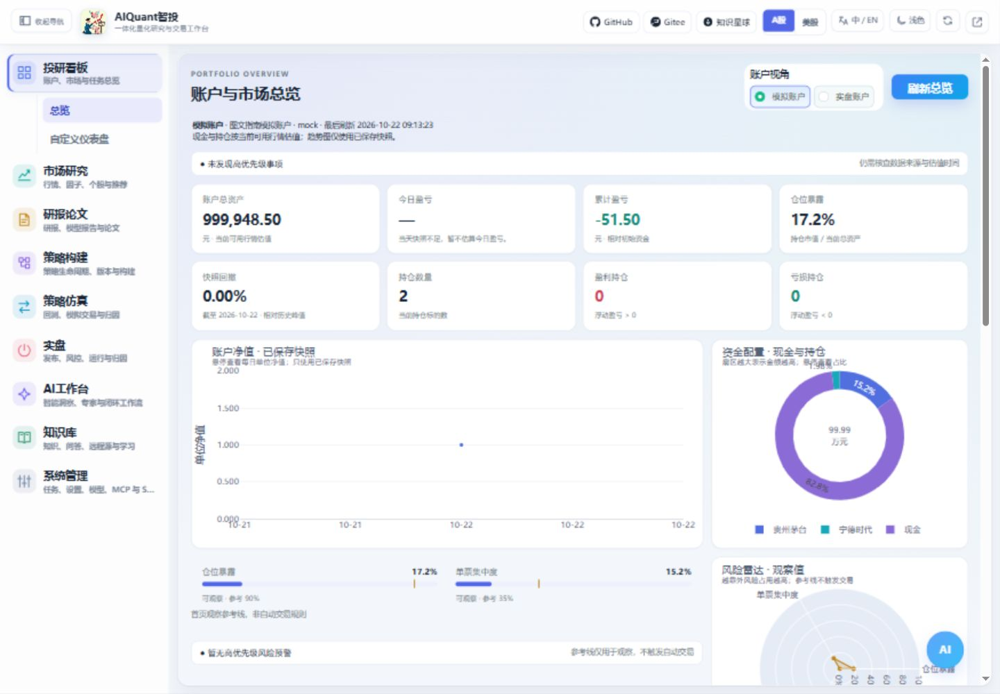

# 总览与图表

## 前置条件和入口

启动服务后，进入“投研看板 → 总览”，先选择模拟盘或实盘视角。没有对应账户、持仓或行情时，页面显示缺失提示；不要把空白当作资产为零。

图 1：先看当前账户与风险状态，再看净值、市场和新闻。截图的数据模式见[截图来源](assets/screenshots/README.md)。

## 推荐查看顺序

1. 核对账户视角、来源与更新时间，再看高优先级事项和风险提示。
2. 查看资产、仓位、持仓总数和盈亏数量。浮动盈亏是当前持仓相对成本的变化，不等同于今日盈亏。
3. 查看净值/回撤、资金配置、板块强弱与持仓盈亏图。图表悬停可以查看数值与解释，参考线仅作观察。
4. 查看情绪代理雷达、风险雷达、新闻及主题热词。代理指标不构成自动下单信号。
5. 需要核查明细时展开“完整数据与历史明细”，对照持仓、订单、任务及风险记录。

## 怎样判断结果

红色为正收益或上涨，绿色为负收益或下跌；蓝色一般表示金额、规模或普通状态。颜色必须结合图例与文字读取。新闻默认最多显示 8 条，实际数量取决于当前来源和时间范围。

账户指标与持仓图应使用同一估值时点。切换市场或账户后重新核对状态；外部源超时、无账户和未回传资产都有不同提示。计算口径见[回测与指标](../principles/backtest_metrics.md)，数据缓存见[数据原理](../principles/data_pipeline.md)。
