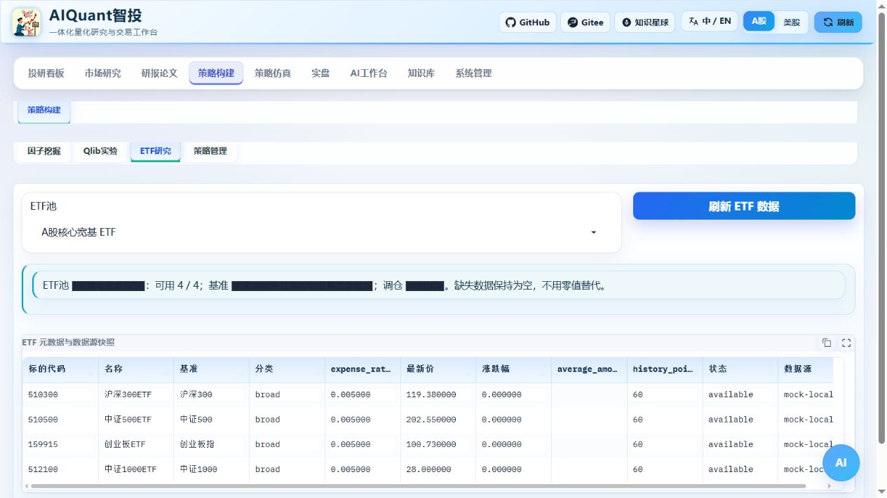

# ETF 研究与回测

The current panel is Strategy Build → Strategy Management → ETF Research.
Old `view=etf` links still work. Fund data, presets, REST and CLI capabilities
remain available; ETF no longer has a separate sidebar entry.



图 9：选择池并刷新，分别检查历史点数、状态与来源；本图 mock-local 仅演示快照，不代表真实基金估值。

先在“策略构建 → 策略管理 → 预制策略”选择ETF示例；ETF池元数据专页可直接从左侧“策略构建 → ETF研究”进入。选择池并点击“刷新 ETF 数据”，页面展示基准、类别、费率、最新价格、历史点数、平均成交额和数据源状态。available表示行情可用，missing_history或unavailable表示证据不足；空值不补零。新入口见[统一入口配图](navigation_and_environment.md)。

目前提供：

- ETF 相对强弱轮动：按回看期排名，在调仓周期到达后用下一交易日开盘执行。
- ETF 趋势配置：用延迟移动均线趋势差进行持有/退出判断。

在“预制策略”导入示例后，到“策略库”检查和启用。参数方案提供 ETF 基准和低换手对照。回测标的应与 ETF 池一致，订单类型选择开盘价；快照保存池标识、参数、执行和数据来源，绩效结果另包含换手与跟踪误差。

## 命令行闭环

先启动服务，在另一个终端查看池和快照：

```text
python egs/entrypoints/cli.py etf universe list --format json
python egs/entrypoints/cli.py etf snapshot cn_core --format json
python egs/entrypoints/cli.py strategy examples import --example egs/examples/strategy_examples/etf_momentum_rotation_strategy.py --name ETF轮动研究 --format json
```

保存返回的 strategy_id，替换以下 12；回测样例的日期也应调整到当前数据源实际覆盖的区间。

```text
python egs/entrypoints/cli.py strategy enable 12
python egs/entrypoints/cli.py backtest run --file egs/config/cli/requests/etf_backtest.yaml --set strategy_id=12 --format json
```

在需要真实来源时加 `--require-real`；该选项只核对来源证据，不代表基金元数据完整或策略盈利。结果查看、导出及参数对比见 [命令行](cli.md) 和 [策略调参](strategy_parameters.md)。

当前跟踪误差指策略净值相对“标的池等权买入持有”的日收益差年化波动，不等于基金对官方指数的正式跟踪误差。正式评估仍需基金成分、申赎、价差、规模、容量和官方基准数据。

在 AI 工作台“工作流中心 → 专家团”选择“ETF策略投研复核”，四个角色会检查 ETF 池、基准、费用、流动性、换手、回撤和跟踪误差。报告只用于研究，不能自动下单。

模型未配置时的实际提示见 [AI 工作台复核示例](ai_workspace.md)。没有真实模型不能将 mock 回答当作复核通过。

CLI 使用 `python egs/entrypoints/cli.py agent review --backtest-id 42 --workflow etf_review --objective 核查ETF换手与成本 --model-id 3 --format jsonl`；42、3 分别替换为已完成回测和真实模型配置 ID。没有可用模型时会失败，不用模拟结论代替真实复核。
