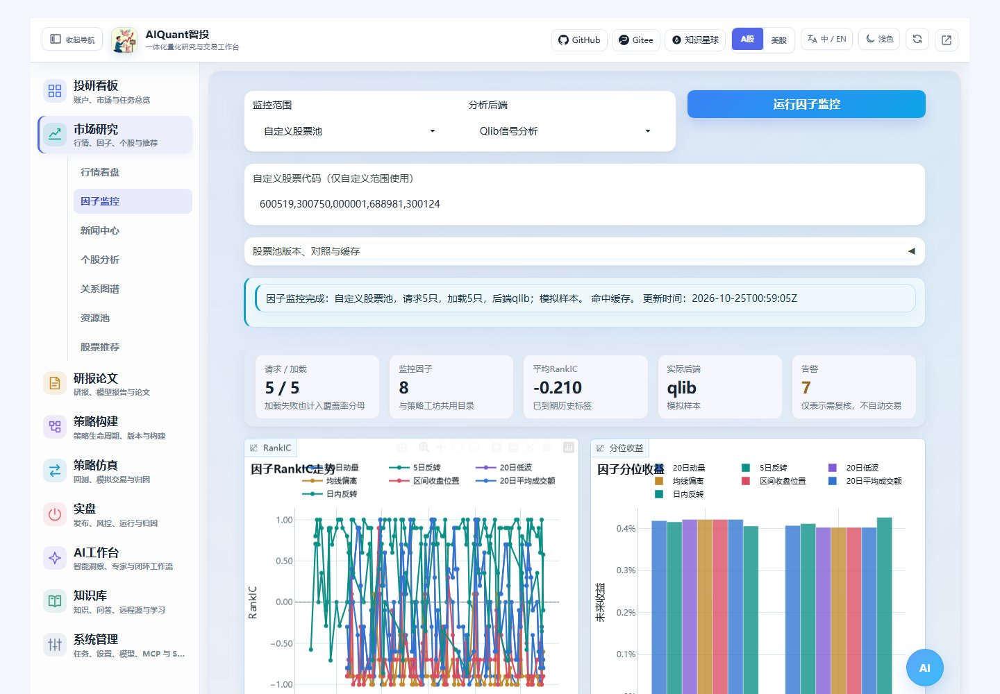

# 通用因子监控与 Qlib

从左侧“策略构建 → 因子研究与监控”进入。原市场因子入口和旧链接转到同一页面，不再维护两套监控表单。监控用于研究指定股票池中的因子表现，不自动下单；新入口配图见[统一入口指南](navigation_and_environment.md)。

## 选择范围与后端

1. 选择沪深 300、中证 500、中证 1000、A 股全市场、自选股、资源池、当前模拟持仓或自定义代码。
2. 资源池填写资源池 ID；模拟持仓填写模拟账户 ID。自定义范围输入当前市场的标准代码，A 股保留六位。
3. 选择“内置因子研究”或“Qlib信号分析”，点击“运行因子监控”。页面显示实际行情加载数量、失败情况和计算阶段。
4. 展开覆盖与原始截面、滚动稳定性和多池对照，核对结果。切页不会自动启动全市场行情查询，任务在后台执行。



图 30：隔离 mock 数据上的真实 Qlib 工作进程验收画面。真实行情的对照结果另存验收报告；不要把示例画面当成市场绩效。

当前指数入口读取当前成分，并明确标注“当前成分回看”；不宣称自动获得历史真实成分。资源池不会因为为空而扩展到全市场。股票数量超过配置上限时明确报错，不再静默截取前 12 只。ETF 和股票的适用范围不同，建议分别建池观察。

## 如何看指标

| 内容 | 阅读方法 |
| --- | --- |
| 请求 / 加载 | 加载失败的证券仍保留在因子覆盖率分母中，展开明细查看失败原因 |
| RankIC | 因子排序与随后收益排序的相关性，正值表示同向，适用范围是当前股票池 |
| ICIR | RankIC 均值除以总体标准差，当前监控未年化 |
| 分位收益 | 按有效样本自动减少组数，每组默认至少 2 只；不足两组时不绘制组间收益 |
| 标签到期 | 最近一期 IC 来自已经走完前瞻周期的观察日，不是对今天未来收益的提前确认 |
| 风格暴露 | 当前价量代理因子间的相关性，不是行业/市值中性或完整风险模型 |
| 前后段与滚动 | 固定时间窗口的稳定性观察，不能冒充模型训练后的样本外绩效 |

监控与策略工坊共用八种价量因子。默认前瞻周期为 1、3、5、10 个输入日历交易日，主周期为 5 日；默认读取 252 根日线，实际来源可能返回更少。最低历史样本要求及窗口可在配置中调整。分组收益未扣交易费用，不等于真实可执行收益。

每张主要图都有常驻短提示和“图表说明”，支持悬停、点击或键盘聚焦。雷达面积不是统一风险总分，情绪分数不是上涨概率；不确定时先展开说明。

## 多股票池与历史成员

“股票池版本、对照与缓存”中可选择额外对照池、观察日期和是否跳过结果缓存。不同池分别计算，结果列明历史政策、覆盖率和样本数；资源池对照使用同一个资源池 ID。观察日期必须不晚于今天，过早日期若不在数据源返回范围内会提示数据不足。

需要历史成员时，先通过 CLI/API 登记含证券代码、有效起止日期和数据来源的清单，再填写返回的版本。清单字段示例位于仓库 `egs/config/strategies/factor_memberships.example.yaml`，仅供填写格式参考，不是指数成分证据。

```console
python egs/entrypoints/cli.py factor memberships --file egs/config/strategies/factor_memberships.example.yaml --format json
python egs/entrypoints/cli.py factor start --universe-id csi300 --backend builtin --format json
python egs/entrypoints/cli.py factor job <任务ID> --format json
```

历史成员是用户提供的数据，系统按版本和有效日期隔离，但不会替用户证明来源真实性。内置日历来自行情日期并集；缺失交易日不会用另一日期的价格顶替，日期与标签口径见原理文档。

## 配置 Qlib 分析环境

本轮已在项目内 `.venv-qlib` 实测 pyqlib 0.9.7，依赖清单位于 `egs/requirements/qlib.txt`。主 Web 环境保持独立；Qlib 分析通过单独解释器运行，不修改 conda 包。

`egs/config/strategies/factor_monitor.yaml` 的 `qlib_python` 可填写虚拟环境目录或解释器路径；环境变量 `ALL_IN_ONE_QLIB_PYTHON` 可覆盖。目录形式在 Windows 使用 Scripts/python.exe，在 Linux 使用 bin/python。

当前服务的因子诊断会真实探测该工作进程。Qlib 缺失时，内置监控仍可用；显式选择 Qlib 后出错不会静默回退。此信号分析使用平台提供的对齐面板，不要求每次训练模型或准备完整 provider。

“Qlib实验”和回测页的原生 Workflow 是另一项能力，仍需 qrun、真实 provider、Workflow 与模型依赖；本轮信号分析成功不等于完整原生训练回测已验证。

## 数据与性能边界

结果按股票池版本、观察日、后端、配置和计算实现缓存，默认有效一小时；可明确勾选重新计算。原始因子数值使用项目内增量缓存。重复运行不应仅为刷新页面而重训模型。

当前未自动提供历史行业/市值中性化、真实容量或显著性保证。全市场入口可用不等于已经验收全部证券的行情覆盖和计算耗时；大池应先查看加载失败及样本，再逐步扩展。实际测试结果见项目验收档案，研究口径见[因子监控原理](../principles/factor_monitoring.md)。
