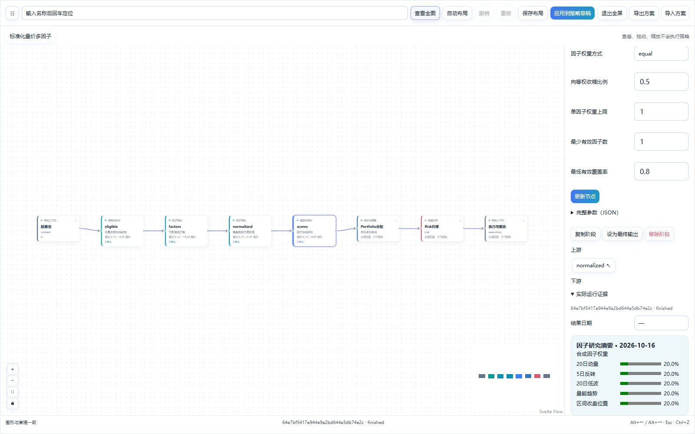
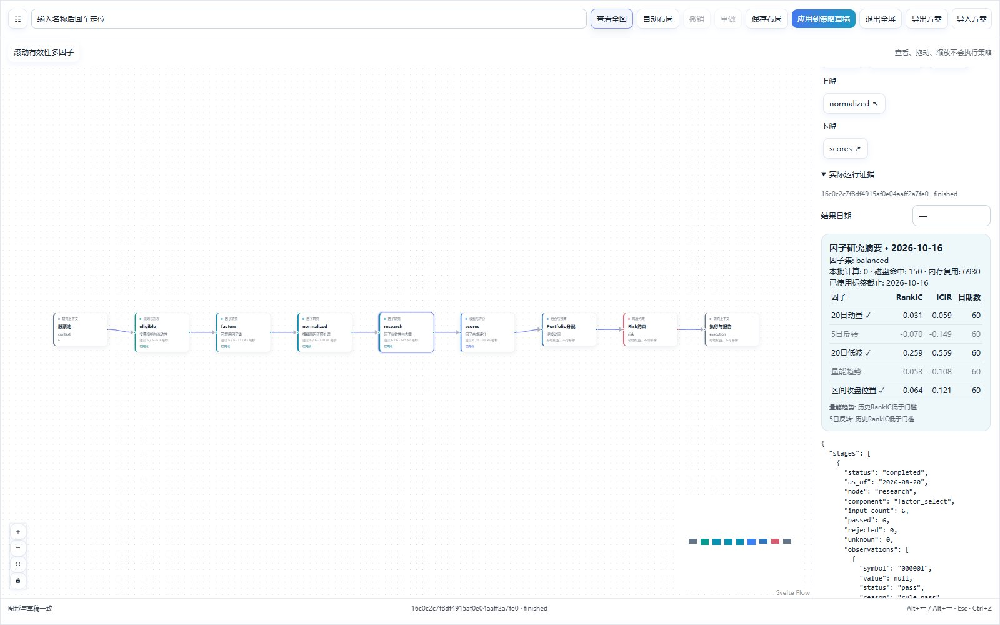
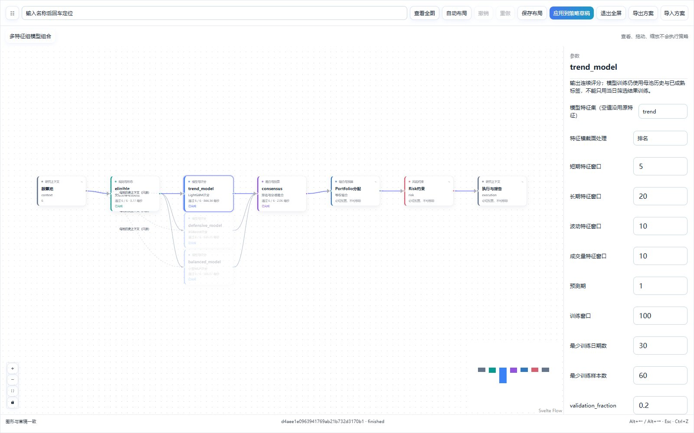

# 因子研究与多特征策略

2026-10-24。入口为左侧“策略构建 → 策略工坊”，继续使用 Gradio，同页操作。本批研究价量因子，不包含真实财务质量、估值或盈利成长数据。

## 从预置开始

| 预置 | 流程 | 先核对什么 |
| --- | --- | --- |
| 标准化量价多因子 | 资格 → 因子集 → 横截面处理 → 等权评分 → Portfolio → Risk | 因子值、当期覆盖、合成权重、实际成交 |
| 滚动有效性多因子 | 资格 → 因子集 → 处理 → 历史研究与去重 → ICIR合成 → Portfolio → Risk | 标签截止、有效日期、入选/排除理由、是否有合格因子 |
| 多特征组模型组合 | 资格 → 趋势LightGBM / 防御XGBoost / 均衡MLP → 排名融合 → Portfolio → Risk | 各模型实际拟合、特征集、验证区间和预测次数 |

选择预置后点击“载入方案”。点击节点查看中文参数、上游和下游；双击子策略进入内部。查看、拖动和参数预览不触发行情、训练或缓存写入。



## 调整因子与研究口径

因子集提供 balanced（均衡量价）、trend（趋势与量能）、defensive（反转与低波），定义在项目 `egs/config/strategies/factor_research.yaml`。登记算子包含动量、波动、量能比、均线偏离、区间位置、平均成交额和日内收益；不执行任意公式或外部 Python。

工坊节点的默认参数在 `egs/config/strategies/strategy_components.yaml`，运行以节点参数和发布预览为准；`factor_research.yaml` 的研究/评分段也供独立研究调用使用。修改YAML目录后先重启服务，再预览和发布新版本。

“横截面因子预处理”逐日去极值后做排名或标准分。缺少窗口或成交量保留缺失；零方差为中性值。

“因子有效性与去重”可配置预测期、研究窗口、最少有效日期、覆盖率、最低平均 RankIC 和相关性阈值。它研究母池历史，不把今天入选的证券误当成历史股票池。样本不足与不合格分别记录，不制造评分或自动扩大候选。



“因子合成评分”支持 equal 和 icir。ICIR 只来自已到期标签，向等权收缩；可设置单因子权重上限。上限必须能容纳所选因子数量，否则明确报错。没有可估计 ICIR 时不把等权伪装成动态权重。

未合成的因子面板不能直接接资金分配、普通规则或投票，需先接“因子合成评分”。合成后可接现有融合、Agent、Portfolio 和 Risk；预测期不同的分支不能直接混合排名。

## 切换模型特征

点击 LightGBM、XGBoost 或 MLP 节点，将 `feature_set` 设置为登记集合，`feature_preprocess` 选择 rank 或 zscore；留空保持原有价量特征。各分支可以使用不同集合，无需复制模型代码。



训练证据包含集合、因子名称、冻结定义、训练/验证和标签截止、实际拟合与预测次数。时间划分继续清除训练标签与验证期重叠。

## 运行与复现

1. 修改后点击“应用到策略草稿”，再预览和发布；发布版本保存因子定义与预处理口径，目录改动应发布新版本。
2. 选择“纯量化回测”，填写日期和可选行情快照 ID，执行方案。历史回测默认不调用今天的 Agent。
3. 点击节点查看实际值、覆盖、研究、权重、排除和耗时。研究摘要标明对应日期；选择其他日期时查看该日阶段及事件，不能把末次摘要当作当日结果。
4. 核对 HTML 的研究相关性图、因子权重、净值、回撤、订单、成交、费用和现金。RankIC 不是收益率，研究分组收益不含组合成本。

CLI 复用现有命令：

```powershell
python egs/entrypoints/cli.py pipeline run --template factor_equal --mode backtest --agent-mode off --start-date 2026-05-04 --end-date 2026-10-22
python egs/entrypoints/cli.py pipeline run --template factor_icir --mode backtest --agent-mode off --start-date 2026-05-04 --end-date 2026-10-22
python egs/entrypoints/cli.py pipeline run --template factor_model_groups --mode backtest --agent-mode off --start-date 2026-05-04 --end-date 2026-10-22
```

上述日期是验收区间，使用时按数据可得范围选择。相同发布版本、参数和行情快照可核对网页与 CLI 的净值、目标、订单、成交和费用；两个实时抓取批次不能作为严格一致性对照。

原始因子缓存在当前 data 目录的 `factors/panels.sqlite`。追加日期复用历史值，行情修订按实际窗口摘要失效；不加载 pickle。缓存损坏明确阻断。

默认行情上限仍为 240 根日线，固定池、未复权及未计公司行动边界仍存在。小样本通过不能证明实盘盈利；应先补可靠长历史，再研究复杂模型。方法见[因子研究原理](../principles/factor_research.md)。
