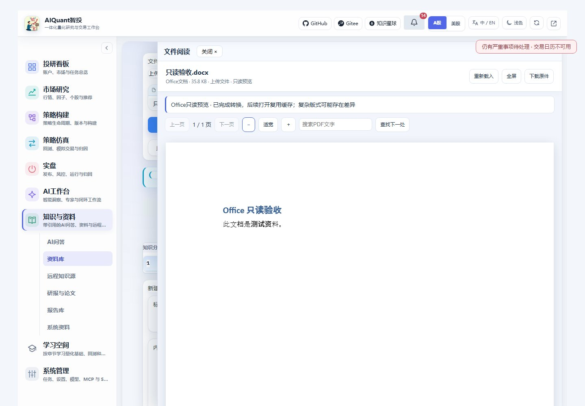
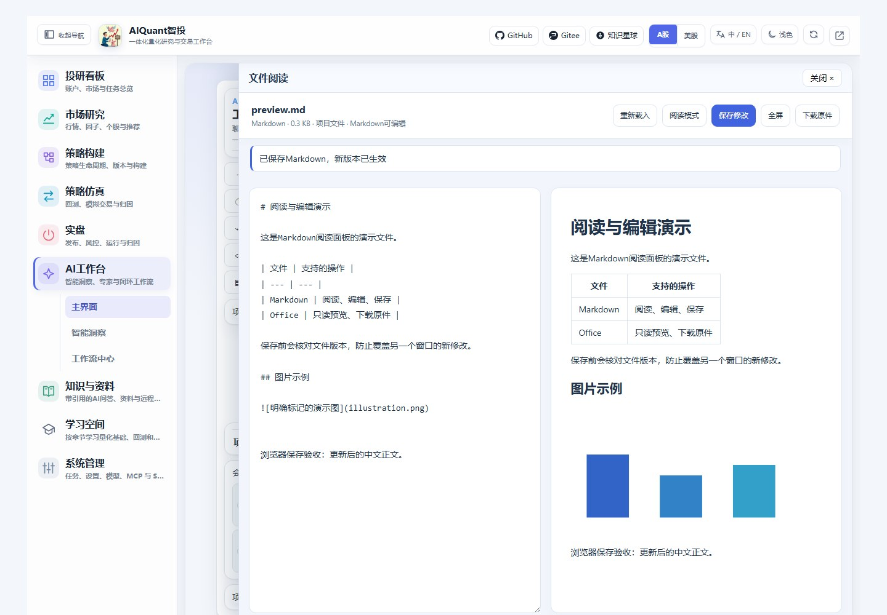
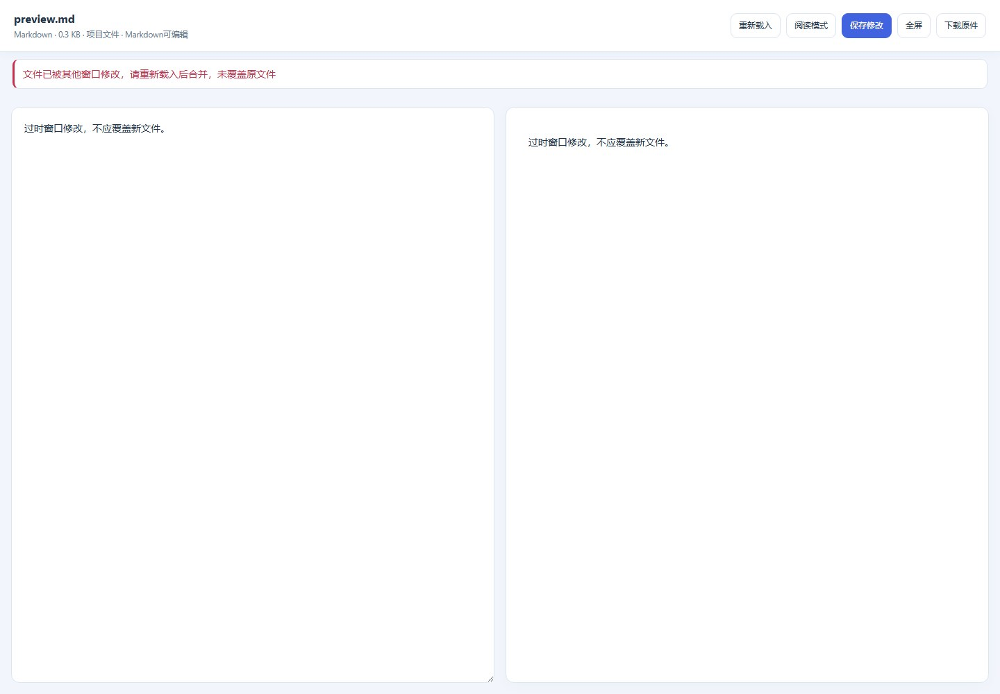
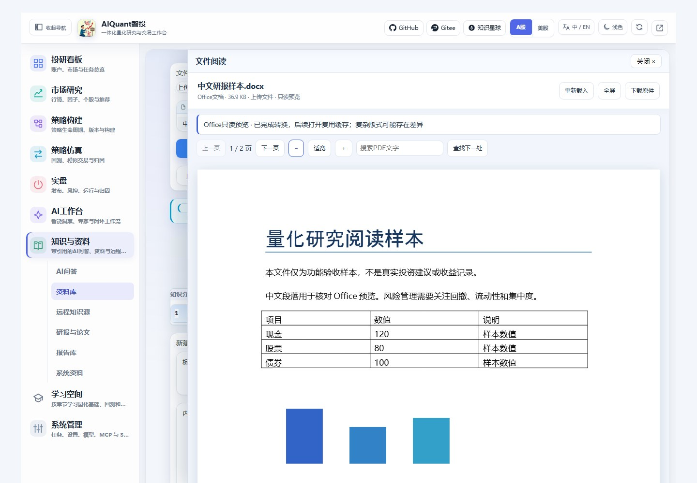
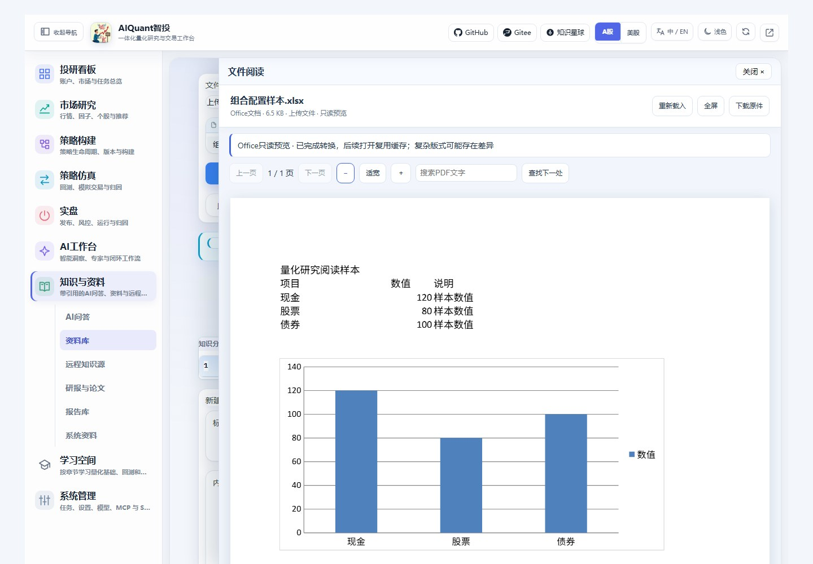
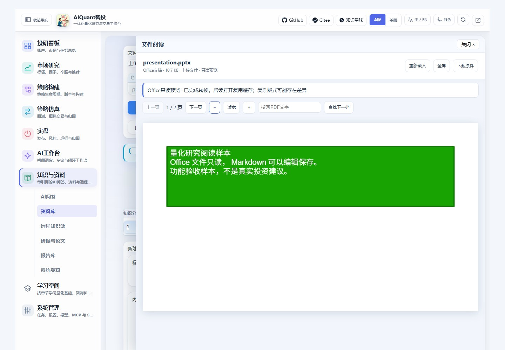
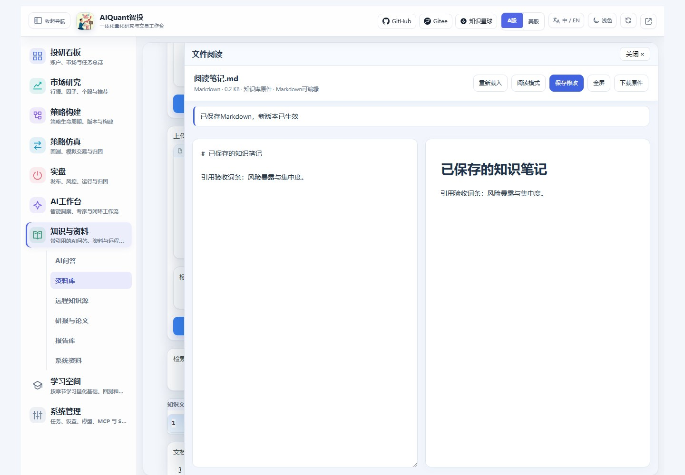
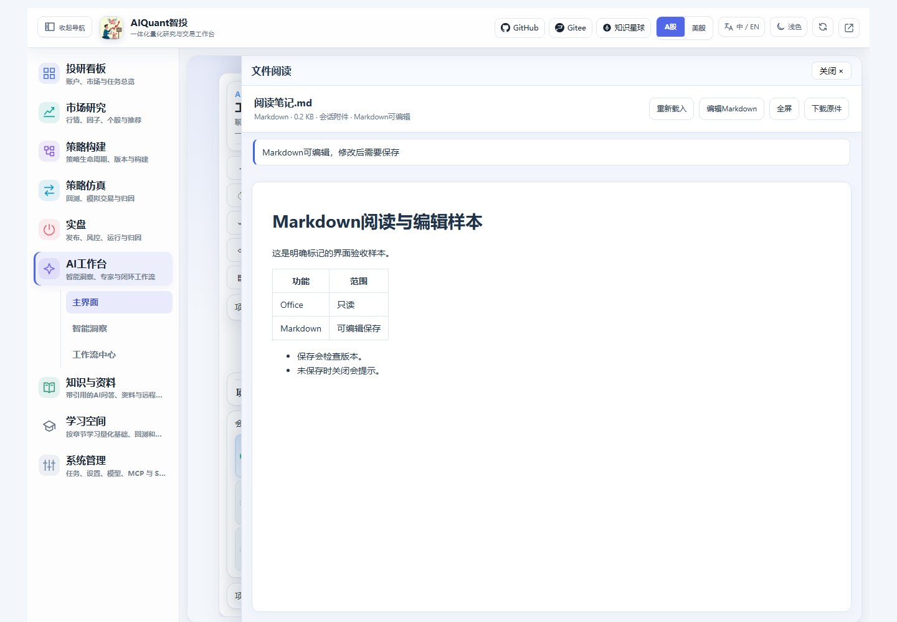
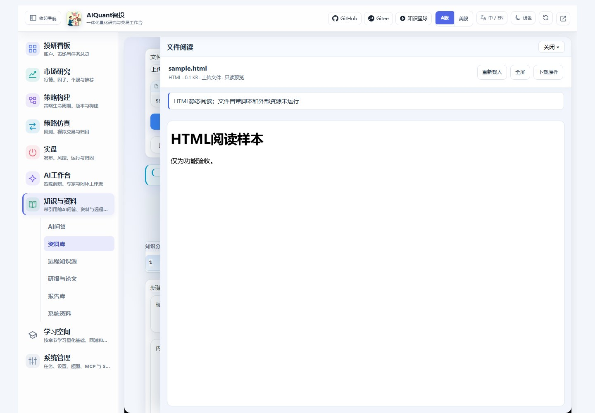
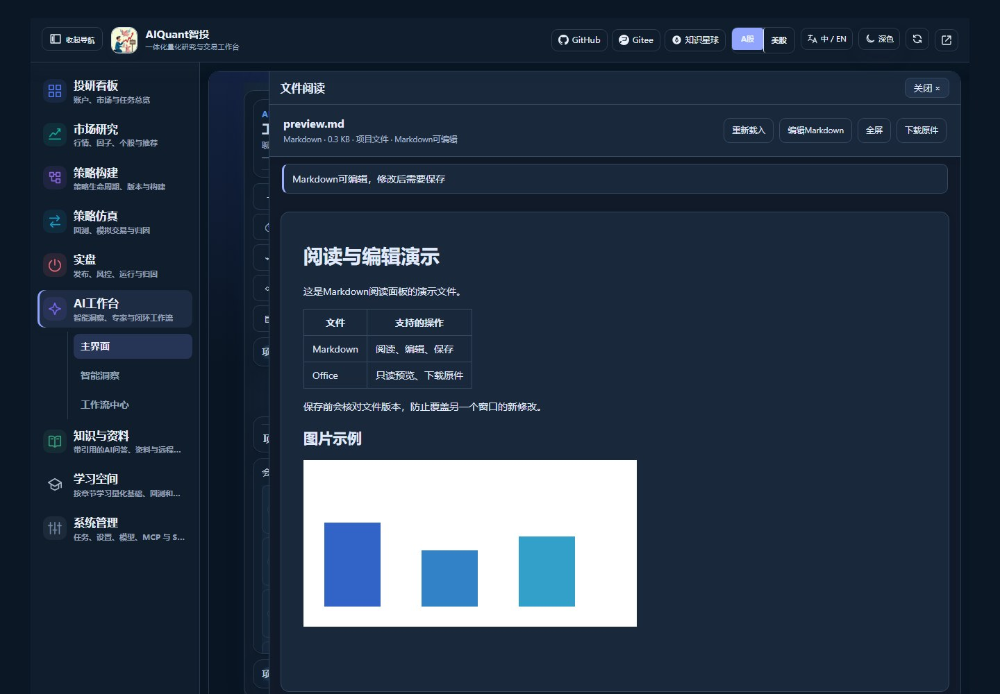

# 文件阅读与Markdown编辑

2026-10-31：阅读面板的“关闭”按钮位于左侧标题旁，避免右上持续严重提醒挡住关闭操作；可关闭的通知卡片仍通过卡片叉号收起。Markdown保存、HTML脚本隔离和Word实际转PDF已在浏览器复测。



图97来自隔离服务的实际Word转PDF预览，文档内容明确标记为测试资料；关闭入口与右上严重摘要保持可分别点击。

Office文件只读，Markdown可以编辑保存；其余支持格式提供预览与原文件下载。主界面继续使用Gradio，文件在右侧阅读面板打开，保留原来的会话与导航。

## 从哪里打开

| 文件位置 | 操作 |
| --- | --- |
| 项目文件 | AI工作台 → 主界面 → 打开文件面板；选择或填写项目内相对路径，点击打开文件 |
| 会话附件 | 成功发送后，点击用户消息下的附件链接；旧历史没有阅读记录时需重新上传 |
| 知识库原件 | 知识与资料 → 资料库，填写文档ID，点击阅读原件 / 编辑Markdown |
| 临时阅读文件 | 资料库 → 文件阅读与Markdown编辑，选择文件后点击打开阅读面板；更换文件先点击更换文件 |

上传预览不会自动加入知识库，也不会自动调用模型。AI项目文件面板打开时会覆盖部分会话区域；回到聊天前可点击“关闭文件面板”。阅读面板中的“关闭×”只关闭阅读，不删除文件。

## Markdown编辑与保存



图65：实际浏览器打开项目中的明确演示文件，左侧编辑源码，右侧同步阅读效果。验收修改已通过界面恢复原文。

1. 打开Markdown，默认先阅读，点击“编辑Markdown”进入双栏。
2. 修改后点击“保存修改”；看到“已保存Markdown”后新版本才生效。
3. 点击“重新载入”或关闭面板时，有未保存内容会提示处理。
4. 保存知识库Markdown会同步正文、摘要与检索分块；保存项目文件会实际修改选中的项目Markdown。



图66：第二个窗口持有旧版本时，保存被拒绝，原文件没有被覆盖。重新载入前先复制需要保留的修改，再人工合并；本版不自动合并两份正文。

项目中的任务文档、验收档案及配置的只读区域禁止编辑。代码、HTML、PDF、图片和Office文件没有编辑按钮，直接调用保存接口同样会拒绝。可先用`egs/examples/file_preview_examples/preview.md`练习。

正文支持标题、列表、表格、代码块；项目Markdown可引用受控的本地PNG/JPEG/WebP图片。上传单个Markdown不会自动带上同目录图片，外链和data图片不自动加载。输入支持UTF-8与既有GB18030文本，保存统一使用UTF-8。

## Office只读阅读



图67：真实LibreOffice转换的中文Word功能样本，包含段落、表格、图形和分页，不是真实投资报告。正文与原文件分别保留。



图68：工作簿中的表格和图形转换为PDF页面供阅读，不提供单元格修改。



图69：两页演示样本的只读预览；可以翻页、适宽、缩放和搜索可提取文字。

支持DOC/DOCX、XLS/XLSX、PPT/PPTX及ODT/ODS/ODP。第一次打开由后台转换，界面显示排队或处理中；完成后自动展示PDF，重复打开复用缓存。首次转换可能需要数十秒，文件大小、字体和版式都会影响时延，导航和聊天不等待转换完成。

顶部“下载原件”下载原始Office文件，不是把PDF改名为Office。复杂字体、公式、分页和浮动对象可能与Microsoft Office不同，重要版式仍需对照原件。损坏、加密、超时或格式不支持时会显示失败原因，保留原件下载。

## 知识与会话附件



图70：通过知识库原件入口修改Markdown后，检索已命中新正文；原件、正文和分块关联保存。

新上传到知识库的DOCX/PDF等资料会保留原始字节。历史记录没有原件时，面板明确显示“历史记录没有原件，以下为提取文本”，不能还原旧Word/PDF版式。旧原生Markdown笔记可以编辑，旧Office提取正文保持只读。



图71：实际点击测试会话中的Markdown附件；对话后台明确为mock，验收的是阅读入口，不表示真实模型分析。阅读或保存附件不会自动将更新内容重新发送给模型；需要模型读取新版本时，应重新添加相应文件。

## HTML、PDF、图片与文本



上传HTML默认静态隔离阅读，不运行文件自带脚本及外部资源；依赖脚本生成的内容可能不可见。平台Skill报告在原“智能洞察/报告库”入口继续保留已有的交互图表预览。

PDF提供翻页、适宽、缩放与文字搜索。中文文字按页面位置整理后匹配；扫描PDF没有文字层时仍能阅读，但不能据此提供OCR搜索。图片支持PNG/JPEG/WebP，普通代码、CSV、JSON、YAML等按只读文本展示。



图73：阅读面板跟随工作台主题，支持全屏；PDF纸张保留白色。阅读时暂时隐藏悬浮AI按钮，关闭后恢复。

## 环境与限制

前端资源固定为PDF.js6.4.299、markdown-it15.0.3，本地提供，不依赖外部CDN。Windows在项目根目录使用已配置的独立Python执行：

```powershell
.venv-secure/Scripts/python.exe -B egs/entrypoints/setup_file_preview.py --office
```

脚本校验下载哈希，将LibreOffice26.8.1和解包工具保存在项目`.tools/`；不安装Microsoft Office，不修改系统或Conda包。源码中已经包含固定版本的阅读资源，首次部署仍需准备Office转换器；Windows脚本可以重建本地资源。

Linux可以执行不带`--office`的同一脚本准备前端资源，再通过`.env`的`ALL_IN_ONE_PREVIEW_OFFICE`指向已部署的LibreOffice或项目内便携程序；默认查找`libreoffice`。中文字体需要部署机器提供。本轮Windows已实测，Linux尚未实机验收。

配置位于`egs/config/knowledge/file_preview.yaml`：默认原文件20MiB，Markdown编辑及文本预览2MiB；较大文本提供只读截取及完整下载。Office转换默认60秒、一个工作线程、最多四个未完成任务；转换PDF上限50MiB，阅读上限500页。修改转换器或字体配置后应重启服务并核对预览。

转换缓存、修改前版本和原件位于服务数据目录的`file_previews/`；转换工作区位于项目`.tools/preview_jobs/`。它们保留用于重开与核对，本版不自动删除历史文件。仅能读取允许的项目文件和已登记原件，密钥、数据库、环境、运行缓存等受保护；新的登记/写入接口拒绝跨站网页请求。文件ID不是登录认证，仍沿用平台现有本地部署访问模型。

原理见[文件预览与版本保存](../principles/file_preview.md)，原始选型依据见开发资料中的网页文档预览调研。主Gradio环境既有Pillow37条告警未因本功能消失，见[运行环境说明](navigation_and_environment.md)。
