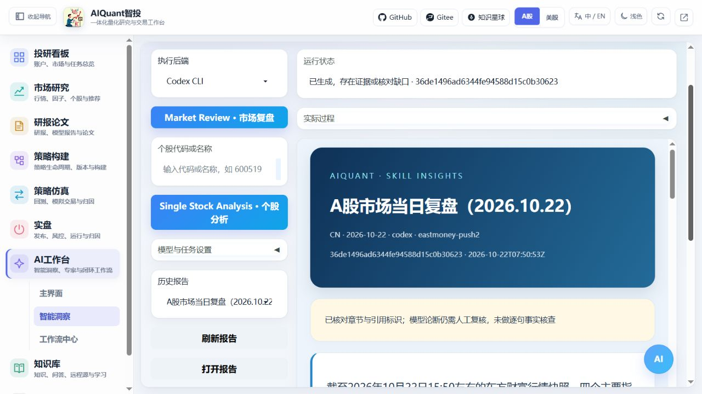
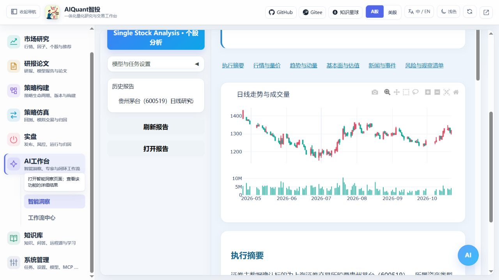
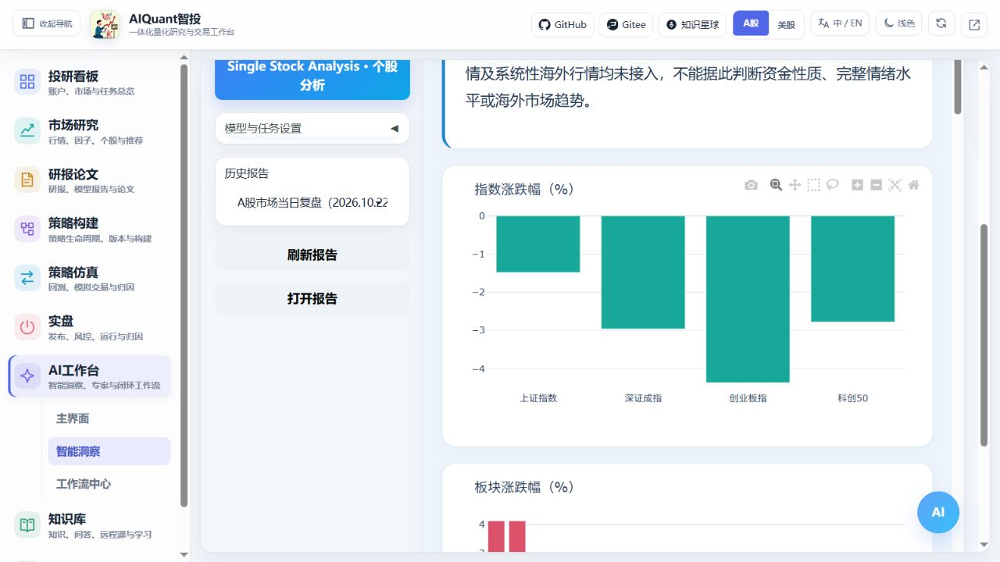

# Skill 洞察报告

2026-10-29：研究角色新增统一API/CLI选择；不用网页的十个本地研究Skill、按角色覆盖、项目级导出及严格研究可用性边界，见[Agent后端与原生Skills](agent_cli_skills.md)。程序安装与普通对话成功不等于历史研究资格已通过。

进入“AI工作台 → 智能洞察 → Skill 报告”，选择执行后端，点击左侧任务。进入页面不会自动采集行情或调用模型。



图 18：2026-10-22 浏览器实际操作，real 行情、本机 Codex CLI。状态“已生成，存在证据或核对缺口”表示文件已生成，仍有缺失数据或待人工核对的论断。

## 操作步骤

1. 选择“模型 API”或“Codex CLI”。API 需要已启用模型及密钥；CLI 需要服务所在机器已安装、认证且可执行的 Codex。
2. 点击 **Market Review · 市场复盘**；分析个股时先填写代码或名称，再点击 **Single Stock Analysis · 个股分析**。任务使用页面已选市场。
3. 需要时展开“模型与任务设置”，选择 API 配置或 CLI 模型名、思考强度、复盘范围和截止日。默认使用所选后端的默认模型。
4. 查看“运行状态”和“实际过程”。工具执行、错误及模型公开返回来自实际事件。长工具结果在页面节选，完整记录可下载 JSONL。
5. 完成后收起过程区，阅读 HTML 的图表、章节、来源和缺失项；图表可缩放，底部证据条目可展开查看原值。
6. 下载 HTML 可离线阅读。点击“刷新报告”，选择历史任务后“打开报告”，可恢复已保存报告和过程，不会重新调用模型。

跨来源浏览请进入“知识与资料 → 报告库”：首次进入自动加载，可按Skill/旧模板、状态及关键词筛选，刷新保留仍存在的选择。缺少HTML时显示文件缺失且不提供下载，原任务状态与过程仍保留。图解见[报告筛选与独立窗口](navigation_and_environment.md#report-library-navigation)。



图 19：实际分析贵州茅台（600519），展示可得日线及成交量。缺少的财务、机构预测和筹码数据不会补成零。

## 结果与边界



图 20：图表直接读取本次证据，涨跌幅以百分比显示，颜色为涨红跌绿。图表可缩放，来源和时点在正文及证据区保留。

| 任务 | 当前内容 | 边界 |
| --- | --- | --- |
| 市场复盘 | 指数、板块最新快照及涨跌幅图，新闻和研究正文 | 无完整指数月度序列；选择近月仍明确提示不足，不能从最新快照推算整月表现 |
| 个股分析 | 证券解析、行情、日线、成交量、均线、RSI、MACD、波动率等实际计算，可得估值和新闻 | 未实现上游全部 23 项指标、筹码追踪和机构一致预期 |

程序检查 JSON、必需章节和引用标识，没有逐句事实核查。模型论断仍需人工结合证据复核，当前生成报告保留 `partial` 状态。mock 行情会标明演示；美股实时源未接通时也标明模拟来源。模型真实执行与行情真实是两个独立维度。

API 采用普通 OpenAI 兼容生成：支持 SSE 时显示实际正文片段，普通 JSON 响应在收到后显示；不请求结构化输出或 function call。Codex 按实际 JSONL 事件更新，正文可能在回合结束时成块返回；不会展示未公开的内部思维。

相同参数的运行中请求复用任务 ID，单服务进程最多同时运行两个任务。关闭页面不取消后台执行，可从历史恢复。服务重启中断的任务在读取时标为失败。当前任务锁在单进程内，部署使用一个 worker。

## 配置与命令行

固定提示词、资源白名单、任务和限制位于 `egs/config/platform/insight_reports.yaml`；本地方法位于 `src/skills/`，来源与 SHA-256 见 `src/skills/provenance.yaml`。运行不依赖 C 盘 WorkBuddy，不执行其固定机器路径脚本，也不读取其私人 token。

启动平台后可执行：

```console
python egs/entrypoints/cli.py insight run --kind market_review --backend codex --format jsonl --deadline 600
python egs/entrypoints/cli.py insight run --kind single_stock_analysis --symbol 600519 --backend api --format jsonl --deadline 600
python egs/entrypoints/cli.py insight list --format json
python egs/entrypoints/cli.py insight show <run_id> --format json
python egs/entrypoints/cli.py insight events <run_id> --format json
```

`--format jsonl` 或 `--stream` 等待实际终态；普通创建立即返回任务 ID，随后查询状态。HTTP 前缀 `/api/v1/insights/runs` 支持创建、SSE、历史、详情、过程及精确文件下载。

“Skill”管理页也已登记两个执行器，该入口需先启用；智能洞察专用按钮可直接执行。服务配置的数据目录下 `reports/insights/<run_id>/` 保留请求、证据、最后一轮实际提示词、正文、HTML 与事件 JSONL。原理见 [AI、CLI 与多 Agent](../principles/ai_agents.md)。
