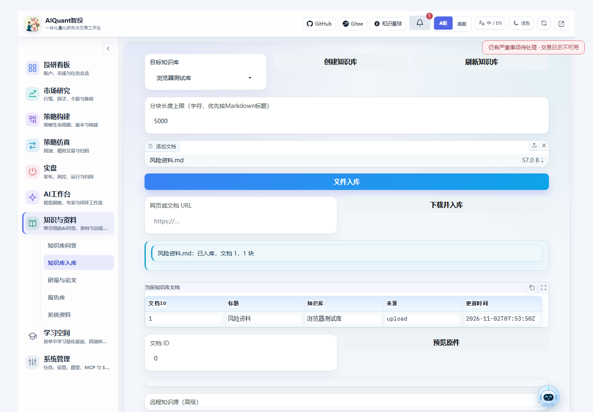
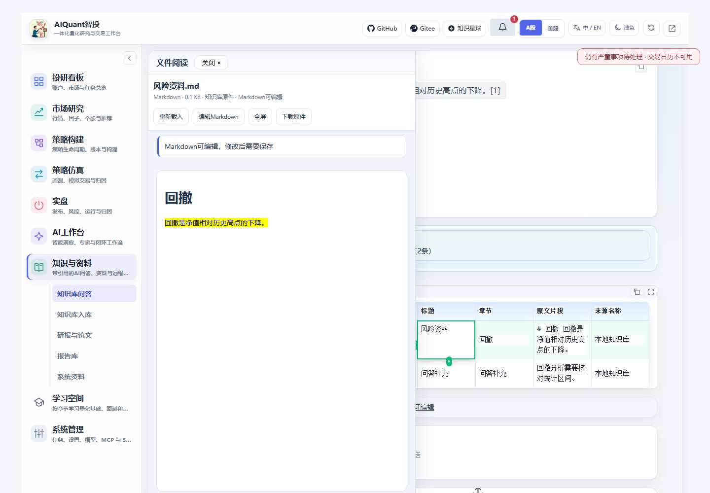
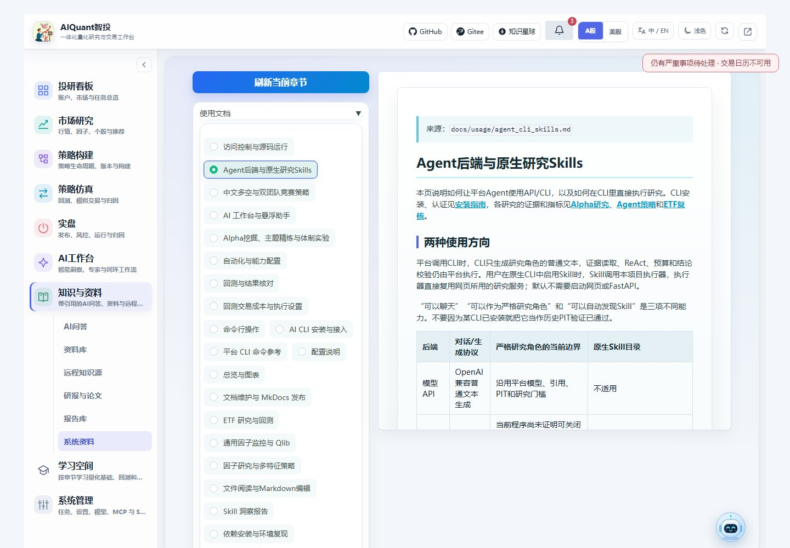

# 知识与资料

知识库业务有“知识库入库”和“知识库问答”两个界面。研报与论文、报告库和系统资料保留各自入口；远程知识源在入库页高级区域。原资料库、远程源和研报链接兼容跳转，AI中的知识入口进入同一问答界面。

2026-11-02实际浏览器验收：创建命名库、上传Markdown并查看入库结果。测试资料与回答使用受控样例。

## 保存与问答

新原件阅读和Markdown修改见[文件阅读指南](file_reader.md)。知识库Markdown保存后同步检索分块；Office原件只读，旧记录没有原件时明确显示提取文本。

1. 在“知识库入库”创建或选择库名。可批量添加TXT、文本PDF、DOC/DOCX、Markdown、HTML，也可填写网页或文档URL并下载入库。
2. 设置分块长度，默认5000字符；优先按Markdown标题划分，超长段落继续切分。DOC需已配置项目内LibreOffice；扫描PDF明确失败，不执行OCR。
3. 在当前库文档列表核对入库结果并预览原件。资料按库保存，检索只使用当前有效分块。
4. 在“知识库问答”选择库和模型，设置最多检索轮数，默认3轮；可添加仅当前会话可用的附件，然后提问。
5. 检查各轮生成的关键词、命中数和引用。点击引用行，在左侧半屏预览原件；窄屏使用全宽。阅读器尝试定位引用文字，PDF可用文字搜索核对。
6. 研报和论文检索页选择目标库，点击“下载研报并入库”或“下载论文并入库”。原有摘要保存操作保留，不能视为全文下载。

模型先生成关键词，zvec-grep按文字检索文件，再根据证据决定补搜或回答；没有新词或达到轮数上限时停止。检索规划失败、证据不足和回答模型失败会分别显示状态。更换库后按当前库恢复会话上下文；附件不出现在公共文档列表。

真实Hy3验收已验证跨文档检索、追问、附件引用和库隔离。关键词按连续文字匹配，同义词应拆成独立项；追问会重新检索原文，历史回答不能代替当前证据。模型与CLI耗时会累积，本次小样本综合问答约112秒、追问约55秒。WorkBuddy本机适配器仅用于验收，产品问答仍通过模型管理中的OpenAI兼容接口配置模型。

首次使用需Node.js 22+、npm及ripgrep，执行项目环境的`python -m egs.setup_knowledge_search`安装项目内固定版本依赖。安装只启用所需词法模块，不启用向量运行库的安装脚本；完整`zg` CLI不作为本功能入口。Python解析依赖随`requirements.txt`安装。配置见`egs/knowledge.yaml`，模型提示词见`egs/rag.yaml`；[检索原理](../principles/knowledge_retrieval.md)说明隔离与预算。

远程知识源需配置实际可用的 MCP 工具，先测试连接，再列目录、拉取或同步；来源缺失时会失败，不生成虚构文档。

2026-11-02实际浏览器验收：问题与会话附件参与检索，点击引用后打开原件并高亮对应文字。截图中的回答由固定测试模型生成，真实使用需配置可用模型。

## 阅读学习资料

“知识与资料 → 系统资料”按“使用文档”和“原理文档”提供正式阅读路线，设计、参考和验收材料保留在各自资料分组。独立“学习空间 → 量化基础课程”包含导读及十二章，支持目录直达与前后章切换；MkDocs课程见[课程导读](../principles/quant_basics/README.md)。

已有章节更新后点击“刷新当前章节”；新增章节及目录变化后重启服务。帮助中心也可直接从“系统管理 → 帮助文档”进入。

图96为2026-10-31隔离服务实测：连续选择不同章节后刷新，当前内容与选择一致，不再丢失章节ID。
