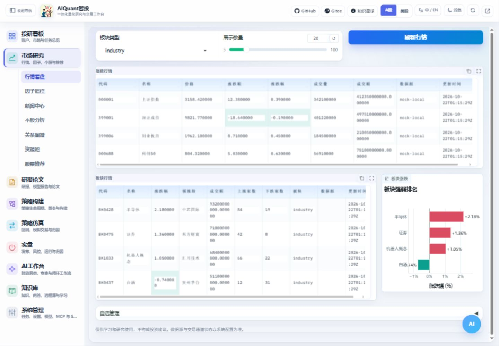
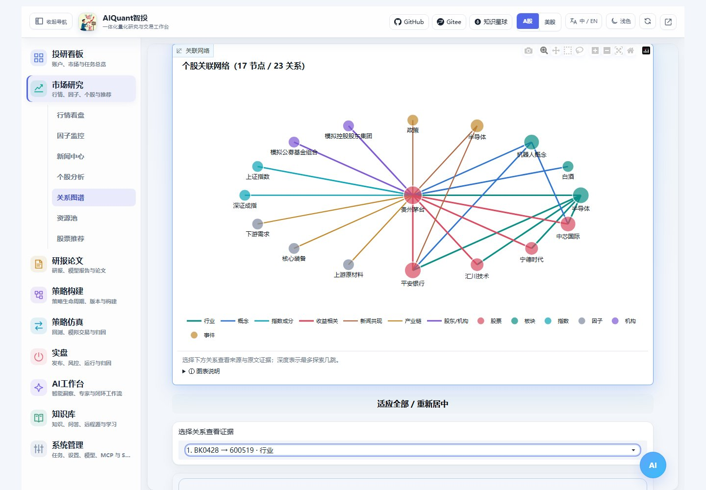
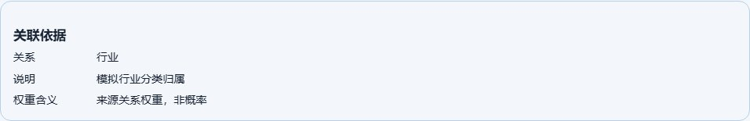

# 行情、因子与关系图谱

Chinese macroeconomic series and A-share financial statements now have dedicated views under Market Research. See [Macroeconomics and corporate fundamentals](economic_analysis.md).

资源池新增“组合方案级联筛选”，可选择预置或已发布方案及API/Codex后端，按当前资源池执行并查看真实过程和HTML报告。操作见[策略工坊](strategy_composition.md)；空池和缺失历史不自动扩展为全市场。

## 入口与前置条件

左侧“市场研究”提供行情看盘、因子监控、新闻中心、个股分析、关系图谱、资源池和股票推荐。顶部市场切换会影响后续查询；mock 行情仅用于流程演示。

图 2：先确定市场与股票池，再读取监控结果；不要将样本不足的提示理解为因子有效。

## 操作步骤

1. 从行情看盘查看指数、板块和自选，核对更新时间与来源。
2. 在资源池创建研究池或导入 CSV/Excel，检查证券名称、代码、重复项和市场归属。
3. 因子监控选择基准、自选、资源或持仓范围及内置/Qlib后端，后台运行后查看覆盖、RankIC与多池对照。流程见[通用监控](factor_monitoring.md)，导入见[资源池模板](resource_pools.md)。
4. 个股与图谱入口支持代码、名称、拼音或别名。设置深度后检查节点、边的关系类型与证据，不能把统计关联当作因果关系。
5. 新闻中心按时间和关键词阅读，再结合原文判断事件；推荐结果作为候选研究池，不能替代回测。

## 结果核对

因子比较使用相同股票池、观察区间和前瞻周期，关注覆盖率及稳定性。风格暴露和容量是代理指标，不能当作完整行业中性风险模型或实际成交容量。图谱解释见[图谱建模原理](../principles/relation_graph_principles.md)。

## 图谱关系与原文依据

深度表示最多探索几跳，实际只有浅层关系时不会凑链路。查询后可用“适应全部 / 重新居中”恢复视口；图例不会占用左半个绘图区。

图 33/34：隔离mock图谱的真实页面操作，示例关系明确标为模拟；正式数据源与新闻证据另见验收报告。暗色界面同样可查看说明与证据。

选择一条关系，核对标题、来源、时间、原文链接、匹配实体与证据片段。公司直接提及与同文共现分别记录；市场背景或相似主题不能当成公司事实关系。只抓到标题/摘要时不会声称已分析全文。真实源没有相关新闻就保持为空；mock 图必须结合来源说明阅读。

收益相关边现在比较相同起止交易日的收益率，显示区间、样本与正负；边宽不是可信概率。每张主要图下可展开说明，核对轴、单位、数据口径与限制。
