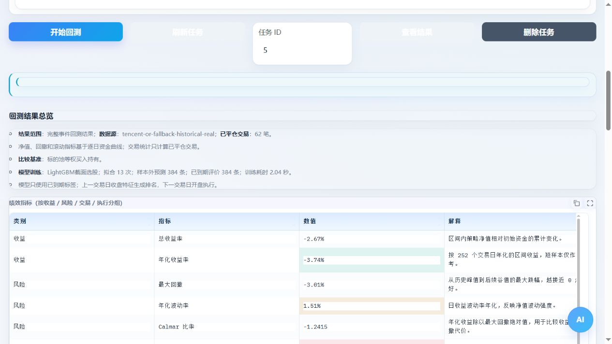

# 模型策略

2026-10-24：策略工坊可为 LightGBM、XGBoost、MLP 分别指定命名因子特征集，留空沿用原特征；“多特征组模型组合”提供现成预置。配置、配图与训练证据核对见[因子研究指南](factor_research.md)。

## 前置条件

预制策略包含 LightGBM 截面选股、XGBoost 截面选股和 CPU 小型 MLP 集成。先安装项目 `requirements-models.txt` 中固定的可选依赖，并确认后端运行在同一个 Python 环境；默认参数位于 `egs/model_strategies.yaml`。

图 8：模型结果需包含实际拟合、样本外预测和耗时证据；历史验证截图的日期与行情来源见[截图索引](assets/screenshots/README.md)。

## 操作步骤

1. 按[策略导入](strategy_import.md)选择并启用对应模型示例。
2. 至少准备两个日期对齐的标的，建议三个及以上，提供足够训练历史。
3. 选择基准或对照方案，点击预览；模型学习率、树数或网络参数放在 model_params。
4. 回测订单类型选择开盘价。已有策略库一键回测会按模型标签选择，但仍应核对最终快照。
5. 完成后检查拟合次数、训练/验证样本、预测数和耗时，再看净值、成交与成本。

样本不足应补充数据或重新选择合理区间，不能用训练段收益替代样本外验证。当前模型策略由平台 simple 引擎执行，不等于原生 Qlib Workflow 运行成功。时间隔离与模型边界见[模型与 ETF 原理](../principles/model_etf.md)。
