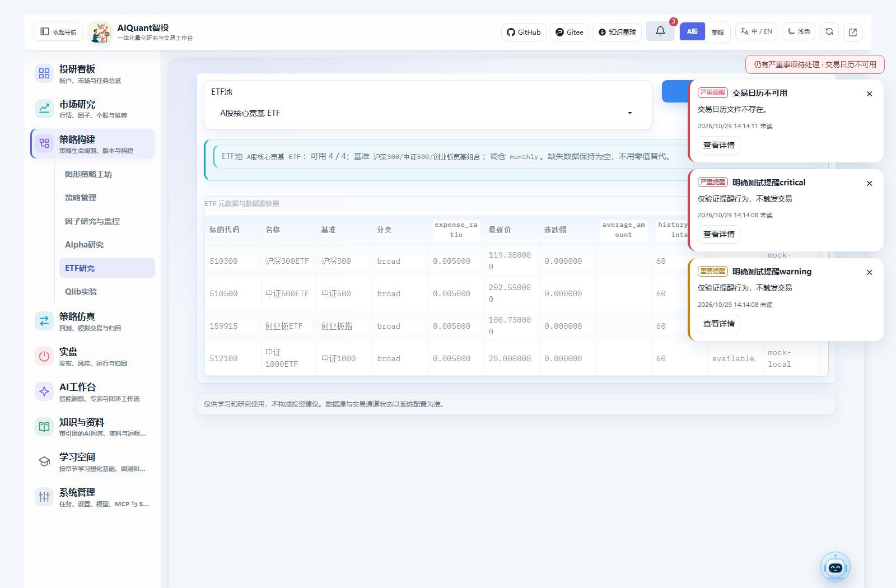
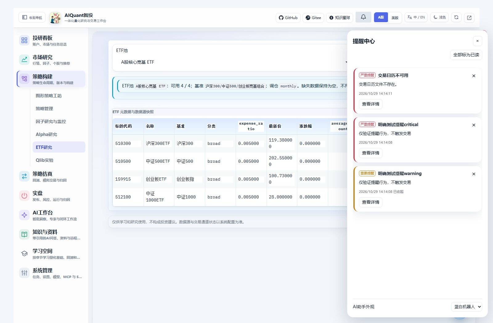
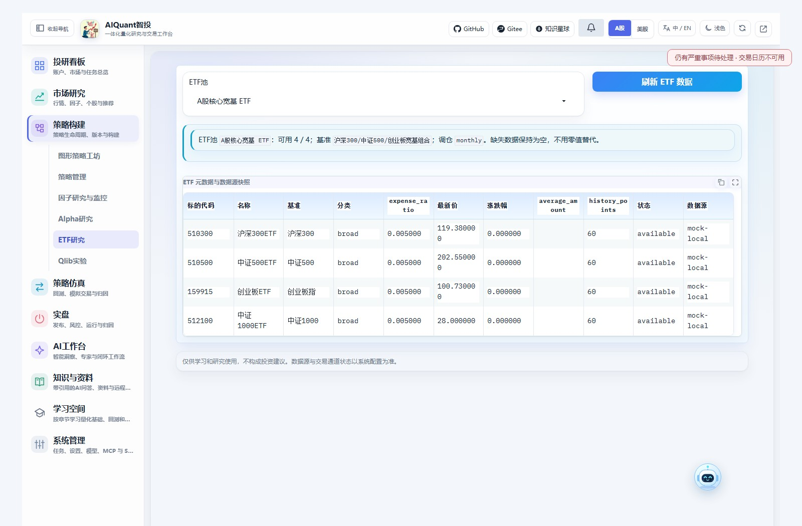
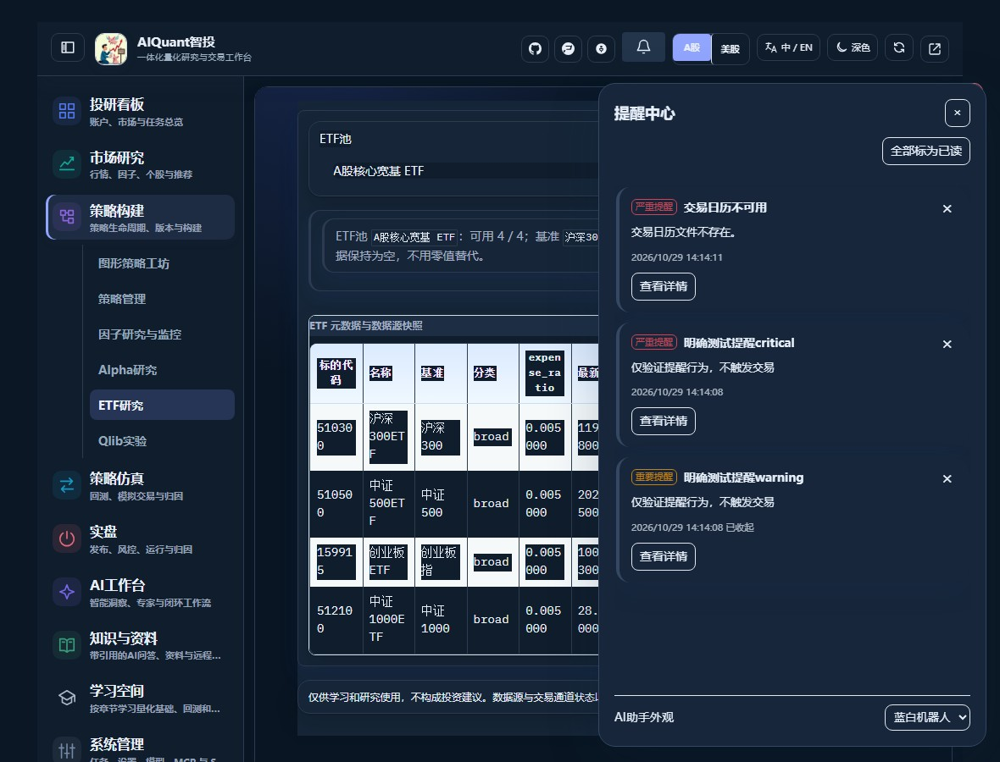

# 提醒中心与AI助手形象

全局提醒在主界面右上角，顶部铃铛打开提醒中心；右下角的蓝白机器人打开AI对话。查看系统告警不需要先打开AI，也不会自动调用模型。

## 查看和关闭提醒

1. 右上角卡片显示程度、标题、原因、时间和查看详情。点击右上角叉号可收起当前卡片。
2. 点击顶部铃铛，在提醒中心查看历史、已读和已收起记录；点击“标为已读”或“全部标为已读”更新当前浏览器的未读数。
3. 点击“查看详情”进入对应功能页。回测携带任务ID；因子、系统设置、报告与定时任务进入其对应列表或页面，再核对来源记录。

普通信息/成功提示约6秒后自动收起；鼠标悬停或键盘操作期间暂停计时。重要提醒需要手动收起；严重提醒还会显示持续的顶部摘要。最多同时显示三张卡片，其余在提醒中心回看。

**收起、已读和来源解决是三个不同状态。** 关闭卡片或全部标为已读，不会解除真实告警、重跑任务或触发交易。严重事项只有来源恢复后才退出顶部摘要；它不会因为普通历史超过保留期而自动隐藏。

同一来源和内容会去重，切换模块或刷新不会重弹已经收起的卡片。首次打开不批量弹出普通历史完成消息。新的执行失败、实质变化或恢复后的再次异常可以产生新提醒。

## 当前覆盖的来源

| 来源 | 提醒依据 | 查看位置 |
| --- | --- | --- |
| 因子监控 | 已保存的factor_alerts，保留原程度和状态 | 策略构建 → 因子研究与监控 |
| 系统健康 | 交易日历等既有本地健康状态 | 系统管理 → 系统配置 |
| 回测 | 已保存任务的完成/失败状态 | 策略仿真 → 回测与模拟 |
| 定时任务 | 已保存的执行结果 | 系统管理 → 定时任务 |
| AI报告/研究 | Skill报告保存及Alpha、Agent研究运行终态 | 知识与资料 → 报告库 |

页面读取已有记录，不为提醒额外拉行情、训练模型或发起AI请求。不新增交易风控规则，也不将首页风险观察参考线当作自动交易规则。提醒时间为实际源时间或首次观察终态的时间，不保证都是精确任务结束时刻。

默认约15秒增量刷新；标签隐藏时暂停，恢复时补取。后台故障不是全部秒级推送，交易阻断仍由原后台业务即时执行。网络失败时有限退避；来源过多会提示本轮读取范围有限，应继续核对来源页面。

普通历史保留期默认30天，严重未解决事项仍保持可见，没有自动物理删除。已读/收起按浏览器客户端区分，客户端标识不是账户认证。全局铃铛位于主工作区外壳；单独打开的模块窗口不另建提醒中心。

## 切换AI助手形象

在“顶部铃铛 → 提醒中心 → 底部AI助手外观”选择“蓝白机器人”或“简洁图标”。选择同步到已经打开的模块，按当前浏览器保存。右下角按钮仍支持拖动、点击和键盘打开；调整窗口后保留在可见范围。

机器人为本地原创SVG，不加载外部图片CDN，不持续播放动画。仅悬停时轻微抬起，并尊重系统减少动画设置；不会用无依据的闪烁或忙碌效果暗示AI正在处理。

显示时长、卡片上限、刷新周期、来源映射及默认形象在`egs/notifications.yaml`配置。已有浏览器选择优先于默认形象；可在外观菜单切换。custom_image必须位于项目frontend/assets目录，使用PNG/JPG/WebP，通过大小和实际内容校验；失败时回退内置机器人，不执行上传SVG脚本。

图87至90来自8890隔离服务的真实点击，测试提醒明确标注，行情为mock。它们说明交互和外观，不代表实际账户产生该风险或任何策略收益。来源见[截图索引](assets/screenshots/README.md)。

文档继续使用MkDocs。与Read the Docs托管的分工见[发布指南](documentation_publish.md)，不因新增提醒迁移格式或对外发布。
