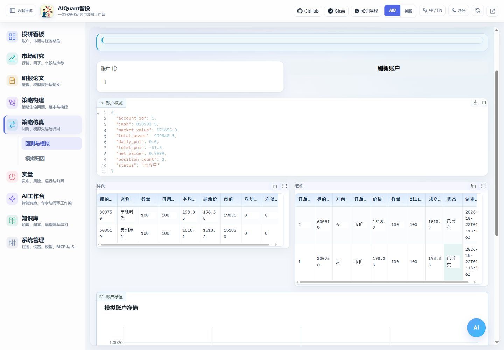

# 模拟账户与成交

本页描述已有单策略模拟账户。级联/多子策略请使用[策略工坊的前向模拟](strategy_composition.md)，其版本固定、分策略归属、风险状态和账户ID独立保存，不能混用两类账户ID。

进入“策略仿真 → 回测与模拟 → 模拟交易”。模拟账户使用本地账本和当前数据源，不连接真实券商；mock 报价成交不能作为真实可成交性证明。

图 10：先确认模拟账户 ID，再检查现金、订单状态、成交和持仓是否相互一致。

1. 使用独立名称创建账户，设置初始资金和关联策略，或从已完成回测创建。
2. 选择账户并刷新总览；没有持仓是正常初始状态。
3. 填写标的、方向、订单类型与数量，核对模拟行情后提交模拟订单。
4. 检查订单是否成交；未成交订单可按现有撮合入口重查，不能将“已提交”当作“已成交”。
5. 对照成交明细、现金变化、费用、持仓数量和持仓成本，再查看净值与模拟归因。

账户重置或删除会影响已有记录，先确认精确对象，不能作为常规刷新步骤。模拟流程通过后仍需独立评估行情质量、真实执行通道和风控；当前[使用边界](risk.md)不允许据此推断真实资金自动交易已就绪。
