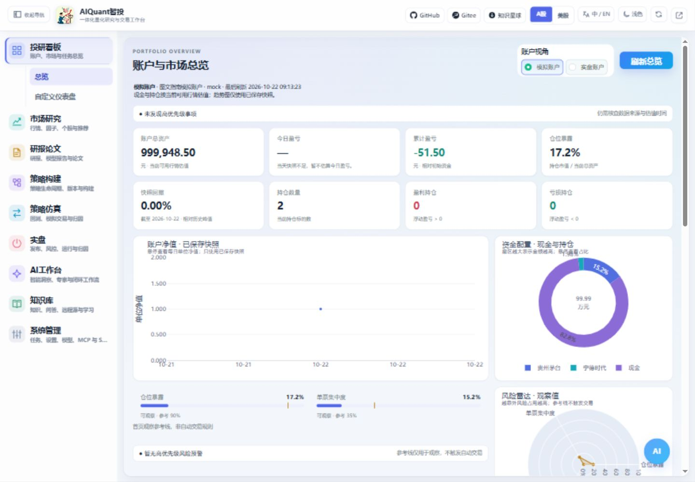

# 快速上手

以下命令均在当前仓库根目录执行。先让网页、CLI使用同一个Python环境和后端地址，再检查具体功能；迁移后的文档构建与目录说明见[新仓库入口](../platform/migration.md)。

## 启动前检查

| 检查项 | 说明 |
|--------|------|
| Python 环境 | Python3.11+；当前完整回归在不继承Conda包的项目.venv-secure执行，先运行环境预检 |
| 依赖安装 | 使用固定直接依赖与哈希锁文件，完整步骤见[依赖安装](installation.md)；Qlib使用单独环境 |
| 配置文件 | 默认读取 `egs/config.yaml`，没有该文件时使用内置默认值 |
| 环境变量 | 模型密钥建议放入 `.env` 或 `.llm_env`，也可以在系统配置页导入 |
| 数据模式 | 默认是真实行情模式；本地回归可显式设置为 mock |
| 端口占用 | `start.py` 启动前会检查端口，占用时不会继续打印误导地址 |

## 启动与连接

1. 按已选环境安装 `requirements.txt` 中的固定依赖。模型策略还需要 `requirements-models.txt`；普通规则策略不依赖该可选文件。
2. 项目 `.env` 设置所需环境变量。首次只验证流程时可填写 `ALL_IN_ONE_DATA_MODE=mock`；使用真实行情时填写 `real` 并核对数据源可达性。模型密钥也保存在环境文件，不写入策略参数。
3. 启动前台服务：

```text
.venv-secure/Scripts/python.exe -B egs/check_runtime.py --role models
.venv-secure/Scripts/python.exe -B start.py --host 127.0.0.1 --port 8000
```

启动终端保持运行，在浏览器打开 `http://127.0.0.1:8000/app/`。帮助中心为 `/help-docs/`，接口文档为 `/docs`。用另一个终端检查 CLI 连接：



图 1：左侧按业务切换，顶部可收起导航、切换市场和主题；截图中账户与行情均为隔离模拟数据。

```text
python egs/cli.py --base-url http://127.0.0.1:8000 system capabilities --format json
```

检查 data_mode、data_source 和 is_mock。`mock-local` 表示模拟行情，不能作为真实策略表现；`system capabilities` 只说明接入边界，真实可执行性仍以具体调用结果为准。启动命令在 PowerShell 和 Linux shell 中相同；如 python 命令指向其他环境，改用该环境 Python 的实际路径。

## 推荐路径

1. 从左侧“系统管理 / 系统配置”检查环境变量和模型管理，确认当前 Python 环境及数据模式。
2. 在“投研看板 / 总览”观察账户、净值、配置和板块；行情进入市场研究，研报与论文进入知识与资料。Linux将上述Scripts/python.exe换成bin/python；新入口见[统一入口指南](navigation_and_environment.md)。
3. 在“策略构建 / 策略管理 / 预制策略”查看示例并用独立名称导入，在策略库检查接口、参数和启用状态。
4. 在“策略仿真 / 回测与模拟”填写策略 ID、标的和日期，以内置引擎执行小样本，核对实际曲线日期、交易和成本，再创建模拟账户观察下单与持仓。
5. “AI工作台 / 主界面”提供对话、自动化、MCP、Skill 和知识库；项目会话在工作台左栏下半部。输入区可拖入文件/图片，选择后台、模型和思考强度，Enter 发送。Codex 使用本机已安装且可认证的 CLI；mock 服务默认不调用，需在服务环境显式设置 `ALL_IN_ONE_ENABLE_REAL_CLI=true` 后重启。真实行情模式不等于模型或 CLI 已就绪。详见 [AI 工作台](ai_workspace.md)。
6. 在“学习空间 / 量化基础课程”学习量化；软件使用和原理资料位于“知识与资料 / 系统资料”，正文变化后点击“刷新当前章节”。帮助入口位于“系统管理 / 帮助文档”。

完整安装方式见[环境安装](installation.md)，存储选型见[存储原理](../principles/storage.md)。

## 第一轮回测看什么

先选择双均线等普通策略，用独立名称导入并启用；在回测页填写实际策略 ID、标的和有历史数据的日期。点击“预览生效参数”，确认参数后再开始。结果至少核对实际曲线日期、数据来源、交易次数、费用、持仓和回撤；零成交可能是未触发信号，不能只凭“已完成”或收益率判断运行正确。

若使用模型策略，至少准备两个日期对齐的标的，建议三个及以上，订单类型选择开盘价，并检查训练与样本外预测证据。ETF 策略还需核对池标识与标的；手动调参见 [策略调参](strategy_parameters.md)，命令行闭环见 [命令行](cli.md)。

## 页面刷新习惯

系统已经减少父级页签的自动刷新。进入具体子页后，优先使用页内刷新按钮；右上角刷新按钮会自动触发当前可见页面中最深层的刷新按钮。

智能洞察的“Skill报告”需显式点击任务；行情摘要位于“每日行情”，若外部行情源冷启动或失败，可点击“刷新每日行情”重试并查看状态。AI工作台和悬浮窗支持Enter发送、Ctrl+Enter换行。

Qlib 实验和回测页的 Qlib 引擎是两个入口。当前不能把可选依赖可导入、登记实验或出现 blocked 记录作为完整 Qlib 训练回测通过的证明；回测页只有拿到逐日组合曲线产物时才绘制完整曲线。mock 回测会把合成 K 线映射到请求区间工作日，真实行情无匹配日期时会明确报错。

## 停止服务

在启动服务的终端按 Ctrl+C，确认进程结束后再启动同端口的新服务。关闭浏览器不会停止后端；不要因页面未响应重复启动多个后端。CLI 业务请求超时或中断也不保证取消服务端任务，应先查任务或会话记录再决定是否重试。
