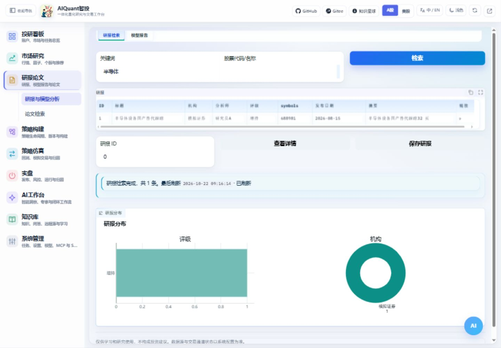

# 研报与论文

进入“知识与资料 → 研报与论文”，顶部选择研报检索或论文检索。旧研报模块链接会直达对应子页。报告历史统一在“报告库”；新的真实Skill生成仍在“AI工作台 → 智能洞察”，旧版模板明确标注演示来源。检索、生成和入库是不同操作，先核对原始资料；配图见[统一入口指南](navigation_and_environment.md)。

图 3：检索列表用于选材，模型报告用于辅助阅读，来源和引用仍需核对。

1. 填写关键词或证券信息后检索，阅读标题、日期、来源和摘要。
2. 打开原文，确认链接有效、内容相关；公开源可能限流或没有结果。
3. 生成分析前在系统配置中启用实际模型，核对模型和行情数据来源。
4. 选择目标知识库，点击“下载研报并入库”或“下载论文并入库”；成功后在知识库问答选择同一库核对引用。arXiv摘要链接自动转换为全文PDF地址。
5. 下载或解析失败会显示具体原因；没有全文链接时不把摘要页当成全文。原有“保存研报 / 导入知识库”用于保存现有正文或摘要，功能与全文下载区分。

论文收藏、知识入库和模型输出不等于内容经过事实验证。遇到下载失败或模型错误时保留具体错误，避免反复提交同一生成请求。文档处理与引用见[知识库指南](knowledge.md)。
