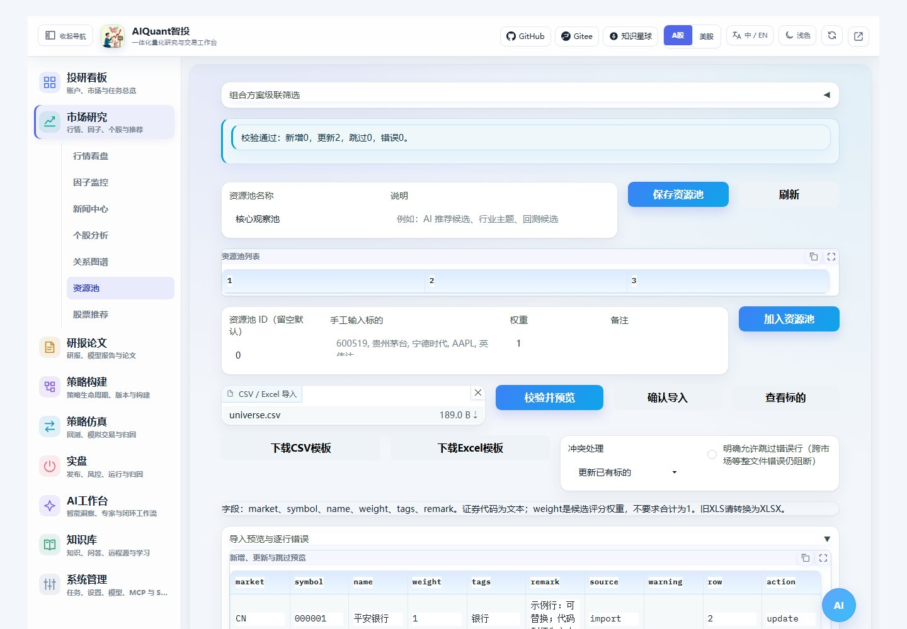
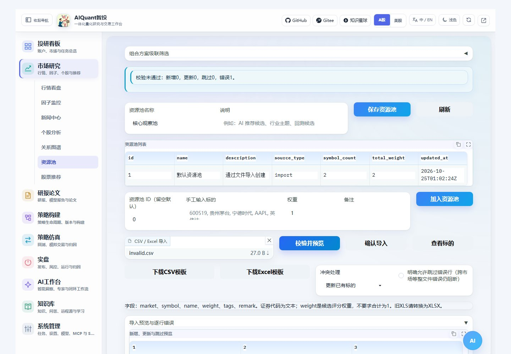

# 资源池模板与文件导入

进入“市场研究 → 资源池”，可以创建候选池、手工添加证券，也可上传文件。资源池候选评分权重不等于目标仓位，不要求合计为 1。

## 下载与填写模板

点击“下载CSV模板”或“下载Excel模板”。仓库对应文件位于 `egs/resource_pool_templates/universe.csv` 和 `universe.xlsx`；下载按钮与 API 读取同一份模板。

| 字段 | 含义 |
| --- | --- |
| market | CN 或 US；缺省时使用当前市场，导入前核对 |
| symbol | 必填的证券代码；A 股/ETF 使用六位文本，如 000001 |
| name | 证券名称，可留空；提供时会核对本地主数据 |
| weight | 非负有限数，空值默认 1，非法数值不自动替换 |
| tags | 标签或分组 |
| remark | 备注 |

CSV 使用 UTF-8（模板带 BOM），解析也支持 GB18030。Excel 代码列保持文本格式；旧 XLS 请先转换成 XLSX。填写时替换或移除示例行，模板不代表推荐持仓。

## 校验预览再提交

1. 选择目标资源池 ID，留空时使用现有默认池；没有池时只在正式提交阶段创建。
2. 上传 CSV 或 XLSX，选择“更新已有标的”或“跳过已有标的”。
3. 点击“校验并预览”，核对标准代码、名称、市场、权重和新增/更新/跳过数量。
4. 确认后点击“确认导入”。文件、目标池或规范在预览后改变时，会要求重新预览。



图 31：浏览器实际上传模板并预览，证券代码保留前导零；此图来自隔离测试数据库。

预览不会写入标的，也不依赖逐行实时行情查询。本地证券主数据未收录的代码会显示“仅通过格式校验”，这不代表已核实存在或可交易。不同市场请切换市场、分池导入；混合市场不能直接当成跨市场组合回测。

## 处理错误



图 32：非法权重被阻断；展开逐行错误可查看行号和问题，并下载错误报告。

校验包括：文件大小和结构、必填/重复列、代码格式与前导零、名称冲突、文件内重复证券、NaN/Infinity、负权重、公式、损坏工作簿和行列数量限制。缺少代码列时不再猜测第一列。

默认存在任何错误就整批阻断。只有明确勾选“允许跳过错误行”时才可导入合法部分；跨市场等整文件错误仍会阻断。正式写入使用事务，中途存储失败不会留下半批数据。

更换文件前可点击上传框右上角“清除”。不要把“校验通过”当成已经保存，需继续点击确认导入。

## CLI 与接口

```console
python egs/cli.py pool preview <资源池ID> --file egs/resource_pool_templates/universe.csv --format json
python egs/cli.py pool import <资源池ID> --file egs/resource_pool_templates/universe.csv --format json
```

CLI 直接导入也会执行同一套校验与原子写入。REST 提供模板下载、上传预览、错误报告及提交；需要严格绑定预览时，将预览返回的 preview_hash 随提交传回。文件规范及大小限制统一位于 `egs/resource_import.yaml`。
