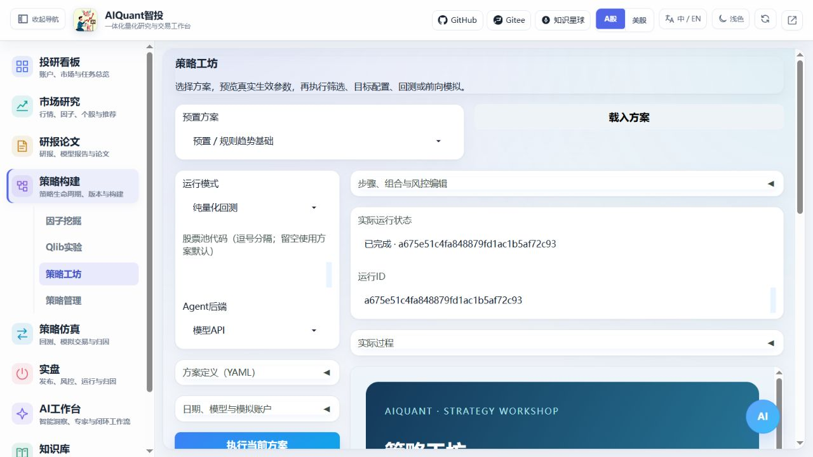
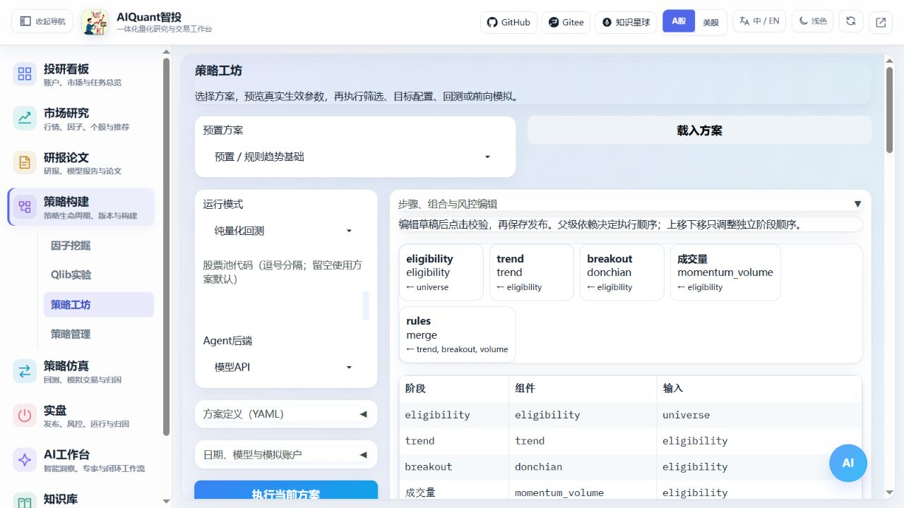
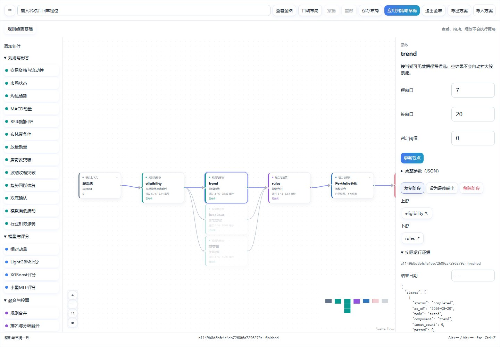
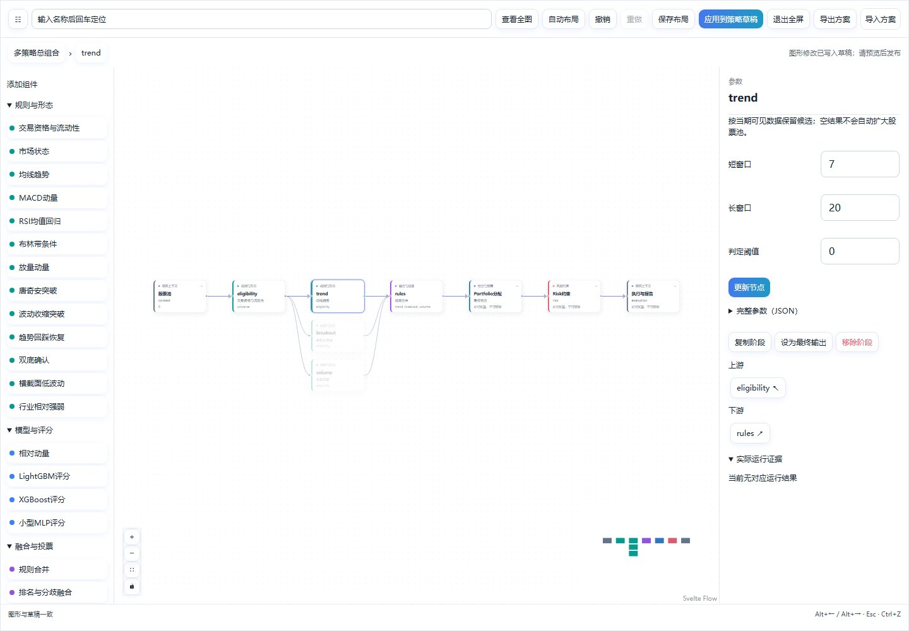
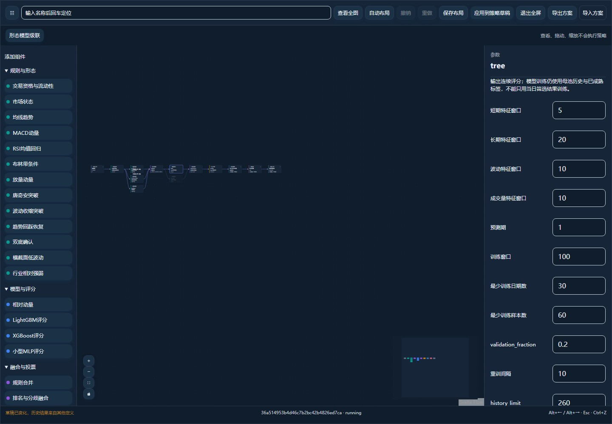
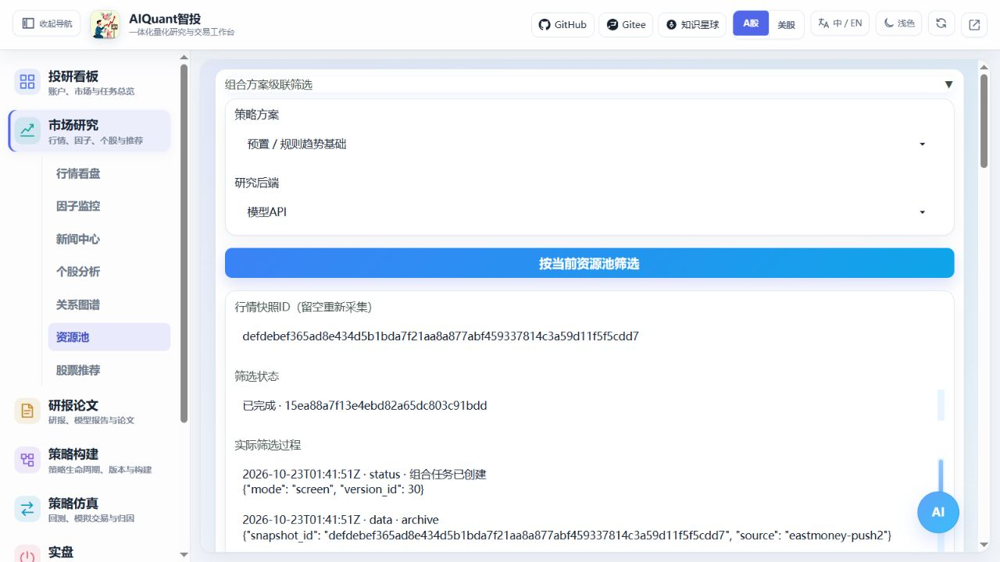

# 策略工坊：级联、组合与风控

2026-10-26：图形策略工坊为“策略构建”的默认二级入口，策略管理提供快捷链接；ETF和统一因子研究也已列入同级导航。界面整合、结果与实际截图见[统一入口指南](navigation_and_environment.md)。

2026-10-25更新：纯量化回测的费用可在全宽“交易成本与执行假设”区覆盖，单独冻结本次执行配置，保留原策略版本。结构、模型和风控变化仍需重新发布；前向模拟沿用冻结执行条件。操作与配图见[交易成本指南](backtest_execution.md)。

2026-10-23。入口为左侧 **策略构建 → 策略工坊**。工坊按需加载；进入其他模块再切回时保留当前表单。它使用独立的组合批次引擎，已有单策略导入和回测继续可用。图形编辑器需要 Gradio 6.16，旧环境保留步骤表和 YAML 编辑。



## 先选一套方案

2026-10-24 新增“标准化量价多因子”“滚动有效性多因子”“多特征组模型组合”，当前共十套预置。因子集、处理、历史研究和合成有独立节点，详见[因子研究指南](factor_research.md)。

| 预置方案 | 实际组成 | 适合先核对什么 |
| --- | --- | --- |
| 规则趋势基础 | 资格过滤、趋势/突破/量价并行合并、等权与风控 | 入选数量、留现金、下一开盘成交 |
| 形态模型级联 | 回踩/收缩/双底合并 → LightGBM 与 MLP → 排名融合 → Agent → 逆波动 | 各阶段淘汰、训练母池、终审理由 |
| 三模型并行 | LightGBM/XGBoost/MLP 归一排名 → 最小方差 | 模型是否实际预测、分歧和贡献 |
| 均值回归 | RSI/布林等规则与分数、组合和风险约束 | 反转条件、止损与时间退出 |
| 行业轮动 | 行业相对强弱、趋势、模型与三角色复核 | 分类可用时间、行业集中限制 |
| ETF配置 | 动量、低波动和 HRP；可切换等权/ERC | ETF范围、协方差、实际现金比例 |
| 多策略总组合 | 趋势、回归和ETF独立子账户预算后净额 | 子策略资金流、同证券对冲、只扣一次市场费用 |

这些是研究起点，不是收益推荐。默认模板、组件参数及固定提示词位于 `egs/strategy_pipelines/` 与 `egs/strategy_components.yaml`。模型需要额外的 `requirements-models.txt` 依赖；缺失时明确失败，不生成替代评分。

1. 选择预置或已发布版本，点击“载入方案”。股票池留空使用方案默认；填写代码时覆盖单层方案母池，多子策略仍保留各自范围。
2. 在画布点击阶段，在右侧编辑参数并点击“更新节点”，再点“应用到策略草稿”。也可展开“步骤、组合与风控编辑”使用原有表单。应用计算修改后，发布版本ID会清空；未应用的图形变更会阻止运行旧 YAML。
3. 展开“方案定义”，选择参数方案或本次覆盖，点击“校验与预览”。预览展示完整生效值，不请求行情、不训练、不调用 Agent。
4. 点击“保存发布版本”。发布会生成不可变版本，并登记为标准组合策略；后续修改应再次发布。



## 用画布组合并跳转步骤



实线表示候选或评分依赖；虚线是模型训练母池上下文；总组合中带百分比的边表示资金预算。评分融合的权重位于融合节点参数中，不等于资金预算。Portfolio、Risk 和执行节点是必经配置，可以编辑允许的属性，不能通过删除或绕过连线关闭风控。

| 操作 | 在界面中怎么做 |
| --- | --- |
| 看某一步前后关系 | 单击节点，右侧“上游/下游”按钮直接聚焦相邻步骤并高亮依赖；输入节点标识或组件名后回车搜索 |
| 进入子策略 | 双击总组合的子策略节点，或点“展开子策略”；面包屑返回父层，各层保留选择和视口 |
| 添加与连线 | 左侧目录点击或拖入组件；从右侧输出端口拖到目标左侧输入端口；已有单输入阶段需先移除旧连线 |
| 移除计算连线 | 点击实线，再点“移除此计算连线”；融合权重会与剩余来源一起调整，最终合法性仍由编译器检查 |
| 调整显示 | 拖动、缩放、缩略图、“查看全图”“自动布局”；小屏可使用“全屏画布”并收起组件目录 |
| 保存或分享 | “保存布局”只保存坐标/视口；“导出方案”生成 JSON，“导入方案”读取本工坊格式，应用前不会执行 |
| 修正操作 | 撤销/重做计算编辑；Esc 返回父图，Alt+左右箭头跳上下游，Ctrl+Z 撤销，输入框内保留正常文本操作 |



导入、参数修改和连线错误不会覆盖已发布版本。先“应用到策略草稿”，再“校验与预览”，最后“保存发布版本”。新节点必须接入有效输出链；不合法多输入、循环、未知组件、风险越界会被拒绝。画布不执行任意 Python。

运行后节点按实际事件显示数量、耗时和状态。右侧“实际运行证据”可按预览中已有日期筛选；为保证速度，嵌套列表默认只展示最近 8 项、长文本最多 6000 字符，不代表完整记录。完整日期和证券证据请下载事件/结果文件，或使用 API。终态后自动轮询停止；“查看当前步骤”只读取证据，不重跑模型或 Agent。



切换方案或修改草稿后，旧报告保留原运行ID，画布提示“历史结果来自其他定义”，不会把新节点标成旧运行成功。“历史运行 → 打开历史”读取该次报告；要在图上核对历史节点，先载入对应已发布版本，再打开该运行。布局多会话冲突时重新载入后再保存。

2026-10-24修复：载入方案会重置未应用的图形修改，即使重新选择的是同一个预置。不同方案使用独立布局；切回已保存的方案恢复其坐标，历史过程刷新不会替换新载入的草稿。进入全屏会在新尺寸稳定后自动适配。原问题复现保留在项目 `docs/audit/strategy_graph_e2e_2026-10-24/`，修复记录在 `docs/audit/strategy_graph_fix_2026-10-24/`。

Portfolio 参数控制分配方法、总投入、单证券上限及估计窗口；Risk 控制最终限仓、行业/相关集中、波动缩放、止损、回撤及冻结。**风控削减后留现金，不重新放大剩余权重。** 子策略预算之和不得超过1，余额留现金。子策略风险预算当前按实际单位净值的逆波动率分配，不等于证券级 ERC；预热不足或零波动仅在明确选择固定预算降级时回退。

## 选择执行模式

| 模式 | 行为 | Agent |
| --- | --- | --- |
| 当期筛选 / 目标组合 | 计算当前候选或受风险约束的目标，不成交 | 有 Agent 组件时调用所选 API/Codex |
| 纯量化回测 | 历史收盘决策，下一交易日开盘尝试成交 | 明确跳过，报告记为量化基线 |
| Agent决定回放 | 仅加载输入摘要完全一致、当时已经生成且未过期的决定 | 填写已保存决定ID；不调用今天的模型补历史 |
| 前向模拟 | 首次建立账本和待执行目标，之后按新增交易日推进 | 当期可调用；同日刷新不重复成交 |

在“日期、模型与模拟账户”中填写日期、模型、思考强度及回放决定ID。默认结束日为今天。当前 Agent 后端支持模型 API 和已接通的 Codex CLI；三角色为研究分析、独立反证、投研汇总，使用普通文本 ReAct 和 `json_repair`，不能访问任意工具、扩大候选或放宽风险。

填写已有“行情快照ID”可重放相同归档行情，便于排除网络波动并比较方案；快照来源、日期和摘要仍会验证。留空时从行情网关采集，仅获取组合需要的价量及分类，不等待全文新闻和研报。网络请求及回退仍可能较慢，实际事件会显示当前证券；历史快照不能冒充新的实时行情。

点击“执行当前方案”后，“实际过程”显示数据、规则、真实训练或权重缓存、预测、Agent公开消息、组合及风险事件。取消会传递给运行任务；Codex 子进程可终止，阻塞中的 API/训练需等待当前调用返回，期间显示“正在取消”。

## 怎样核对结果

右侧报告包含净值与基准、目标权重、回撤、末次阶段数量、中文指标和计算说明。目标权重不等于实际持仓；日线价格跳空、费用、整手、可卖数量、流动性和风控都会影响成交。无成交、模型样本不足、空候选也会按实际结果显示。

下载 HTML 后可以离线查看图表。详细证据保存在项目数据目录的 `reports/pipelines/<运行ID>/`，包含冻结定义、请求、行情快照、事件、账本和结果。原生模型权重在 `models/pipelines/`，保存摘要与训练切分；不加载外部 pickle。“刷新历史 → 打开历史”可以重新展示报告。

前向模拟首次执行返回账户ID。后续携带该ID沿用版本和持仓；“启用独立日线风控监控 → 保存监控状态”才开启监控，默认关闭。监控不调用 Agent，重复时点不重复成交。解除冻结只重设本地模拟账本风险状态，并保留审计，不发送券商指令。

“市场研究 → 资源池”中的“组合方案级联筛选”使用同一执行器，先选资源池ID与方案再运行。空池不会自动扫描全市场。



## 命令行

在项目根目录使用当前 Python 环境运行：

```powershell
python egs/cli.py pipeline templates
python egs/cli.py pipeline components
python egs/cli.py --format json pipeline run --template rule_trend --mode backtest --agent-mode off --start-date 2026-05-04 --end-date 2026-10-22
python egs/cli.py --format jsonl --require-real pipeline run --template parallel_three_model --mode targets --agent-mode off
python egs/cli.py pipeline runs
python egs/cli.py pipeline result <运行ID>
python egs/cli.py pipeline events <运行ID>
python egs/cli.py pipeline nodes <运行ID> --after 0
python egs/cli.py pipeline layout show <方案ID>
python egs/cli.py pipeline enabled <方案ID> --enabled false
```

`pipeline run` 等待终态；JSON只输出最终结果，JSONL/`--stream`逐条输出实际事件。`--require-real`同时传入服务端检查并校验最终来源。长任务可显式调整 `--deadline` 和 `--read-timeout`。CLI 的 create/preview/update 可用 `--file` 传入含 definition、variant、overrides 的 YAML/JSON；`pipeline publish`、versions、export、cancel、accounts、account、monitor 和 risk-reset 见 [完整命令参考](cli_reference.md)。停用方案阻止新研究/建仓，已有持仓的 risk-only 监控继续可用。

本轮补充了执行事件的节点路径元数据。已有历史报告仍可读；如果旧版本的实现摘要校验失败，需从其定义重新发布后运行，不修改原版本或伪装为相同实现。

## 当前数据边界

- 现有网关一次最多240根日线；当前验证只证明小池、小样本链路，不证明长期收益或全市场容量。
- 未复权价格不含分红和公司行动；固定池未校正幸存者偏差。普通A股默认100股、T+1仅为研究假设，特殊证券需显式配置。未自动接入券商实盘。
- 当前行业分类只从采集时点起可用，历史行业策略在缺少当时分类时阻断；普通历史组合会标注行业覆盖缺口，不能倒填今天分类。
- 日线撮合的部分未成交量按当日批次失效记录，不保留真实交易所挂单；风控仍按实际持仓继续计算。止损不保证以触发价成交。
- 尾部 CVaR、动态 Stacking、GRU/TCN 和更长历史属于后续 C 范围，未启用。

计算逻辑见[策略编排原理](../principles/strategy_composition.md)。
