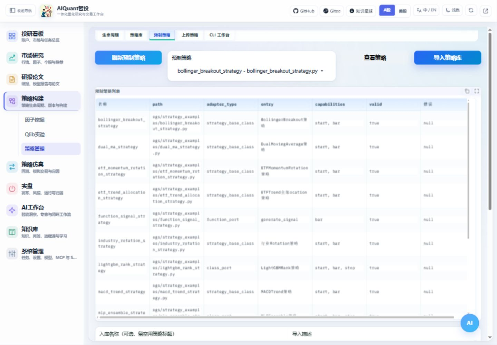

# 导入和启用策略

## 前置条件

先以普通规则策略验证流程。预制源码在 `egs/strategy_examples/`，共有 13 套；模型策略额外需要可选依赖。接口检查验证能否接入，不能证明策略盈利。

图 4：选择示例、查看介绍后导入，保存实际返回的策略 ID。

## 操作步骤

1. 进入“策略构建 → 策略管理 → 预制策略”，选择双均线等示例，查看逻辑、风险与默认参数。
2. 使用独立名称导入。上传自有策略时进入“上传策略”，提交 Python 文件并检查入口识别结果。
3. 在策略库刷新列表，按名称或ID查找；查看静态接口报告、参数及状态。自定义源码先阅读并核对`source_sha256`，在“自定义源码运行复核”登记摘要和复核者；[操作配图与边界](access_and_execution.md#source-review)见新指南。
4. 启用策略，再到“策略仿真 → 回测与模拟”或策略库一键回测。未复核自定义源码会被阻断，详情加载本身不执行代码；已结束任务应新建，不能覆盖旧结果。
5. 先[预览参数](strategy_parameters.md)，执行小样本[回测](backtest.md)，核对实际曲线和成交。

## 结果检查与常见问题

名称相同不代表同一个策略，后续操作以实际 ID 为准。导入失败先看入口、依赖及信号格式；导入后修改示例文件不会自动更新数据库中的策略版本。运行自有 Python 策略前应先审查源码，接口校验不是隔离任意代码的沙箱。

模型和 ETF 分别见[模型策略](model_strategies.md)、[ETF 研究](etf_research.md)；支持形态与加载过程见[策略端口原理](../principles/strategy_port_principles.md)。
