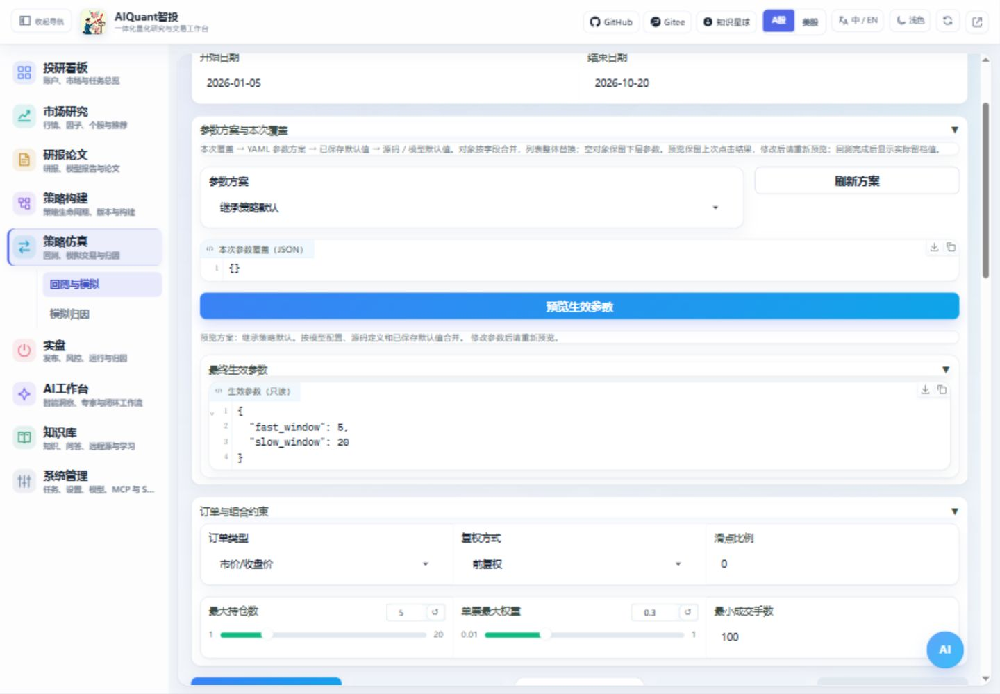

# 策略怎么调参

## 先选择策略

13 套预制策略均从“策略构建 → 策略管理 → 预制策略”导入，源码位于 `egs/examples/strategy_examples/`，共提供 26 个命名参数方案。预制策略介绍页包含逻辑、默认值、适用场景和局限；导入时使用独立名称，避免与已有策略混淆。

| 类型 | 示例 | 首次验证重点 |
| --- | --- | --- |
| 入门与端口 | 双均线、阈值突破函数式、标准端口动量突破 | 参数继承、接口检查、信号与成交 |
| 常用规则 | RSI 均值回归、布林带突破、MACD 趋势、量价动量突破 | 窗口长度、阈值、调仓成本及零成交原因 |
| 行业轮动 | 行业轮动策略 | 行业代理标的、可得历史和组合约束；不自动建立行业成分映射 |
| 模型 | LightGBM、XGBoost、小型 MLP 集成 | 可选依赖、日期对齐、训练隔离、样本外预测和开盘执行 |
| ETF | 相对强弱轮动、趋势配置 | 池标识、开盘执行、换手、费用和跟踪误差口径 |

## 页面操作



图 5：每次修改后重新点击预览，核对只读生效值；图中双均线参数继承策略默认。

1. 进入“策略仿真 → 回测与模拟 → 回测”或“策略构建 → 策略管理 → 策略库 → 策略一键回测”，填写实际策略 ID。
2. 在“参数方案与本次覆盖”选择方案。现有 13 套示例包含两套 ETF，提供基准方案和对照方案；“继承策略默认”不叠加方案。
3. 在“本次参数覆盖（JSON）”只填写需要改的字段，空对象或留空表示继承。
4. 点击“预览生效参数”，展开只读结果，核对窗口、数量、模型参数和随机种子等。
5. 设置相同的股票池、日期、成交方式、费用和组合约束，再开始回测。模型策略须用日期对齐的多标的和开盘价订单。
6. 完成后查看实际生效参数和“回测证据与模拟衔接 → 查看参数快照”；用“回测参数对比”比较不同任务。

切换策略或点击“刷新方案”会重置本次覆盖和旧预览。修改参数后需要重新预览；开始回测会重新读取当前配置，完成后显示本次实际留档值。

## 参数放在哪里

| 位置 | 用途 | 何时生效 |
| --- | --- | --- |
| egs/config/models/model_strategies.yaml | 三种模型的公共默认配置 | 下一次解析与运行，未被更高优先级覆盖的字段 |
| egs/examples/strategy_params 下各 YAML | 每个策略的命名参数方案和说明 | 选中该方案后的下一次运行 |
| 数据库中的策略默认参数 | 导入或更新策略时保存的基础设置 | 下一次解析与运行 |
| 页面本次覆盖 | 单次试验差异 | 仅本次回测 |

优先级从高到低：本次覆盖、所选方案、数据库默认、源码声明默认、模型公共默认。嵌套对象按字段合并，列表整体替换，空对象保留下层字段。导入介绍文件的默认值只在导入时复制，不会自动更新已有策略。

## 配置示例

LightGBM 的单次覆盖示例，数值只用于说明填写方式，不代表推荐的最优组合：

```json
{
  "train_window": 80,
  "top_n": 2,
  "model_params": {"learning_rate": 0.03, "n_estimators": 80}
}
```

其他模型字段会继承。MLP 的隐藏层规模、迭代次数、学习率和种子列表放在 model_params；选择新列表会替换整个原列表。初始资金、滑点和订单类型使用页面独立控件，不放入 model_params。

新增 YAML 方案时复制同目录下同类文件的结构，entry 必须匹配源码入口名称，一个入口只能绑定一个文件；profiles 内使用唯一方案名并填写 label、description 和 params。方案 ID 使用“文件名:方案名”，页面自动列出。配置不支持项目外路径。自定义策略没有方案文件时仍可使用基础默认值和页面覆盖。

## 命令行调参

以下 12 为导入后的实际策略 ID 的占位，42、43 为回测任务 ID 的占位。

```text
python egs/entrypoints/cli.py strategy params profiles 12 --format json
python egs/entrypoints/cli.py strategy params resolve 12 --parameter-profile etf_momentum.yaml:baseline --params-file egs/config/cli/params/etf.yaml --format json
python egs/entrypoints/cli.py backtest run --file egs/config/cli/requests/etf_backtest.yaml --set strategy_id=12 --set params.top_n=2 --dry-run --format json
```

确认请求后去掉 `--dry-run` 执行；`--file` 提供完整请求，`--params-file` 只提供 params 内容，`--set` 覆盖指定字段，显式业务选项优先于文件和 set。命名方案仍由后端读取，CLI 不复制一套参数规则。

运行后用 `python egs/entrypoints/cli.py backtest snapshot 42 --format json` 查看实际快照，用 `python egs/entrypoints/cli.py backtest compare --ids 42,43 --format json` 比较任务。比较结果保留日期、股票池和执行成本差异，条件不同时不能仅按收益排名选参数。

## 怎样判断调参有效

先固定股票池、数据区间和执行成本，每次只比较少量差异。模型按时间顺序训练和验证，最终测试段留作独立检验；同时观察回撤、交易次数、成本、预测误差和耗时。小样本跑通、训练误差降低或单次收益增加，都不能单独证明参数长期有效。

本期提供手动方案选择与对比，尚未提供自动参数搜索。新任务保存参数来源、策略和相关源码摘要、依赖版本及 OHLCV 摘要；旧任务没有完整证据时会明确提示。行情摘要用于核对数据变化，复现仍需要保留对应行情和环境。
