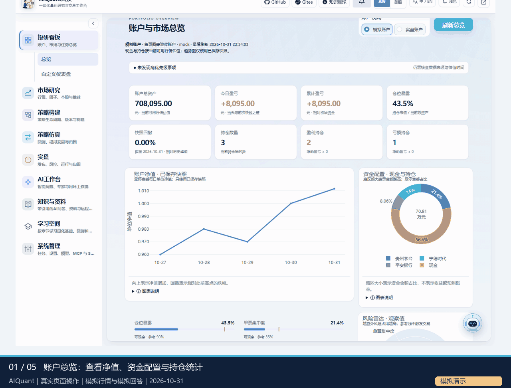
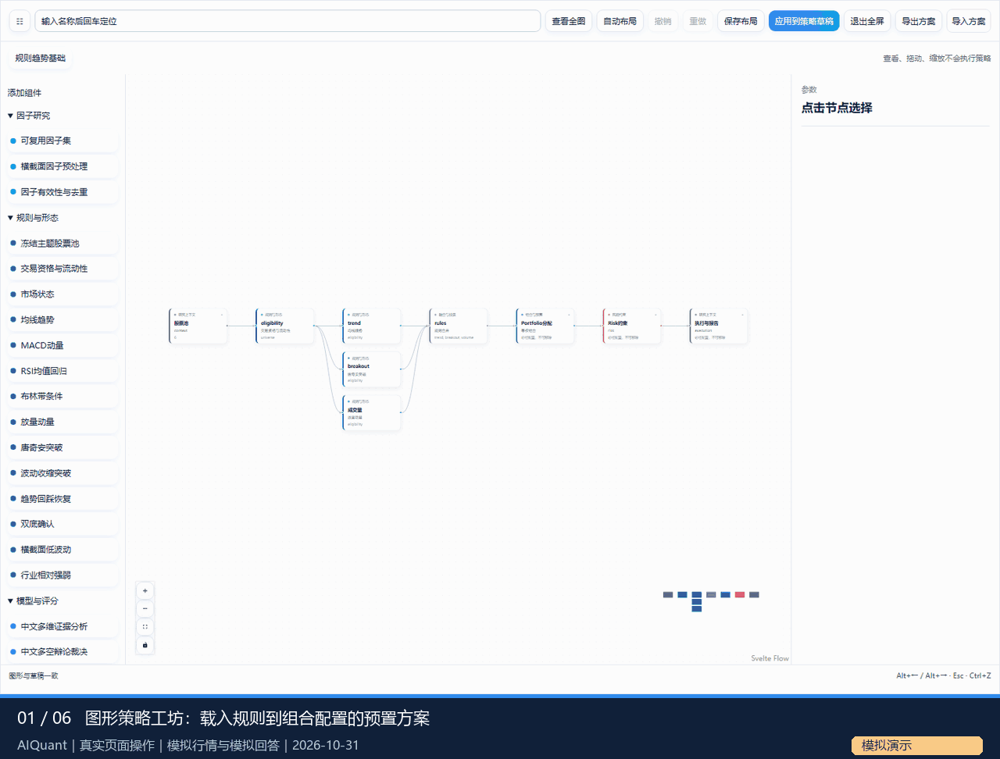
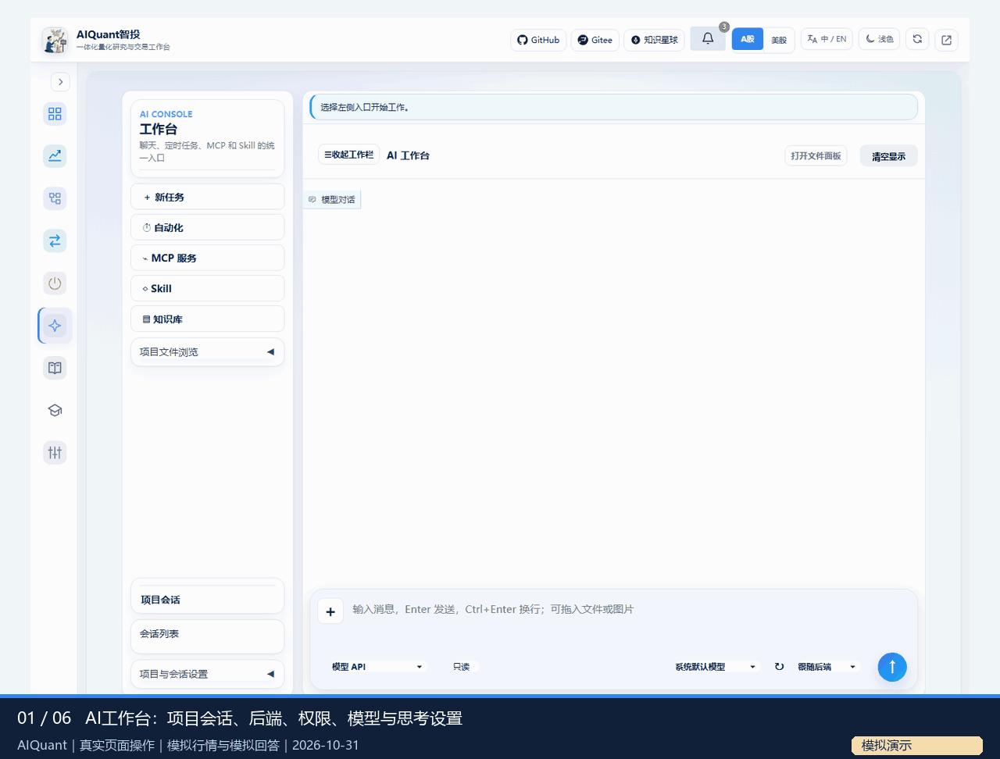

# 一体化工作台使用指南

本页是`src`应用的统一入口。工作台把行情、策略、回测、AI会话与知识资料放在同一Gradio网页，并提供共用业务规则的API和CLI。第一次使用建议先完成一轮规则策略回测，再接入模型、原生CLI或外部服务。

## 1. 准备运行环境 {#environment}

在`ai_quant_trade`仓库根目录操作。工作台要求Python3.11+，根`requirements.txt`、`pyproject.toml`和`egs/requirements/`属于本应用；历史`egs_*/`示例有独立依赖，不要全部混装。安装和哈希锁文件步骤见[环境安装](installation.md)。

| 目的 | 环境与前提 |
| --- | --- |
| 网页、API、CLI和普通策略 | `.venv-secure`；先执行Web角色预检 |
| LightGBM/XGBoost/CPU MLP | 同一业务环境增加模型依赖，执行models角色预检 |
| 因子Qlib信号分析 | 独立`.venv-qlib-secure`；原生Workflow还需自己的provider数据、配置及qrun |
| 图片附件 | 独立`.venv-image-secure`，缺少时拒绝图片，不回退到旧解码器 |
| 原生AI命令行 | 按[CLI安装](cli_installation.md)准备需要的后端并登录；不要求全部安装 |
| 公开文档站 | 独立`.venv-docs`和`requirements-docs.txt`，不安装整套业务依赖 |

业务设置位于`egs/config.yaml`等YAML，密钥位于本地`.env`/`.llm_env`。首次可参考`.env.example`，已有私有配置不要覆盖。第一次仅验证流程可在本地环境中设`ALL_IN_ONE_DATA_MODE=mock`；切换real后仍需检查各行情源、模型及CLI的实际可用性。

## 2. 启动、连接和停止 {#startup}

Windows示例：

```text
.venv-secure/Scripts/python.exe -B egs/check_runtime.py --role web
.venv-secure/Scripts/python.exe -B start.py --host 127.0.0.1 --port 8000
```

Linux按相同清单创建环境，再把上述解释器路径替换为`.venv-secure/bin/python`。打开`http://127.0.0.1:8000/app/`，API交互文档为`/docs`，应用内帮助为`/help-docs/`。

默认只接受本机访问；远程访问需令牌、允许的Host及TLS，具体见[访问控制](access_and_execution.md)。结束时在启动终端按Ctrl+C；关闭网页不等于停止服务，重新启动前确认端口释放。

## 3. 按目标进入页面 {#navigation}

| 模块 | 第一步与结果核对 | 详细说明 |
| --- | --- | --- |
| 投研看板 | 选择账户视角，查看总资产/持仓/净值；空账户、缺估值和真实/模拟来源需分别判断 | [总览与图表](dashboard.md) |
| 市场研究 | 刷新行情，查看新闻/个股；使用图谱时展开关系证据，资源池先预览再提交 | [行情与图谱](market_research.md)、[资源导入](resource_pools.md) |
| 策略构建 | 导入示例或进入图形工坊；先检查参数与执行能力，再运行或发布冻结版本 | [导入策略](strategy_import.md)、[图形组合](strategy_composition.md) |
| 策略仿真 | 指定策略ID、标的、真实日期和成本，查看任务及结果，不凭“已完成”判断收益有效 | [回测](backtest.md)、[费用与执行](backtest_execution.md) |
| 实盘 | 查看发布检查、风险配置、运行和归因；缺少真实通道时不能执行实盘 | [使用边界](risk.md) |
| AI工作台 | 选择后端和模型再发消息，查看会话与过程；Skill任务需要显式点击 | [AI工作台](ai_workspace.md)、[洞察报告](insight_reports.md) |
| 知识与资料 | 先存资料，再问答并核对引用；资料库可阅读原件和编辑Markdown | [知识库](knowledge.md)、[文件阅读](file_reader.md) |
| 学习空间 | 从目录选量化章节，用前后章继续阅读；软件帮助在知识与资料的系统资料页 | [课程入口](workspace_learning.md) |
| 系统管理 | 管理模型/MCP/Skill、定时任务、环境及帮助，配置后再验证实际能力 | [配置](configuration.md)、[自动化](automation.md) |

[](assets/demos/navigation.gif)

动图可点击查看原尺寸，本指南使用中文界面和中文字幕发布副本。该录制使用模拟行情及测试账户，不是实盘资产展示。英文和日文README另用英文界面实录及英文字幕。

## 4. 完成第一轮策略回测 {#first-backtest}

1. 在“策略构建 → 策略管理 → 预制策略”选择双均线等规则示例，阅读逻辑和默认参数，用独立名称导入。
2. 在策略库查看实际策略ID、源码、参数和状态。自定义或修改过的Python源码须先核对SHA256并登记复核；详情的静态检查不会执行代码。
3. 预览参数方案和本次覆盖，确认最终参数，再启用策略。模型策略需额外安装依赖并核对训练/样本外记录。
4. 在“策略仿真 → 回测与模拟”或策略库一键回测中填写实际ID、标的与历史区间。确认引擎、复权、手数、仓位、手续费/最低佣金、税费和滑点口径。
5. 运行后核对实际日期覆盖、数据来源、净值、回撤、交易和费用；零成交可能是条件未触发，不能据此评价策略。
6. 展开“回测证据与模拟衔接”读取参数快照、导出成交；修改参数后创建新任务，既有结果不会被覆盖。

使用[图形工坊](strategy_composition.md)时，点击节点查看参数和上下游，拖动仅改变布局；修改节点后需应用到草稿，运行/发布仍走同一编译与账本。级联、并行评分、模型、Agent、Portfolio和Risk的输入类型及数据门槛必须兼容。

[](assets/demos/strategy-backtest.gif)

ETF/行业轮动、[模型策略](model_strategies.md)、[因子研究](factor_research.md)、[Alpha研究](alpha_mining.md)和[多Agent策略](agent_strategies.md)各有自己的数据与验证要求。原生Qlib Workflow的blocked状态不等于训练或回测通过。

## 5. 使用AI、Skill和知识 {#ai-and-knowledge}

在“AI工作台 → 主界面”选择后端、权限、模型和思考设置；可添加或拖入附件，Enter发送、Ctrl+Enter换行。查看实际状态与消息，不能把mock回复或CLI未认证当成真实调用成功。

“智能洞察 → Skill报告”提供市场复盘和个股分析按钮，选择后端、必要的代码及日期后明确点击；执行过程、错误/缺口、HTML与历史报告分别展示。进入页面不会自动生成报告。严格研究对后端和角色有额外约束，见[Agent后端与原生Skill](agent_cli_skills.md)。

在“知识与资料 → 资料库”保存笔记或上传资料，再到“AI问答”提出问题，核对标题、片段、范围和分类。模型不可用时引用仍可保留，资料无命中时会明确降级。Office只读，Markdown支持保存/冲突检查与检索同步。

[](assets/demos/ai-knowledge.gif)

三段动图录于2026-10-31，均为隔离服务实际点击后的关键状态序列，使用模拟行情/回答，没有付费模型、真实CLI、券商或Skill报告生成；播放时长不是执行延迟。它们仅说明操作流程。

## 6. 使用命令行 {#cli}

后端启动后，可在同一根目录运行：

```text
.venv-secure/Scripts/python.exe -B egs/cli.py --base-url http://127.0.0.1:8000 system capabilities --format json
.venv-secure/Scripts/python.exe -B egs/cli.py --base-url http://127.0.0.1:8000 strategy list --format json
```

策略导入、调参、回测、模拟盘、知识和研究任务共用网页业务规则；完整流程见[CLI指南](cli.md)。本地原生研究Skill入口`egs/skills.py`可复用研究服务且无需启动网页，但实际研究仍需对应数据和后端，不能由“CLI可启动”推断所有研究已就绪。

## 7. 出错时先检查 {#troubleshooting}

| 现象 | 处理 |
| --- | --- |
| 启动预检失败 | 检查解释器、版本和角色；不要通过修改Conda包或强制忽略来伪装通过 |
| 会话无真实回复 | 查看所选后端是否mock、未认证或不可用，检查实际事件和留档 |
| 回测失败/无曲线 | 检查数据日期、引擎能力、源码复核与执行状态；不要用区间外行情补成功 |
| 帮助页陈旧 | 确认应用使用mkdocs.platform.yml并更新data/help_site；公开文档使用另一套构建环境 |
| 文档站图片/搜索失败 | 通过HTTP检查深层页面和完整资源，按[发布指南](documentation_publish.md)验证实际部署前缀 |

更多问题见[排障](troubleshooting.md)。需要理解计算、时点与风险假设时进入[原理文档](../principles/README.md)。
