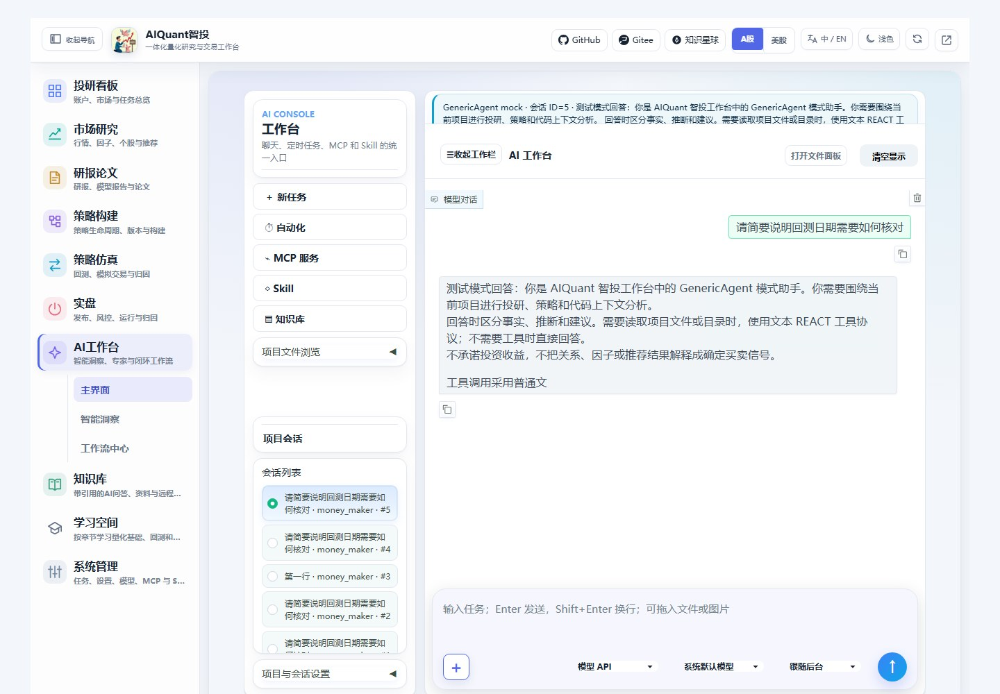
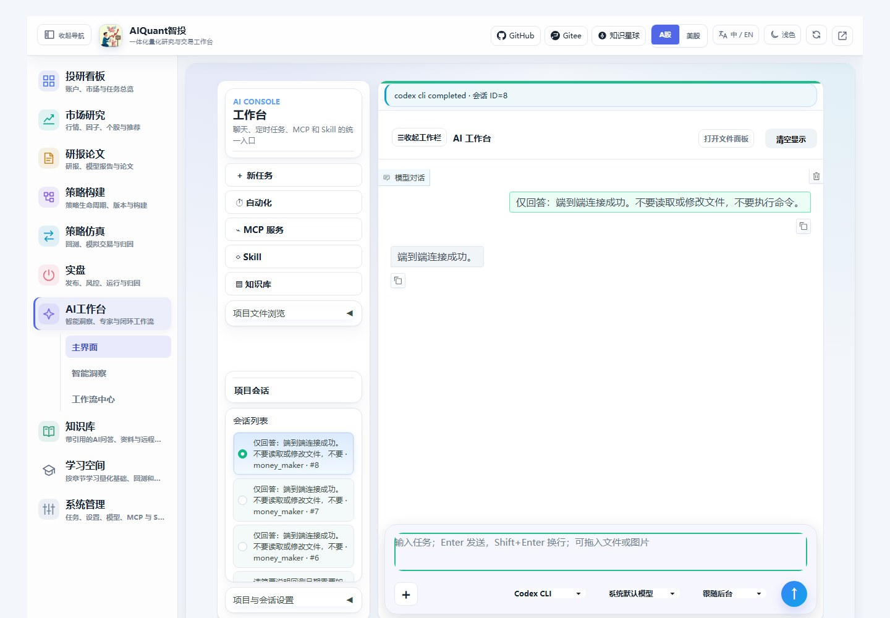
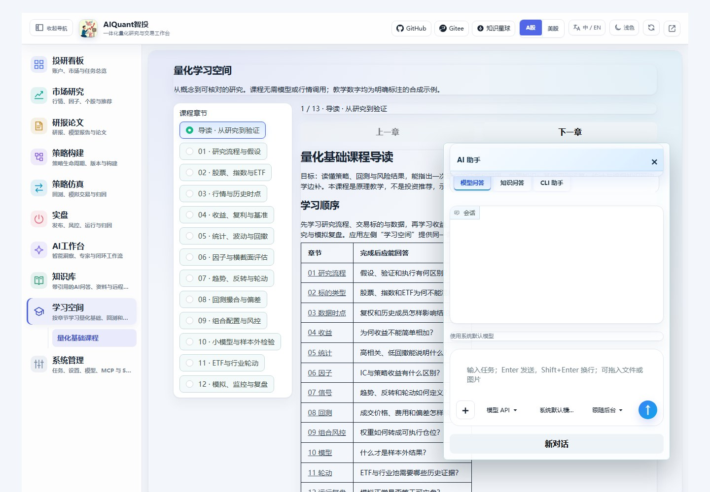
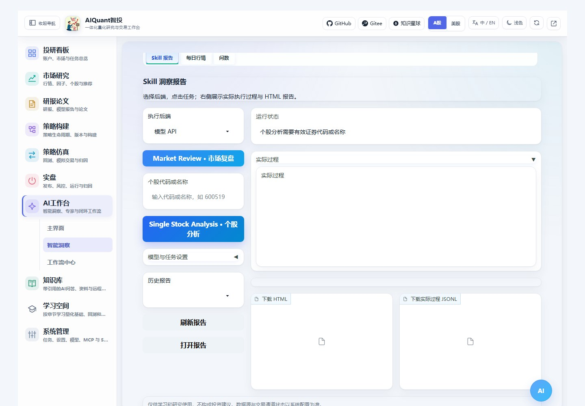
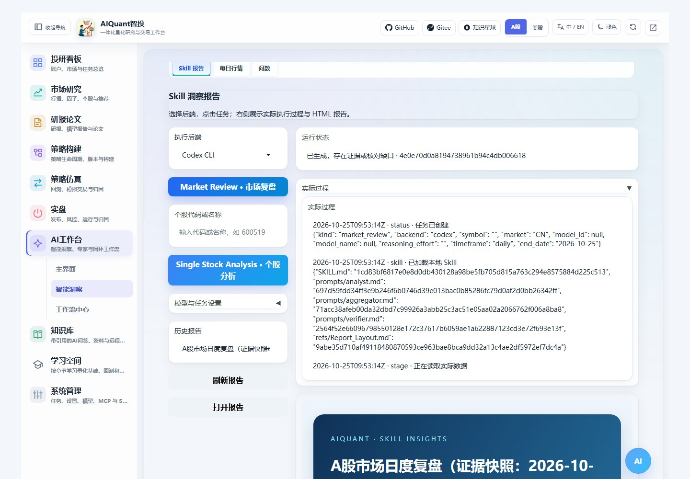
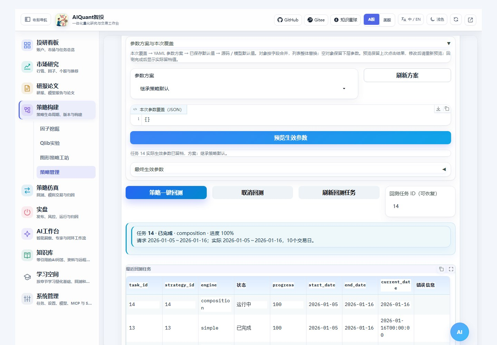
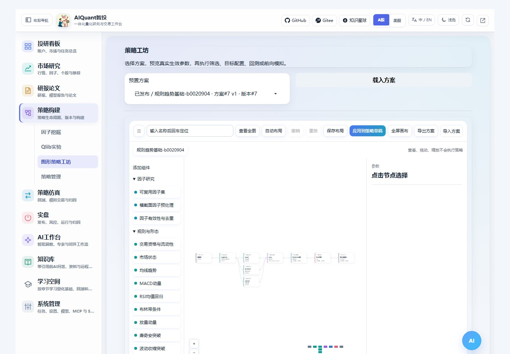
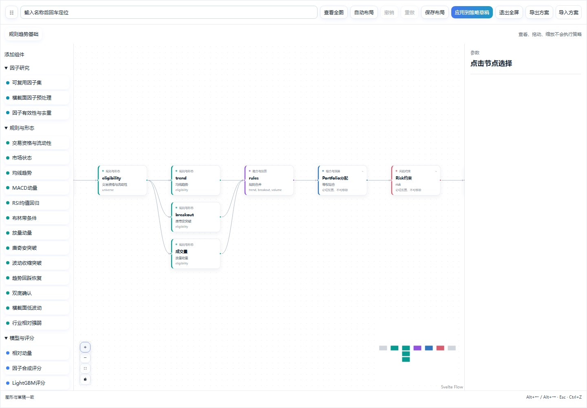
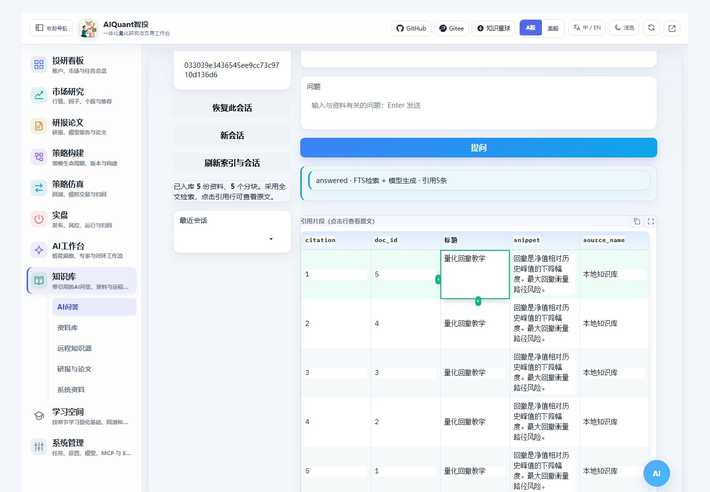
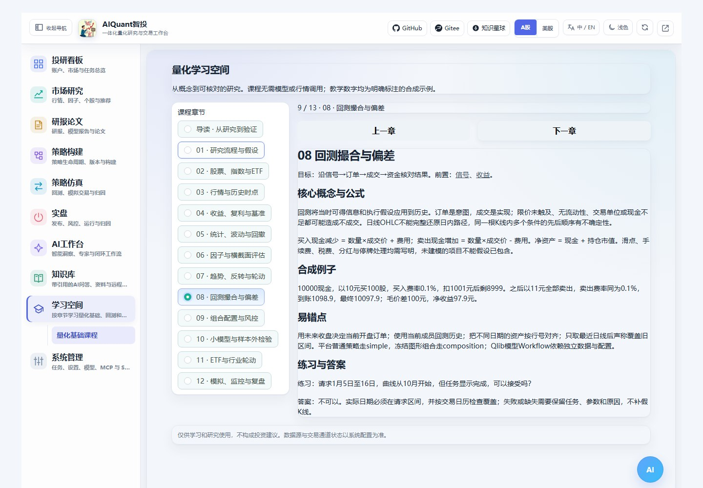

# 工作台、知识问答与学习入口

本指南对应18号改进。统一前端仍为Gradio：左侧二级导航切换内容，图形策略、AI报告和课程不需要另开网页。

## 一键回测

进入“策略构建 → 策略管理 → 策略库”，刷新列表后点击策略行，或填写策略ID。选择“跟随策略”时，普通策略使用simple，已发布的组合使用composition；页面显示执行入口和冻结版本。显式选错引擎会在取行情前说明原因，Qlib模型Workflow缺配置时提前阻断。

填写真实日期、标的和参数后点击“策略一键回测”。后台执行与页面等待分开；同一请求在运行中重复点击会复用任务。任务状态为queued、running及最终finished/failed/cancelled/timeout之一。取消是请求，当前行情或模型调用完成后才会在安全检查点退出。

完成后核对请求与实际日期、交易日数量，再到“策略仿真”查看净值、指标、成交和费用。失败任务保留ID及原因。切页或刷新后，可点“刷新回测任务”，把原ID填回“回测任务ID（可恢复）”。

真实A股行情按日期分批获取，并用同区间上证指数日线检查交易日覆盖；上市不足、停牌或数据故障导致缺失时会阻断完整回测，需补齐数据或主动调整日期。指数日线是当前校验来源，不等于独立验证过的交易所官方日历。mock使用合成日线和工作日映射，不能用于证明真实日期覆盖。

图形组合采用冻结方案中的费用、滑点、交易单位和风险约束，以及未复权日线与次日开盘执行；这些值不会由普通策略快速控件替换。模型策略通过明确的运行能力选择开盘执行，并将请求区间前的观察用于预热；预热不产生账户成交，也不进入正式净值统计。

## 扁平AI输入

输入区上部为文本，下方一行依次为附件加号、后台、模型、思考强度与发送。工作台和悬浮助手使用同一组件。点击加号选择文件；也可把文件或图片拖入输入区域。上传后文件名独立显示，原生清除按钮移除附件。

Enter发送，Shift+Enter换行；中文输入法选词时不会因为确认候选词而发送。后台选择决定实际执行通路，未接入的CLI会明确说明；模型及思考强度是否可用仍由实际后台支持决定。mock模式的回答会明确标注测试，不能当作真实CLI验证。

## Skill投研报告

进入“AI工作台 → 智能洞察 → Skill报告”，首屏直接显示“Market Review · 市场复盘”和“Single Stock Analysis · 个股分析”。选择实际后台；个股分析还需填写代码。展开模型设置可调整模型、思考强度、观察周期与结束日期。

点击任务后查看真实过程、结果状态和HTML报告。刷新历史后可以重开既有报告，下载报告和事件文件。进入页面只构建轻量控件，不会自动启动模型、行情或定时任务。通用Skill管理与这两个固定投研任务是不同入口。

## 图形组合入口

“策略构建 → 图形策略工坊”提供级联、并行评分、Portfolio和Risk节点。原稳定地址的view仍为workshop。策略库识别到组合后，显示指向该冻结图形版本的链接；修改后需重新发布版本，原冻结记录保留供复核。单个Python策略仍可独立回测，不会自动被改写成图形节点。

## 直接使用RAG问答

点击“知识库”默认打开“AI问答”，与资料库、远程知识源、研报论文及系统资料同级。

1. 在资料库上传文档或保存笔记，或在远程知识源同步入库。
2. 进入AI问答，选择知识范围、分类和模型；点击“刷新索引与会话”查看资料及分块数量。
3. 输入问题并提问。回答下方显示文档、片段、来源和资料编号；点击引用行查看原文。完整引用记录另保存上下文片段摘要校验值，可由API读取。
4. 保留会话ID，下次点“恢复此会话”，或从最近会话下拉框选择原会话。

目前采用SQLite FTS全文检索、分块与模型生成，不是向量检索。no_hits表示没有足够资料；model_unavailable表示已经检索到资料但模型生成失败，引用仍然保留。内容摘要校验值对应本轮提供给模型的上下文片段，不是整份文档文件的版本号。

## 独立学习空间

左侧“学习空间 → 量化基础课程”包含导读及十二章，从研究、标的、数据、收益和统计，到因子、信号、回测、组合、模型、轮动与运行复盘。首次显示导读，支持目录直达、上一章和下一章；每章都有目标、前置、合成例子、易错点和练习答案。

课程与系统帮助分开，阅读不依赖模型或行情服务。MkDocs将同一内容发布在“原理文档 → 量化基础课程”；“知识库 → 系统资料”继续保留原来的软件文档浏览功能。

## 实际操作截图

图36：附件、后台、模型、思考强度与发送保持一行；此图为mock模型回复。

图42：相同输入区切换到真实Codex CLI，只读进程返回测试口令并持久保存。

图43：悬浮助手底栏可见；聊天与长状态分别限高，保留原生附件预览和清除。

图37/45：固定任务首屏可见；点击市场复盘后，真实Codex CLI加载Skill、输出过程并生成HTML。此报告使用mock证据，明确保留数据缺口，不能当作真实行情投研结论。

图40：从策略库启动composition，显示实际日期和完成状态；此图为隔离mock回测，真实六场景另存验收报告。

图41/44：先定位对应冻结版本，再全屏、缩放及平移阅读；默认全图用于连接概览，放大后首末节点可能需要平移。

图38：点击可见引用单元格查看原文。重复标题来自隔离验收多次入库，正式资料不需要重复上传；生成模型为mock，检索、文档和会话均走实际服务。

图39：实际第八章，目录直达与前后切换均已点击验证；正文跨文档链接指向帮助站点，页内换章使用目录或前后按钮。
